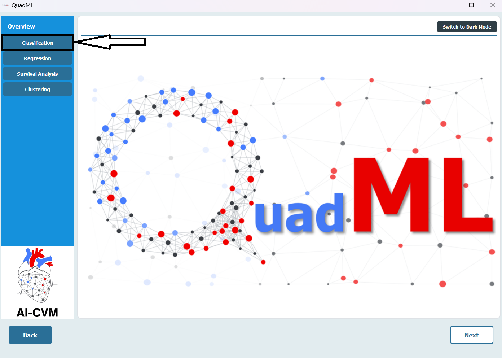
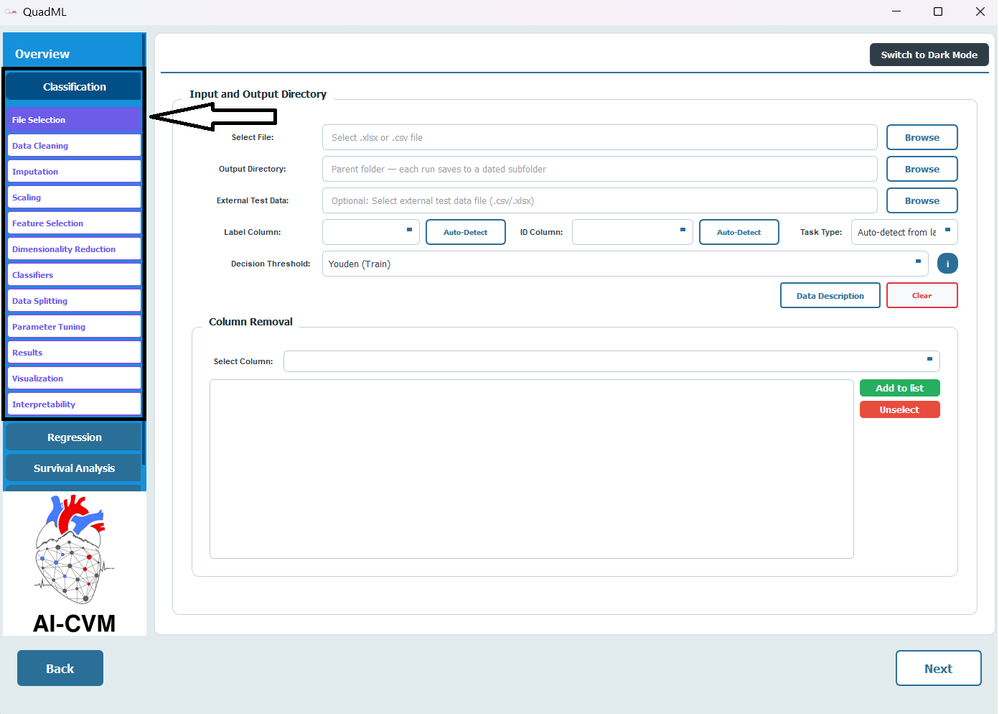

# Classification — Introduction

**Classification** predicts a **category** for each row in a tabular dataset. Typical examples are disease present vs absent, risk group, or any discrete label with two or more classes.

In QuadML, Classification builds and compares full pipelines: you choose cleaning, imputation, scaling, feature selection, dimensionality reduction, and classifiers; the search tries every combination you enable, then reports metrics, plots, and explanations. Binary tasks can also set a **Decision Threshold** for hard-label metrics. Everything runs locally — no data is uploaded.

Use this mode when you have a labeled table and want to find strong preprocessing + model combinations without writing code. For a continuous numeric outcome use Regression; for time-to-event data use Survival Analysis; for unlabeled grouping use Clustering.

---

## Workflow map

After you click Classification on the left, the nested steps are:

| Order | Step | Role |
| --- | --- | --- |
| 1 | File Selection | Load data, label, ID, decision threshold, output folder |
| 2 | Data Cleaning | Outlier / hygiene options (applied at Start Procedure) |
| 3 | Imputation | Fill missing values (searched combinations) |
| 4 | Scaling | Scale features (searched combinations) |
| 5 | Feature Selection | Rank / drop original features |
| 6 | Dimensionality Reduction | Compress remaining features (includes LDA) |
| 7 | Classifiers | Choose classification models |
| 8 | Data Splitting | Train/Test (or Train on all + External) |
| 9 | Parameter Tuning | Search settings + Start Procedure |
| 10 | Results | Pipeline metrics (Final_Results.csv) |
| 11 | Visualization | Charts for metrics and diagnostics |
| 12 | Interpretability | Explain a loaded fitted pipeline |

## Suggested first configuration

- One labeled `.csv` / `.xlsx`, Output Directory set
- Cleaning: One preferred method
- Imputation: **Simple Imputation**
- Scaling: **Standard Scaler** (and optionally **None**)
- Feature Selection: **Select From Model**
- Dimensionality Reduction: **None**
- Classifiers: two models (e.g., Logistic Regression + Random Forest)
- Split: 80/20, Train on all data **off**
- Parameter Tuning: Random Search, Fast budget → **Start Procedure**

Then follow the [walkthrough](walkthrough.md).
