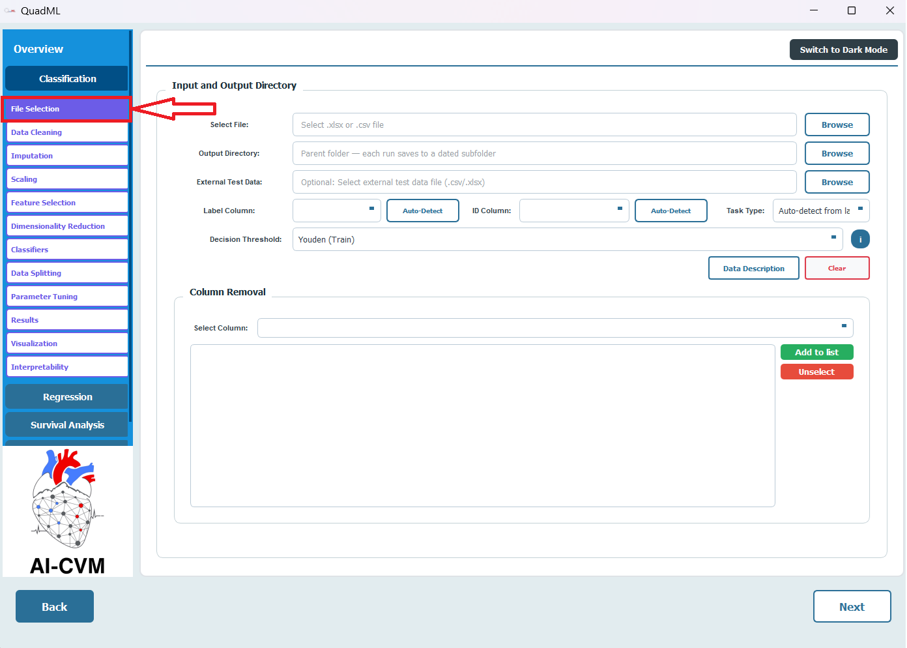
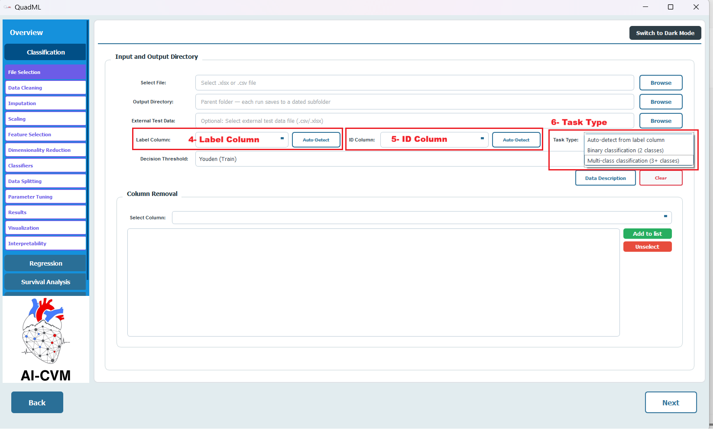
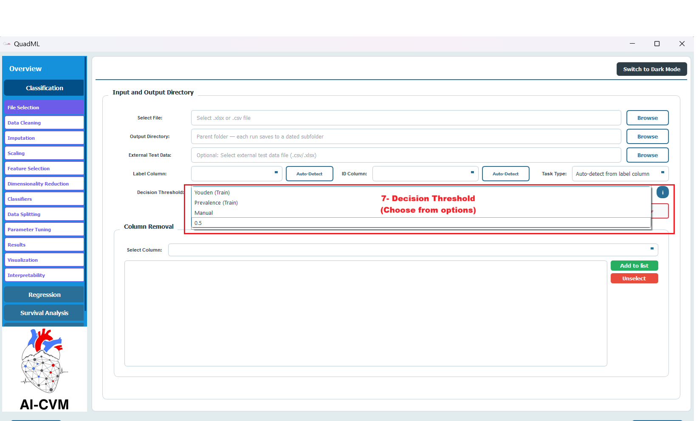

# Classification — File selection

**Where**: Classification → **File Selection**

Load the dataset, set the label and options, and choose where run outputs will be saved. Nothing is written to disk until **Start Procedure** on Parameter Tuning.

## What this step does

Points QuadML at your `.csv` / `.xlsx`, the **Label Column**, optional ID / External file, and the **Output Directory** parent folder.

## Controls

| Control | What it does | When to use it |
|---------|--------------|----------------|
| **Select File** | Loads the main dataset (header row required) | Always |
| **Output Directory** | Parent folder for dated run outputs | Always required before Start |
| **External Test Data** | Second labeled file with the same features and label | Hold-out cohort |
| **Label Column** | Class outcome (Auto-Detect for names like `label`, `class`) | Always |
| **ID Column** | Record ID, or **No ID Column** for synthetic IDs | When you have stable IDs |
| **Task Type** | Auto / Binary / Multi-class | Override Auto only if needed |
| **Decision Threshold** | Probability cut for hard-label metrics | Binary tasks; default Youden (Train) is fine to start |
| **Column Removal** | Drops listed columns at Start Procedure | IDs, text, unused columns |
| **Data Description** | Summary of the loaded file | Quick data check |
| **Clear** | Clears file and output choices | Starting over |

Main file, Output Directory, and optional External file:

Label Column, ID Column, and Task Type:

| Decision Threshold | Meaning |
|--------------------|---------|
| Youden (Train) | Maximize Sensitivity + Specificity − 1 on Train ROC (default) |
| Prevalence (Train) | Positive-class fraction on Train |
| Manual | Probability in (0, 1) |
| 0.5 | Fixed cut |

The threshold is set on Train and frozen for Test/External. Multi-class uses argmax (control hidden).

Column Removal, Data Description, and Clear:

## Tips

- Prefer a writable Output Directory you own (not Program Files).
- External files must match feature and label column names.

## Common mistakes

- Starting without an Output Directory  
- External file with different column names  
- Expecting Decision Threshold on multi-class  
- Leaving ID columns in as features  
