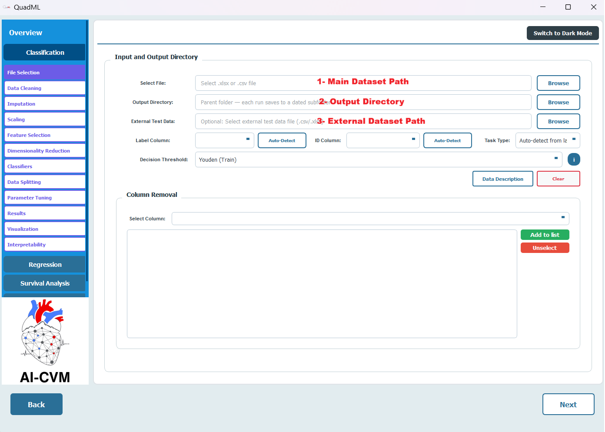
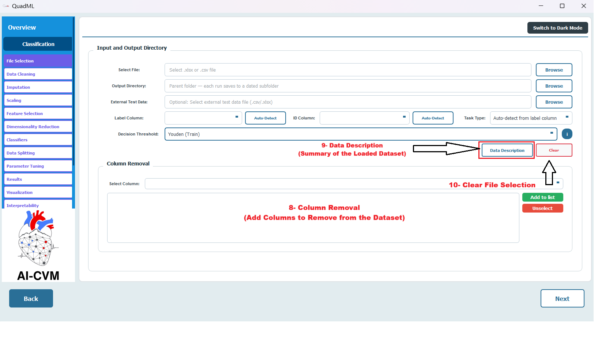

# Classification — File Selection

**Where**: Classification → **File Selection**

**Attention**: This is the first step. Nothing is written to the run folder until Start Procedure on Parameter Tuning.

## What you need

A file with **.csv** or **.xlsx** format

A label (target) column with class values

A writable Output Directory (parent folder; each run creates a dated subfolder YYYY-MM-DD_HH-MM-SS)

**Input and Output Directory**

1- Select File → Browse — choose the main dataset (Select .xlsx or .csv file).

2- Output Directory → Browse — choose a parent folder (Parent folder — each run saves to a dated subfolder).

3- Optionally External Test Data → Browse — second labeled file with the same feature columns and the same label column.

**Label, ID, and Task type**

4- Label Column — select or type the target column; use Auto-Detect if the name is obvious (class, label, target, …).

5- ID Column — optional record ID. Choose No ID Column to force synthetic IDs (sample_1, sample_2, …). Use Auto-Detect for common ID names.

6- Task Type:

Auto-detect from label column

Binary classification (2 classes)

Multi-class classification (3+ classes)

**Decision Threshold (binary only)**

7- Decision Threshold sets the probability cut  for hard-label metrics (Accuracy, Precision/PPV, Recall/Sensitivity, F1, Specificity, NPV, MCC, kappa, confusion matrix).

| Option | Meaning |
| --- | --- |
| Youden (Train) (default) | Maximize Sensitivity + Specificity − 1 on the training ROC |
| Prevalence (Train) | Positive-class fraction on Train |
| Manual | Type a probability in (0, 1) |
| 0.5 | Fixed sklearn-style cut |

The cut is chosen on Train and frozen for Test and External. Multi-class uses argmax; this control is hidden for multi-class.

Click the **“i”** button next to Decision Threshold for the in-app definition.

**Column Removal and helpers**

8- Column Removal — pick columns to exclude from modeling (Add to list / Unselect). Selected columns (features) will remove after starting the procedure. Features do not remove just by moving to the removal box. 

9- Data Description — after load, shows a pandas summary; can export CSV/Excel.

10- Clear — clears selected files and output directory, and then other files can be selected. 

## What is written to disk

Nothing yet. The dated run folder is created when you click Start Procedure.

## Common mistakes

Starting without an Output Directory

External file with different column names than the main file

Expecting Decision Threshold to apply to multi-class (it does not)

Leaving IDs in as features instead of using ID Column or Column Removal
