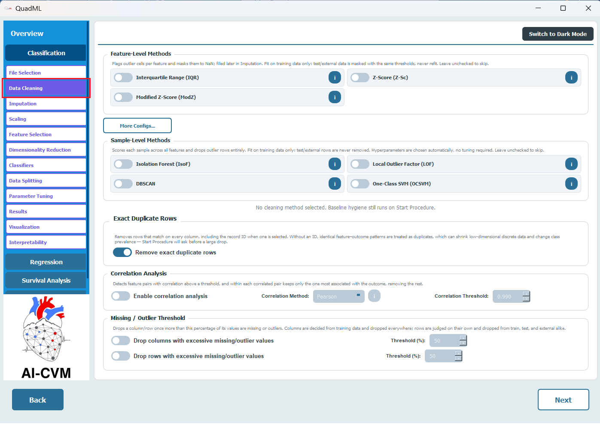
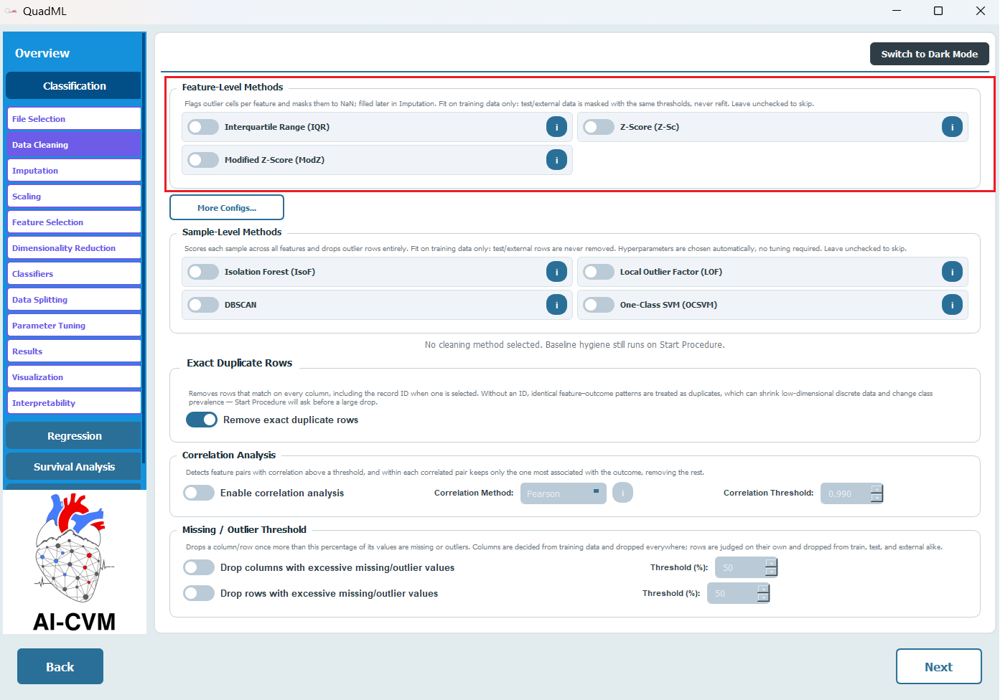
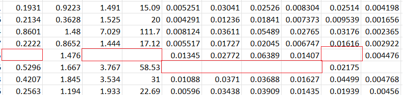
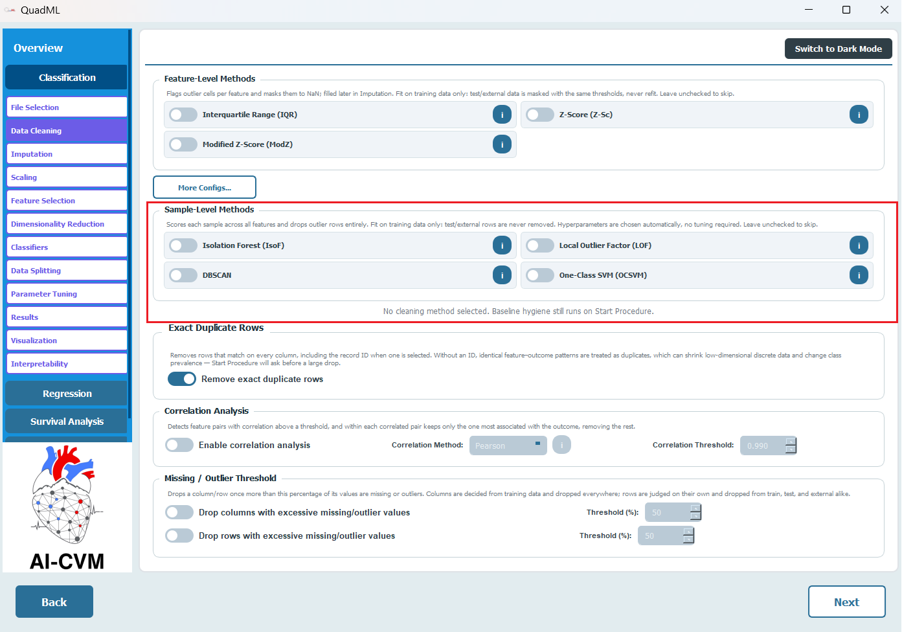
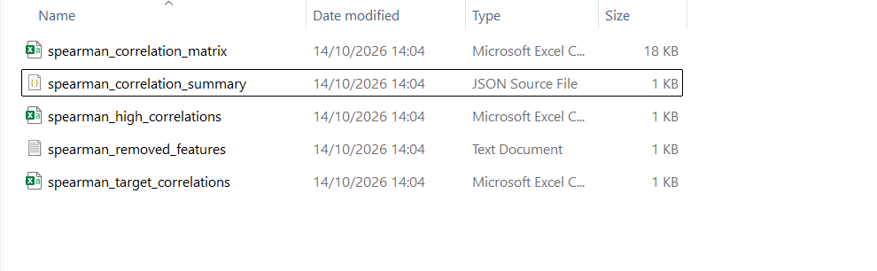

# Classification — Data Cleaning

**Where**: Classification → **Data Cleaning**

Cleaning does not run when you change the combo. It runs when you click Start Procedure.

## When to use it

**Attention**: If you do not choose any cleaning method, that means **None**.

Use **None** on clean data (baseline hygiene still runs).

Use a feature-level method to flag extreme cells (filled later in Imputation).

Use a sample-level method to drop whole outlier rows.

## Methods

**None**

Leaving every method card unselected is **None**: QuadML skips outlier detectors. Baseline hygiene still removes duplicates, extreme-missing rows/columns, and all-zero rows/columns.

**Feature-level methods**

| Method | Behavior |
| --- | --- |
| Interquartile Range | Per-feature IQR fences |
| Z-Score | Per-feature z-score fences |
| Modified Z-Score | Robust (median-based) fences |

Outlier cells become missing and are handled on Imputation.

## What to click

Choose a method from the method cards.

Click **“i”** button on a card for parameters, defaults, advantages, and disadvantages.

Open More Configs for feature-level methods (IQR multiplier, Z-Score and Modified Z-Score thresholds).

**Sample-level methods**

| Method | Behavior |
| --- | --- |
| Isolation Forest | Multivariate; flagged rows dropped |
| Local Outlier Factor | Multivariate; flagged rows dropped |
| DBSCAN | Multivariate; flagged rows dropped |
| One-Class SVM | Multivariate; flagged rows dropped |

Hyperparameters for sample-level methods are chosen automatically from backend ranges (no user tuning required on this page). To know about hyperparameters, click on **“i”** button of each method. 

### Duplicate Rows Challenge

Remove exact duplicate rows is a Data Cleaning hygiene option (enabled by default).

After starting the procedure, QuadML removes rows that match on every column—including the record ID when one is selected—and keeps the first occurrence of each unique row.

Rows that match on all features and the outcome but differ only by record ID are not removed; they are retained and reported separately as ID-only duplicates.

If no record ID is in use, identical feature–outcome patterns are treated as duplicates.

**Attention**: On low-dimensional discrete data, that can shrink the dataset and change class prevalence. In that situation, if more than 5% of rows would be dropped, Start Procedure asks for confirmation before removing them (and may show how binary outcome prevalence would change).

### Correlation Analysis

An optional step that removes redundant features. After the train/test split, it measures how strongly features move together using Pearson or Spearman correlation. If two features are correlated at or above the threshold (default 0.99), it keeps the one more related to the outcome and drops the other. The same columns are then dropped from the test and external sets. It is off by default, and it is not used in clustering.

In the output folder it creates a folder for correlation and csv files to show how features are correlated.

### Missing and Outlier Threshold

Optional Data Cleaning control (both options off by default; default threshold 50%).

Drops a column or row when more than the chosen percentage of its values are missing—or outlier cells cleared to NaN by a feature-level method (IQR, Z-Score, Modified Z-Score). With cleaning method None, only true missing values count.

Columns: decided from training data, then dropped from train, test, and external alike.

 Rows: judged per dataset and dropped independently. On held-out data, only original missingness is counted (not train-fitted outlier masks).

## What is written to disk?

After Start Procedure, the run folder includes cleaned data (e.g., cleaned_data.csv in original units).

## Common mistakes

Expecting the on-screen table to change before Start Procedure

Using sample-level drop when you only wanted to cap a few cells — use IQR / Z-Score instead