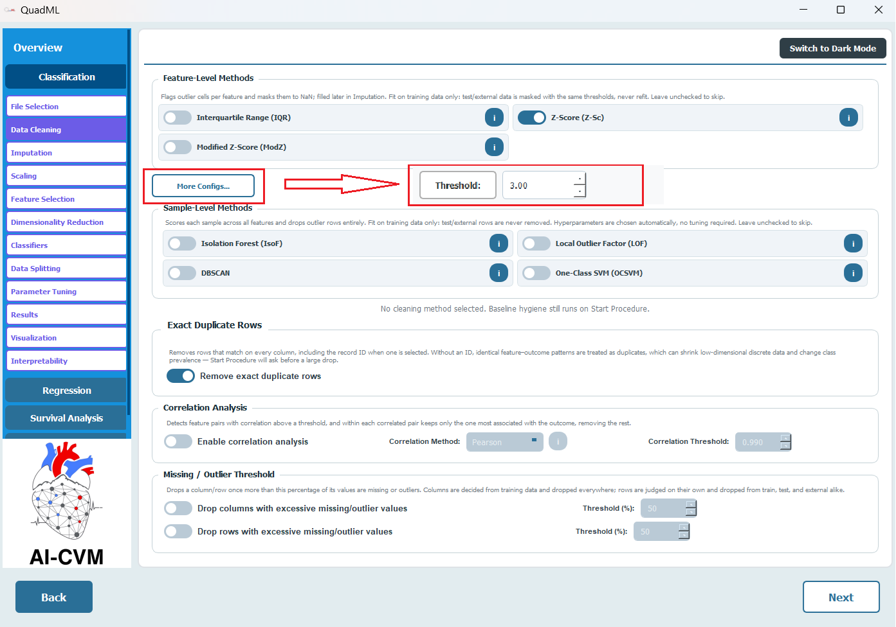
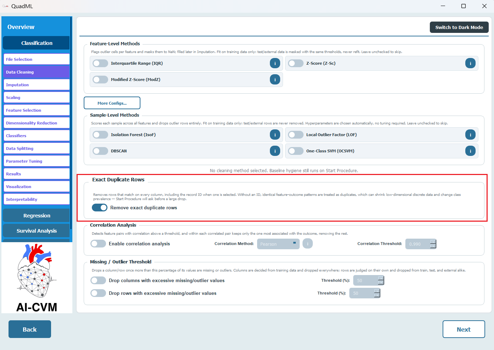
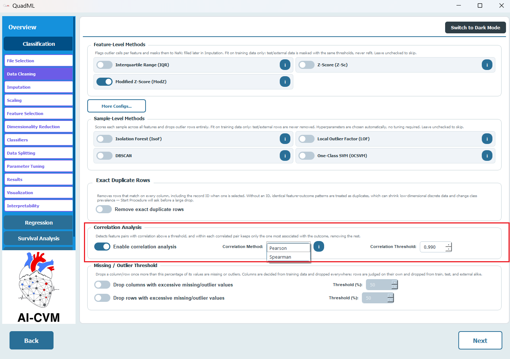

# Classification — Data cleaning

**Where**: Classification → **Data Cleaning**

Optional outlier handling and hygiene before modeling. Applied at **Start Procedure**.

--8<-- "_snippets/data-cleaning.md"

Feature-level methods mask outlier cells to NaN (filled later in Imputation):

**More Configs…** opens thresholds for the selected feature-level method:

Sample-level methods drop entire outlier rows:

Exact duplicate rows (Active by default):

Correlation Analysis (Pearson / Spearman + threshold):

Missing / Outlier Threshold for columns and rows:

## Common mistakes

- Expecting the preview to change before **Start Procedure**
- Feature-level cleaning without Imputation for new NaNs
- Low correlation thresholds that drop many useful features
