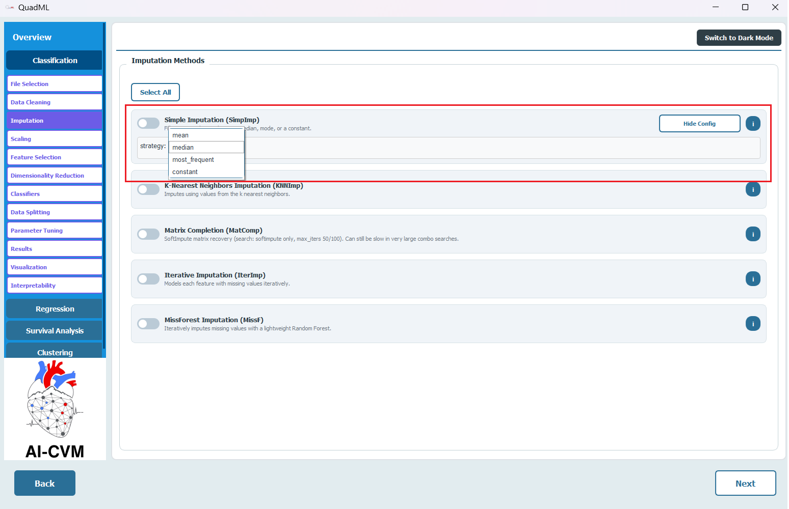
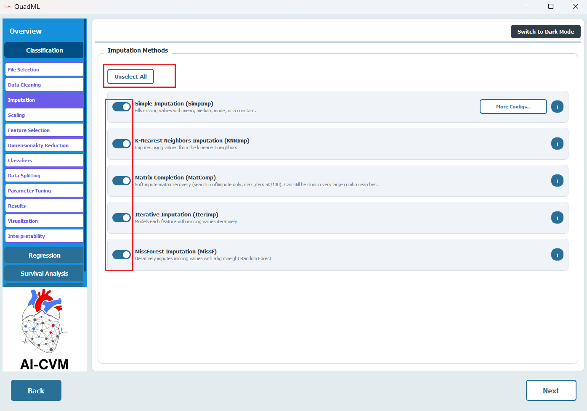

# Classification — Imputation

**Where**: Classification → **Imputation**

Fills missing feature values (including cells cleared by feature-level cleaning) so every searched pipeline has complete inputs.

--8<-- "_snippets/imputation.md"

Expand a method for options (for example Simple Imputation strategy):

Use **Select All** / **Unselect All** and the toggles carefully — every checked imputer multiplies the search:

## Common mistakes

- Checking every imputer with every scaler and model (product explosion)
- Assuming **mean** is the Simple Imputation default — QuadML default is **median**
- Feature-level cleaning without any imputer for the NaNs it creates
