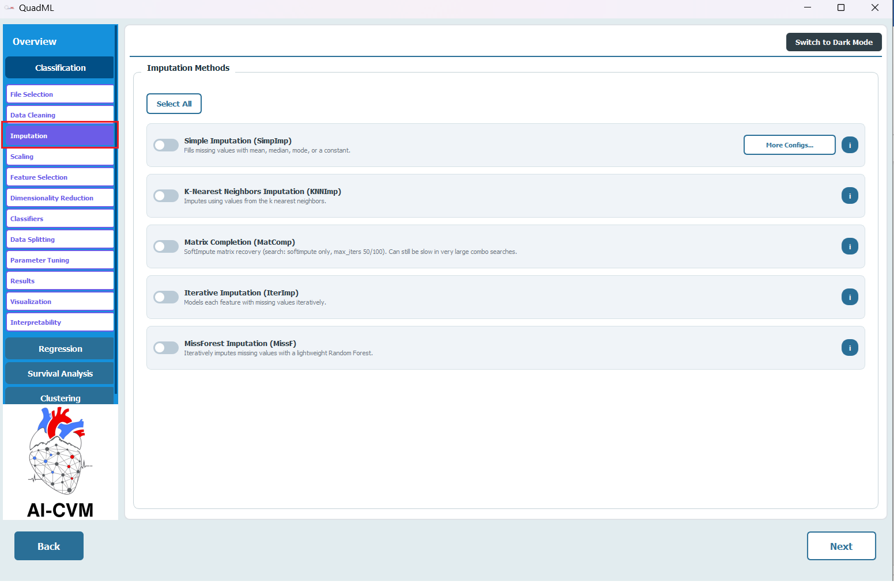

# Classification — Imputation

**Where**: Classification → **Imputation**

Missing values (including cells from feature-level cleaning) are filled here during the search. You can enable one or more methods; QuadML searches combinations with scaling, feature selection, DR, and classifiers.

## Methods

| Method | Short idea |
| --- | --- |
| Simple Imputation | Per-column fill: mean, median, most_frequent, or constant |
| K-Nearest Neighbors Imputation | Fill from nearest neighbors |
| Matrix Completion | Soft Impute-style matrix recovery |
| Iterative Imputation | Models each feature iteratively |
| Miss Forest Imputation | Iterative fill with a lightweight Random Forest |

Simple Imputation default strategy in QuadML is median (not mean). Only Simple Imputation has More Configs for strategy / fill_value; other methods are auto-optimized during search.

## What to click

Toggle the imputation methods to include in the search.

Click **“i”** button on a method for how it works, defaults, pros/cons, and a library link.

Optionally open More Configs on Simple Imputation.

Use Select All / Unselect All if available to manage many cards at once.

## What is written to disk?

Imputed tables and configs live in the dated run folder. Results labels use short codes such as SimpImp(med).

## Common mistakes

Selecting every imputation method plus every scaler plus every classifier on a large table — the search grid grows multiplicatively

Assuming mean is the Simple Imputation default — QuadML default is median
