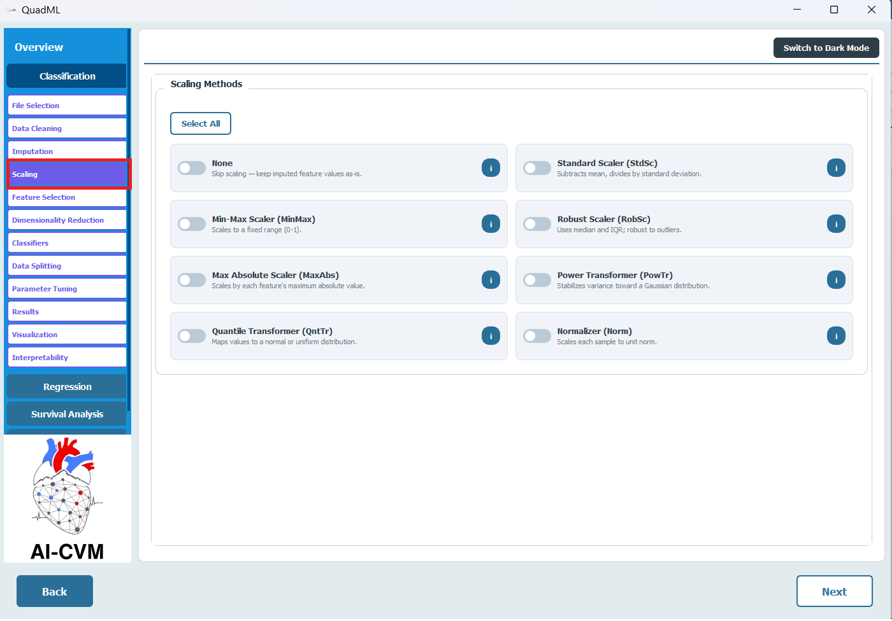
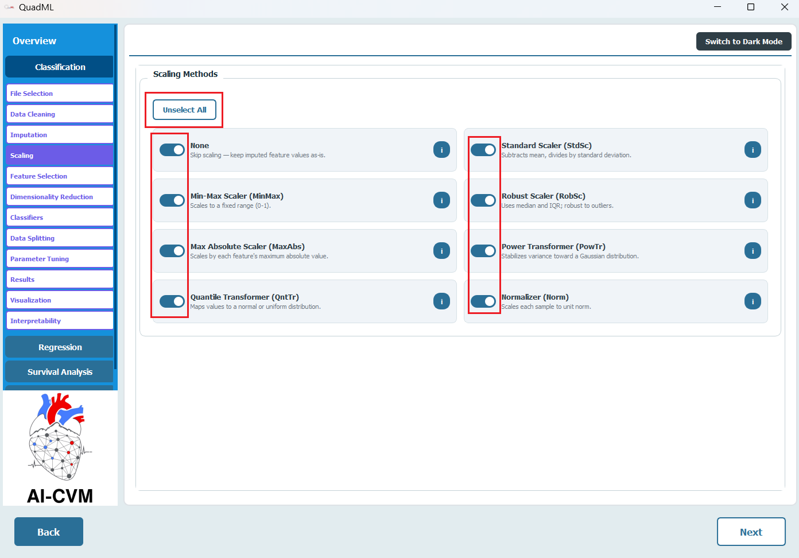

# Classification — Scaling

**Where**: Classification → **Scaling**

Rescales features before Feature Selection, Dimensionality Reduction, and the classifier. Linear models and SVC usually need scaling; many trees work with **None**.

--8<-- "_snippets/scaling.md"

A common first-run pair is **None** + **Standard Scaler**:

**Unselect All** clears every scaler before you pick a smaller set:

## Common mistakes

- Linear / SVM-style models with only **None** on mixed-scale features
- Selecting every scaler on the first run
- Forgetting **None** when you want a tree-model baseline
