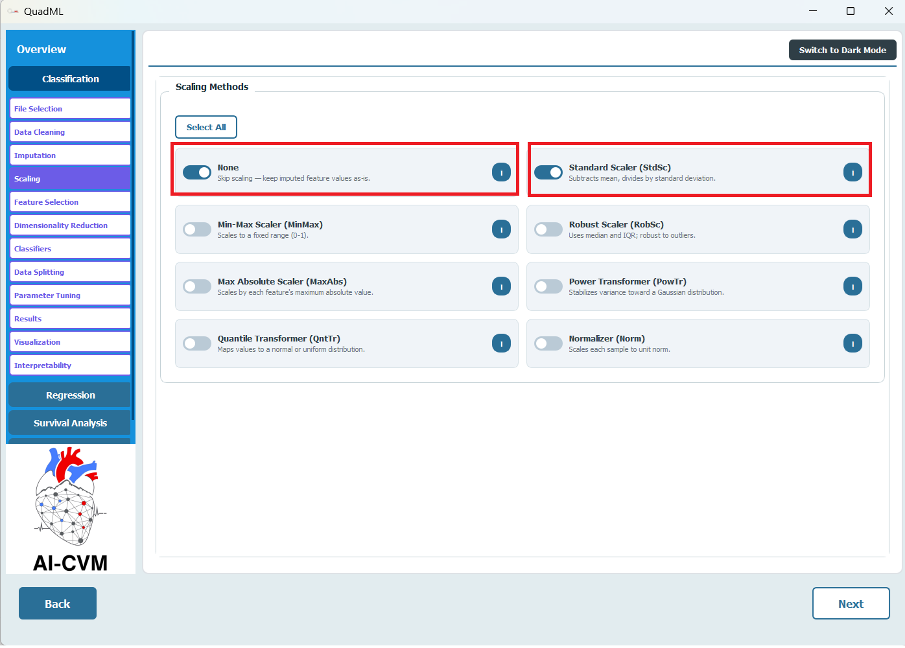

# Classification — Scaling

**Where**: Classification → **Scaling**

Scaling is part of each pipeline combination. You can include None and/or one or more scalers.

## Methods

| Method | Short idea |
| --- | --- |
| None | Skip scaling; keep imputed values as-is |
| Standard Scaler | Mean 0, variance 1 |
| Min-Max Scaler | Scale to a fixed range |
| Robust Scaler | Center/scale with robust statistics |
| Max Absolute Scaler | Scale by max absolute value |
| Power Transformer | Stabilize variance / reduce skew (search tune yeo-johnson) |
| Quantile Transformer | Map to normal or uniform (search may tune distribution) |
| Normalizer | Scale samples to unit norm (search may tune l1 / l2 / max) |

Selecting **None** skip implementing scaling on dataset.

## What to click

Toggle the scaling methods to search.

Click **“i”** button for parameters and defaults.

There is no More Configs panel for scaling on this page; tunable parameters (where any) are explored during Parameter Tuning search.

Use Select All / Unselect All if available to manage many cards at once.

## What is written to disk?

The fitted scaler is inside the saved pipeline (.pkl). Results labels use codes such as StdSc or No scaling.

## Common mistakes

Forgetting None when you want a no-scale baseline for tree models

Selecting every scaler on the first run
