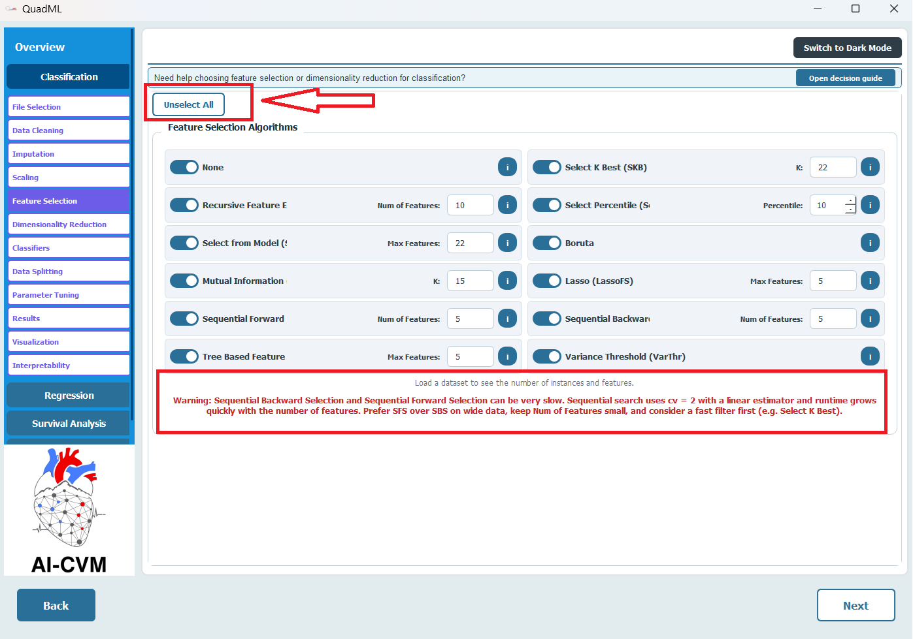

# Classification — Feature Selection

**Where**: Classification → **Feature Selection**

This step ranks or drops original features. It is searched as part of each pipeline combination. Dimensionality reduction (PCA, LDA, …) is a separate next page — not an alternative to this step.

**None** means keep all eligible features. If the dataset has a high number of features, strongly suggested to do not choose None, as it makes the time of running very long.

## Methods available in Classification

| Method |
| --- |
| None |
| Select K Best |
| Recursive Feature Elimination |
| Select Percentile |
| Select from Model |
| Boruta |
| Mutual Information |
| Lasso |
| Variance Threshold |
| Sequential Forward Selection |
| Sequential Backward Selection |
| Tree Based Feature Selection |

## What to click

Toggle the methods to include.

Click **“i”** button on a method for a plain-language description and link.

Use extra configs where available (k, percentile, estimator, …).

Use Select All button to choose all methods. An alarm appears after choosing some methods to let the user know about computational cost.

Every selected Feature Selection method is crossed with every selected Dimensionality Reduction method (FS × DR).

## What is written to disk

Selected-feature CSVs and the fitted selector live in the run folder. Interpretability Load files should use the selected-features tables that match the .pkl.

## Common mistakes

Turning on None when you have a high number of features.

Putting PCA/LDA on this page — they are on Dimensionality Reduction

Loading Interpretability files from a different run than the model .pkl
