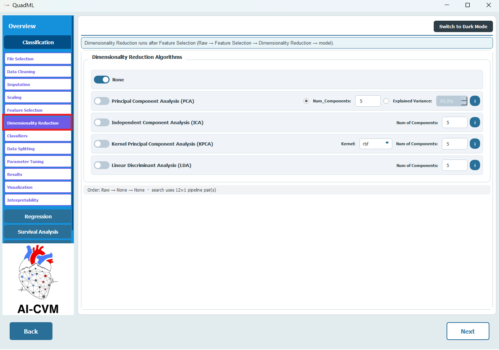

# Classification — Dimensionality reduction

**Where**: Classification → **Dimensionality Reduction**

Compresses features after Feature Selection. Classification includes **LDA** (supervised).

--8<-- "_snippets/dimensionality-reduction.md"

Method cards (None, PCA, ICA, Kernel PCA, LDA) and component settings:

## Common mistakes

- Looking for **LDA** outside Classification
- Many DR methods without a **None** baseline
- Pairing Clustering **Laplacian Score** with non-None DR
