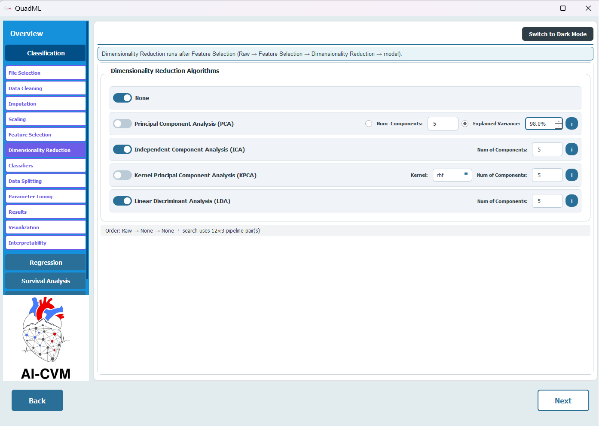

# Classification — Dimensionality Reduction

**Where**: Classification → **Dimensionality Reduction (DR)**

Dimensionality Reduction is a sequential step after Feature Selection. It compresses the remaining features. **None** means no extra projection.

## Methods available in Classification

| Method | Notes |
| --- | --- |
| None | Skip DR |
| Principal Component Analysis | Unsupervised components |
| Independent Component Analysis | Unsupervised components |
| Kernel Principal Component Analysis | Nonlinear kernel PCA |
| Linear Discriminant Analysis | Supervised; Classification-only DR (needs labels) |

Every FS × DR pair is legal in Classification. Empty lists default to None for that step.

## What to click

Toggle methods to include. Keep None unless you already know you want components.

Click **“i”** button for method notes.

Use extra configs where shown (e.g., number of components / variances retained for PCA).

## What is written to disk

Component pipelines are stored with the combination. Results labels use PCA, ICA, KPCA, LDA, or No DR.

When DR is None, Interpretability can show original (pre-scale) feature values on some plots while the model still uses scaled space. After PCA / ICA / Kernel PCA / LDA, explanations use the compressed component space.

## Common mistakes

Expecting LDA in Regression or Clustering (Classification-only)

Selecting many DR methods on the first run without None
