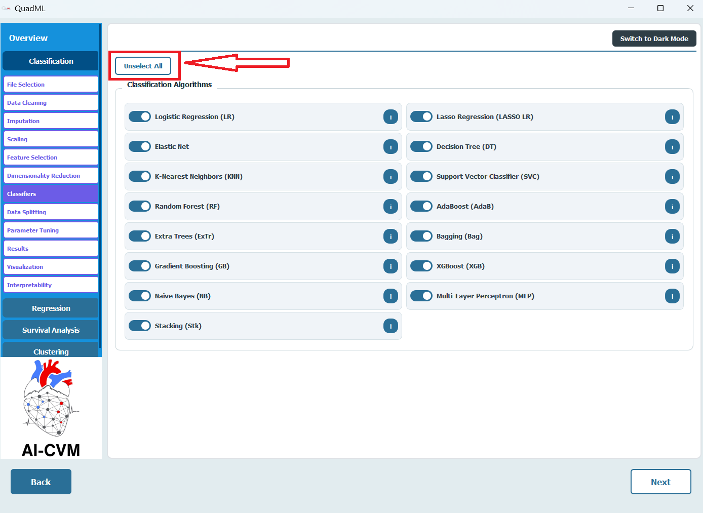

# Classification — Classifiers

**Where**: Classification → **Classifiers**

Select one or more models. Each selected model is crossed with your imputation × scaling × feature selection × dimensionality reduction choices.

## Models (GUI names)

| GUI name | Short code on Results |
| --- | --- |
| Logistic Regression | LR |
| Lasso Regression | LASSO LR |
| Elastic Net | (Elastic Net logistic) |
| Decision Tree | DT |
| K-Nearest Neighbors | KNN |
| Support Vector Classifier | SVC |
| Random Forest | RF |
| AdaBoost | AdaB |
| Extra Trees | ExTr |
| Bagging | Bag |
| Gradient Boosting | GB |
| XGBoost | XGB |
| Naive Bayes | NB |
| Multi-Layer Perceptron | MLP |
| Stacking | Stk |

## What to click

Toggle models to include (or Select All / Unselect All).

Click **“i”** button on a card for how the method works in QuadML, search notes, and a library link.

For a first run, two or three models is enough (e.g., Logistic Regression + Random Forest).

## What is written to disk

Fitted classifiers live inside saved pipelines (.pkl) under the dated run folder, named by combination.

## Common mistakes

Enabling every classifier plus every imputer/scaler/FS on a large dataset.

Expecting Stacking or MLP to finish as fast as Logistic Regression.
