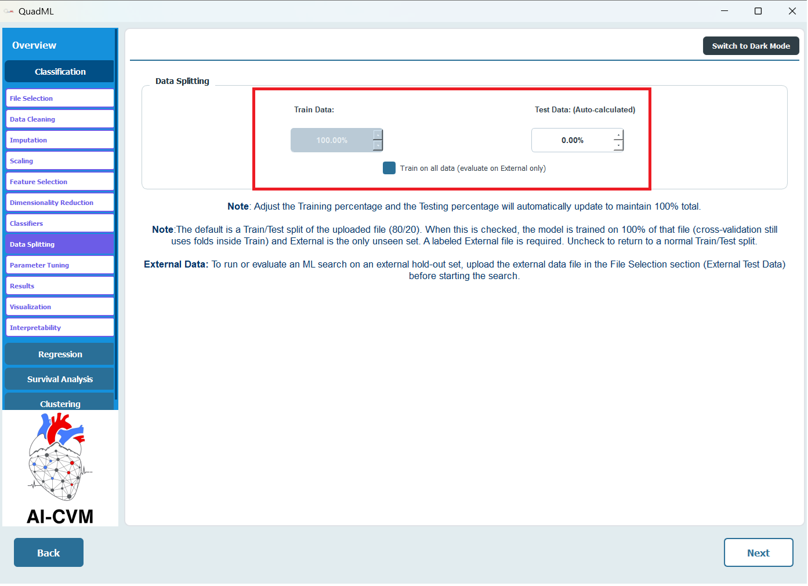

# Classification — Data splitting

**Where**: Classification → **Data Splitting**

Chooses how the main dataset is divided into Train and Test (and whether External is the only hold-out).

--8<-- "_snippets/data-splitting.md"

**Classification note:** Splits may be **stratified** by class labels so Train and Test keep similar class mix.

When **Train on all data** is checked, Train is 100% of the main file and a labeled **External** file is required for evaluation:

## Common mistakes

- Checking **Train on all data** without External — **Start Procedure** will refuse
- Comparing Test metrics from a normal split with External metrics from a train-on-all run as if they were the same design
- Extremely small test percentages on tiny datasets
