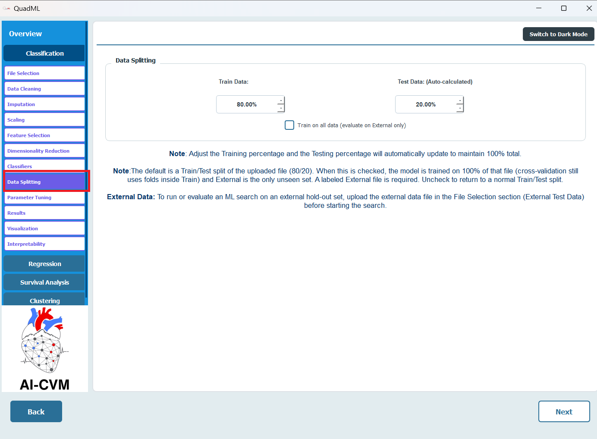

# Classification — Data Splitting

**Where**: Classification → **Data Splitting**

## Default

An internal Train / Test split of the uploaded file, 80% / 20%. Cross-validation during tuning uses folds inside Train. Test is held out for reporting.

## What to click

Set train / test percentages if you do not want 80/20.

Leave Train on all data (evaluate on External only) unchecked unless you have a labeled External file and you intend to fit on 100% of the main file.

### When “Train on all data” is checked

There is no internal Test split

External is the only unseen set

Results cards pair Train with External

Ranking uses External metrics

A labeled External Test Data file on File Selection is required

Optional External without the checkbox: you still have Train/Test, and External is scored as a third split.

## What is written to disk

Split membership and prepared Train/Test (and External) tables in the run folder. Results always center on Final_Results.csv after the search.

## Common mistakes

Checking Train on all data without External — Start Procedure will refuse

Comparing Test metrics from a normal split with External metrics from a train-on-all run as if they were the same design
