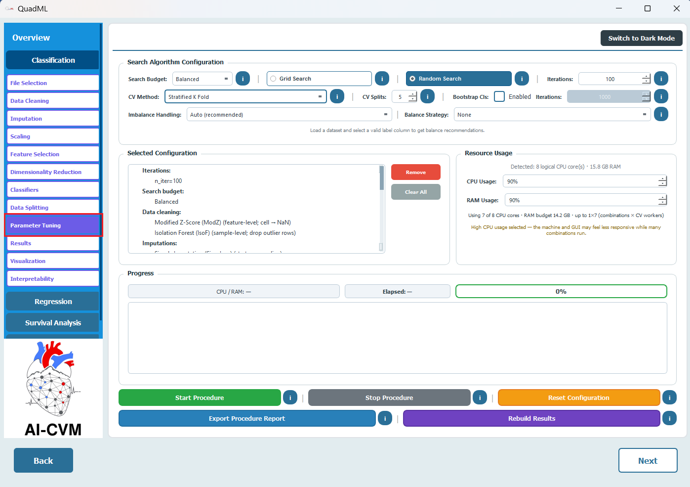
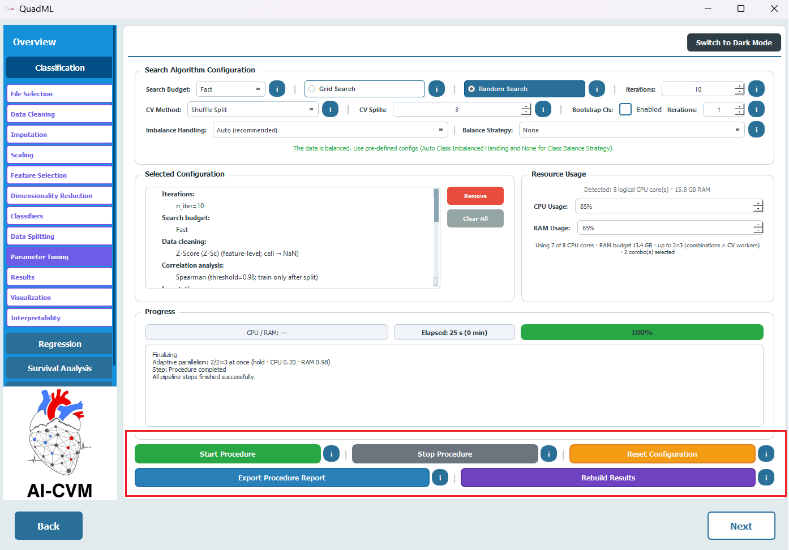
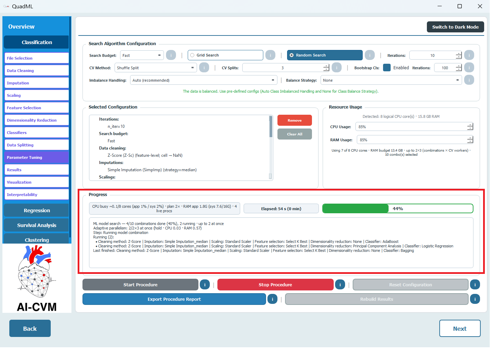

# Classification — Parameter tuning

**Where**: Classification → **Parameter Tuning**

Sets how QuadML searches the combinations you selected, then starts the run (**Start Procedure**). Also covers Stop, resources, imbalance handling, and Rebuild Results.

--8<-- "_snippets/search-run.md"

--8<-- "_snippets/start-stop-resources.md"

## Classification-only: Imbalance Handling

| Setting | Meaning |
|---------|---------|
| **Auto** (recommended) | Let QuadML decide from class balance |
| **On** / **Off** | Force imbalance handling on or off |
| Balance strategy | **None** or **SMOTE** when handling is active |

When imbalance handling is active, search may prefer stratified CV and F1/MCC-oriented scoring.

**Point:** Check the configuration tree before Start combination count is the product of every checked option. Use **Fast** or **Balanced** for first runs.

## Common mistakes

- Starting with every method selected combination count is a product
- Ignoring Resource Usage on large searches
- Changing File Selection roles after configuring without re-checking the tree
- Closing the app instead of **Stop**
- Setting CPU/RAM to 100% on a machine you still need for other work
- Starting again without noticing a new dated folder was created
