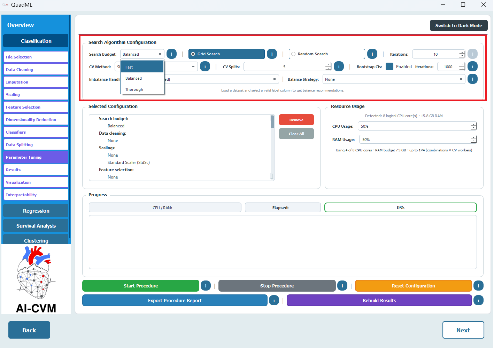
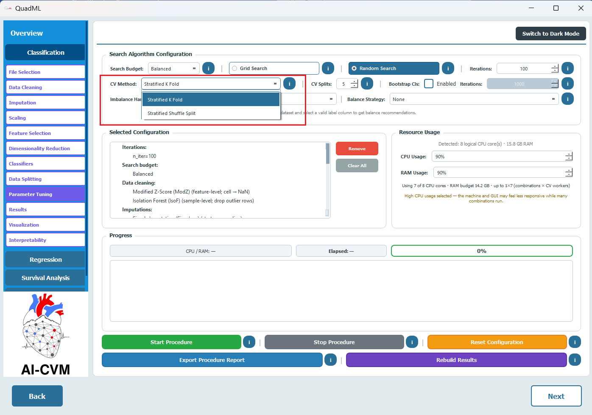
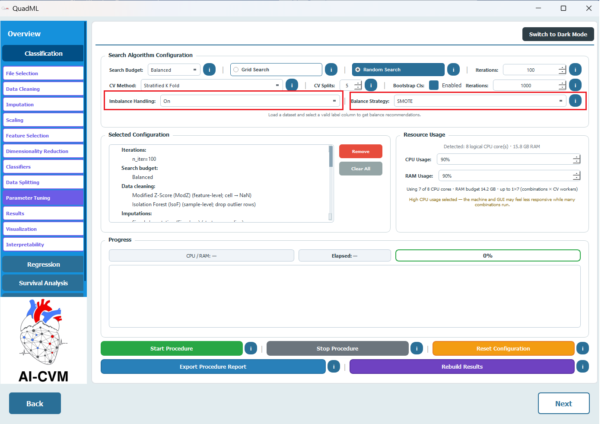
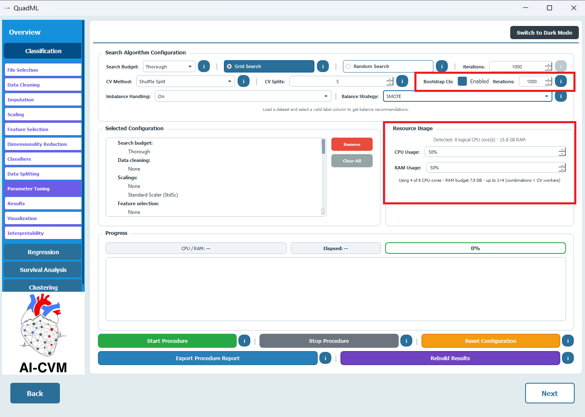
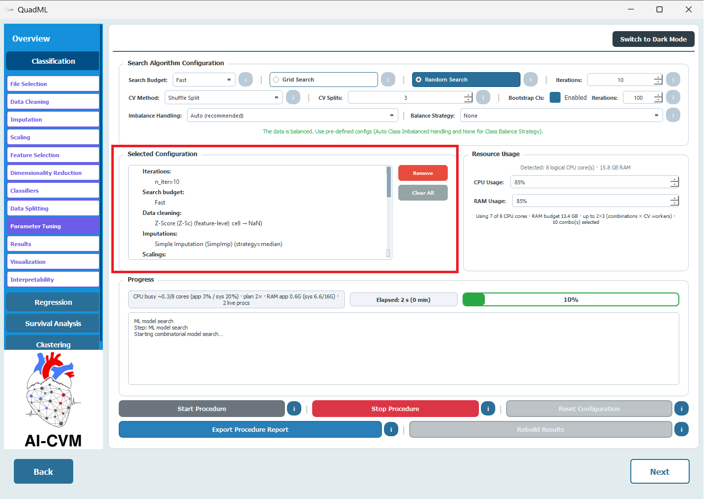

# Classification — Parameter Tuning

**Where**: Classification → **Parameter Tuning**

On Parameter Tuning you set the search budget, algorithm, and cross-validation, then start the combinatorial run over the preprocessing and classifier choices from the earlier steps.

## What to click

**Search controls**

**Search Budget**: Fast / Balanced / Thorough — scales Random Search n_iter and suggested CV folds. It does not remove methods you already checked.

**Search algorithm**: Grid Search or Random Search (Random Search has Iterations / n_iter).

Cross-validation method and number of splits (used inside Train).

### Classification-only:

**Imbalance Handling**:

Auto (recommended) | On | Off

Balance strategy (when handling is active): None or SMOTE.

When imbalance handling is active, search may prefer stratified CV and F1/MCC-oriented scoring; ranking can prefer test F1 and MCC over accuracy alone. See the info dialog for details.

**Optional Bootstrap CIs** — 95% percentile intervals on scalar metrics. Enable here and re-run; QuadML resamples the evaluation split and reuses stored predictions (does not refit models or retune the Train-locked decision threshold).

**Resource Usage**: CPU % and RAM % (default 50 / 50).

### Configuration tree and run

Review the selected configuration tree (every imputer × scaler × FS × DR × classifier you checked).

Start Procedure — reads data, cleans, searches, writes **Final_Results.csv**.

Stop Procedure — cancels; partial combo results may remain.

If the procedure breaks in the middle of run, clicking on **Rebuild Results**, builds Final_Results.csv file for completed combinations until that time.

Other actions as labeled: Reset Configuration, Export Procedure Report, Rebuild Results.

In the Progress card, you can see the combos running or the combo that finishes recently. Also, progress bar shows how the procedure is running and live information about CPU/RAM is visible.

Click **“i”** button next to Start Procedure, search budget, CV, imbalance, and bootstrap for the in-app wording.

## What is written to disk

In the dated run folder:

Final_Results.csv — one row per pipeline combination

combo_results/ JSON (can rebuild the CSV if a run is interrupted)

Fitted pipelines (.pkl), prepared data, plot caches

Optional class_balance_report.json when imbalance reporting is active

Procedure report (if exported)

## Common mistakes

Starting with every method selected — combination count is a product

Ignoring File Selection's Decision Threshold when comparing binary hard-label metrics

Changing File Selection columns after a long configure pass without checking the tree
