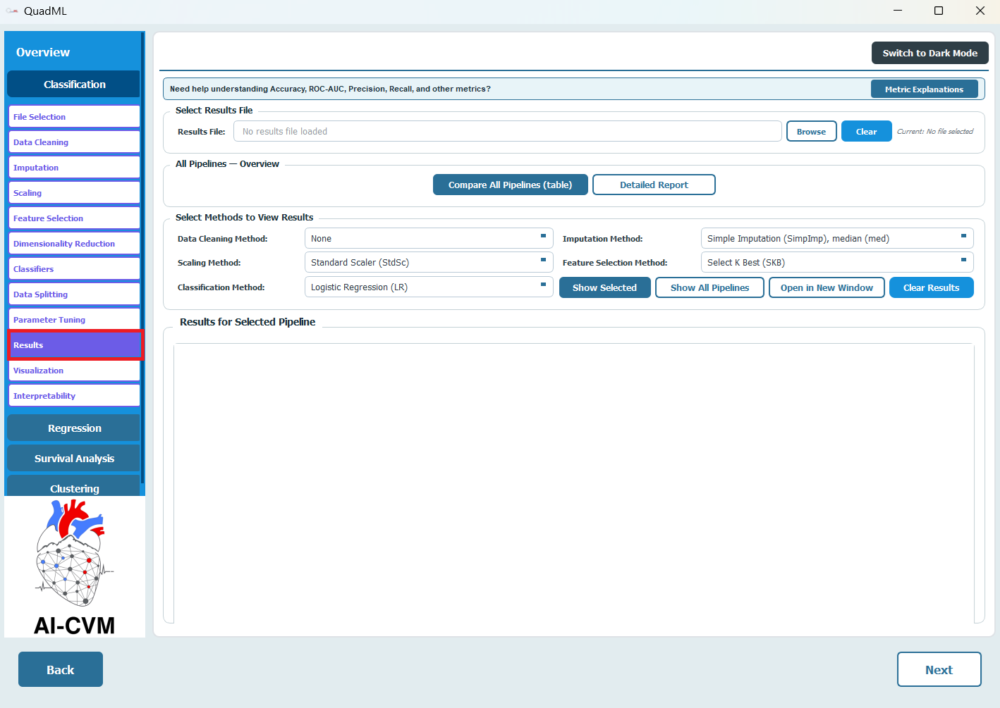
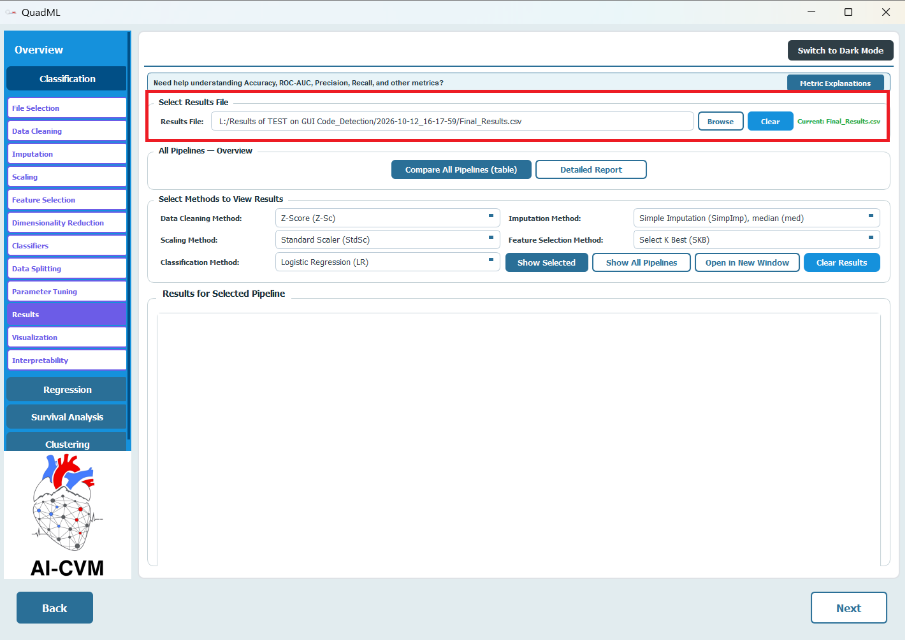
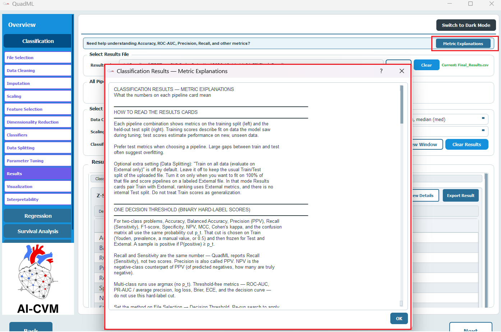
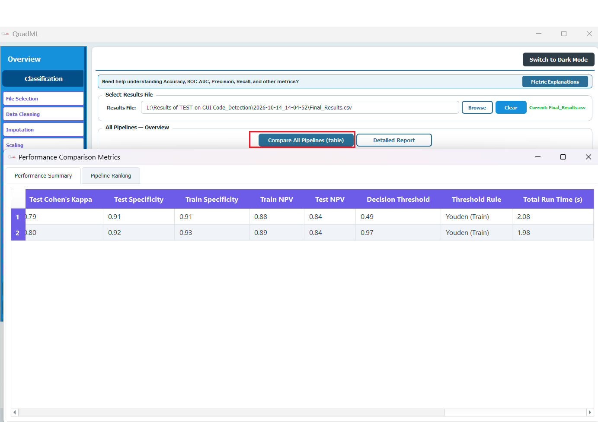
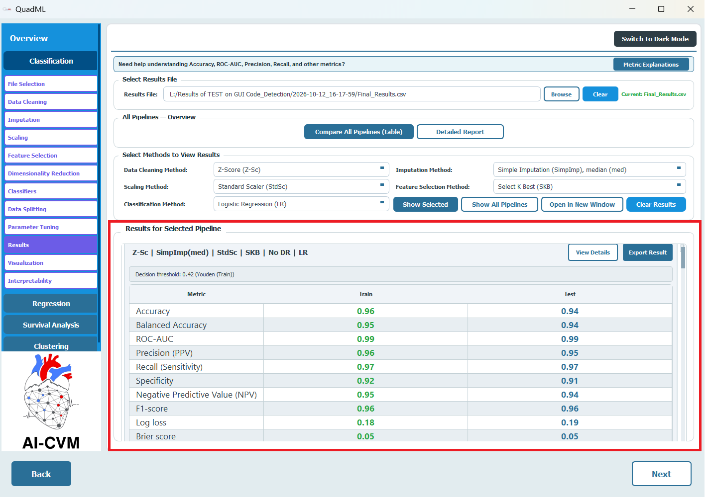

# Classification — Results

**Where**: Classification → **Results**

After **Start Procedure** finishes, **Results** loads `Final_Results.csv` from the dated run folder and shows each searched pipeline combination with its Train and Test metrics (or External metrics when Train on all data is on), so you can compare, filter, and open detailed reports. The user can also **Browse** an older run folder that already contains `Final_Results.csv` (or combo JSON) to reload and inspect previous results without starting a new search.

## What to click

Confirm the results file. QuadML looks for Final_Results.csv in the run folder. You can Browse another folder that contains that CSV or combo JSON.

Read the cards / tables: Train on the left, Test on the right (or External when Train-on-all-data is on).

Click Metric Explanations on the top bar for the full, in-app metric text.

Use overview actions as labeled, for example:

Compare All Pipelines (table)

Detailed Report

Show Selected / Show All Pipelines / Open in New Window / Clear Results

Filter by cleaning, imputation, scaling, feature selection, DR, and classifier as shown on the page.

## How to read metrics (summary)

Prefer Test (or External in train-on-all mode) when choosing a pipeline.

Large Train vs Test gaps often mean overfitting.

Do not treat Train scores as generalization.

### Binary decision threshold

On **binary** tasks, File Selection’s **Decision Threshold** (Youden, Prevalence, Manual, or 0.5) is chosen on **Train** and then reused for Test and External. That single cut turns predicted probabilities into class labels for hard-label metrics such as Accuracy, Balanced Accuracy, Precision (PPV), Recall (Sensitivity), F1, Specificity, NPV, MCC, Cohen’s kappa, and the confusion matrix.

**Multi-class** tasks do not use this threshold; the predicted class is the one with the highest probability (argmax).

Probability-based metrics — ROC-AUC, PR-AUC, log loss, Brier score, ECE, and decision-curve analyses — do **not** depend on the Decision Threshold.

### Core metrics

**Higher is better**: Accuracy, Balanced Accuracy, ROC-AUC (plus OvO / Micro on multi-class), Precision (PPV), Recall (Sensitivity), F1-score, MCC, Cohen’s kappa.

**Lower is better**: Log loss, Brier score, ECE.

Optional Bootstrap CIs (if enabled on Parameter Tuning) appear as intervals on scalar metrics; curves/matrices stay point-only.

## What is written to disk

You are reading files already written by the search. Export extra tables from the Results buttons if you need a copy elsewhere.

## Common mistakes

Opening a Final_Results.csv from a different task like Regression or an older run

Picking the highest Train score

Treating Recall and Sensitivity as two different scores — QuadML reports them as one
