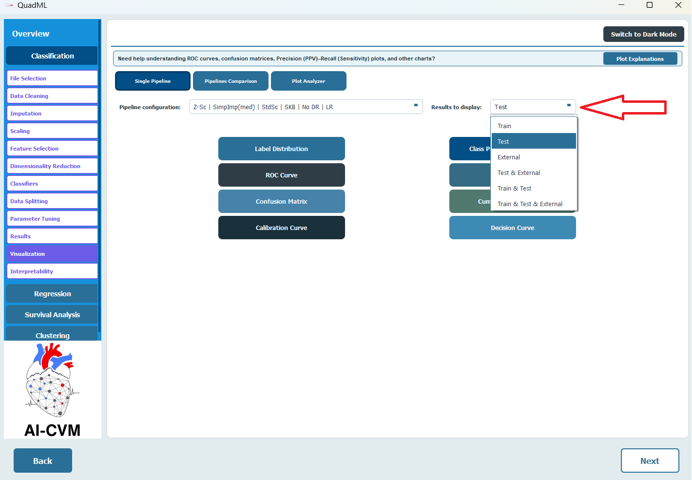
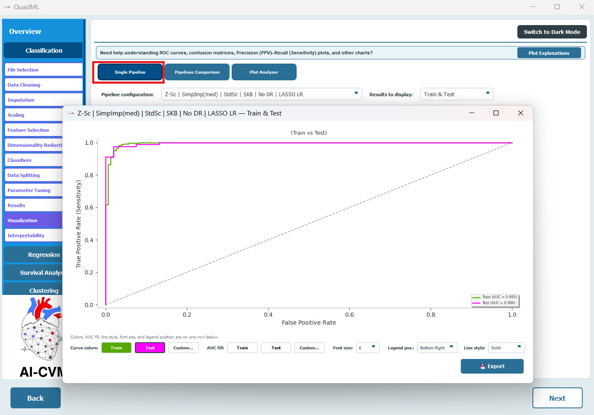
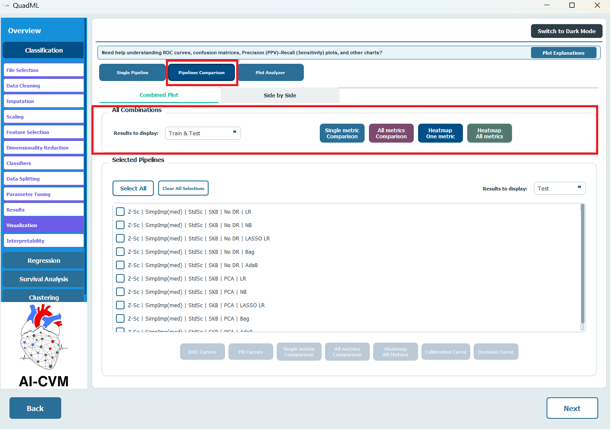
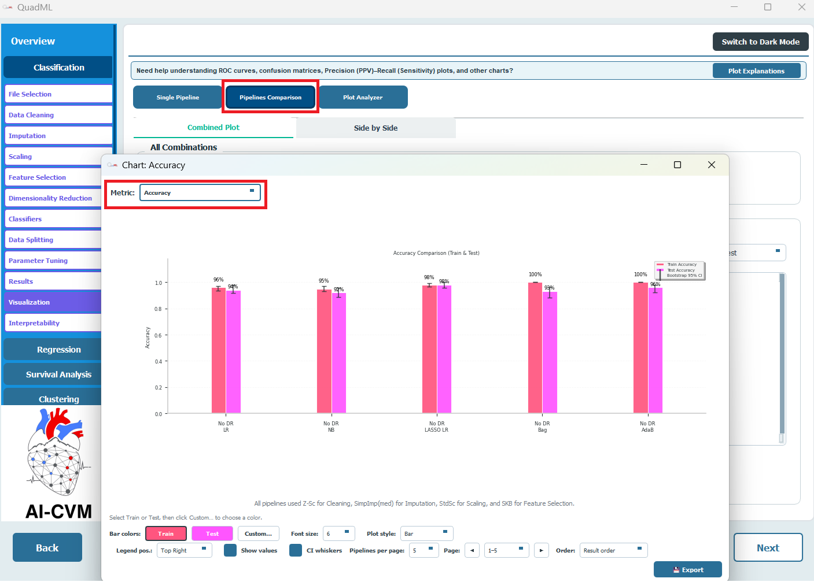
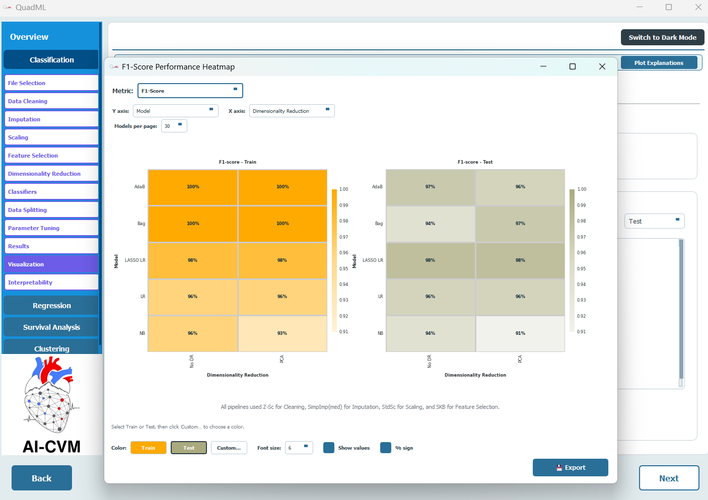

# Classification — Visualization

Shows charts for the pipelines you already scored on **Results**, ranking (ROC / PR), confusion, calibration, and decision curves. Load `Final_Results.csv` in **Results** first, then open **Visualization** and choose **Single Pipeline** (one configuration’s curves), **Pipelines Comparison** (metrics / ROC / heatmaps across combinations), or **Plot Analyzer**. Prefer **Test** or **External** when judging generalization. You can plot confusion matrices, ROC / PR curves, class and probability distributions, cumulative gains / lift, calibration curves, and decision curves; PR, gains / lift, and decision curves are binary-only. Use **Plot Explanations** and **Analyze** for in-app help.

--8<-- "_snippets/visualization-usage.md"

Choose **Single Pipeline**, **Pipelines Comparison**, or **Plot Analyzer** from the Visualization welcome screen (above).

**Single Pipeline** pick a pipeline and set **Results to display** (prefer **Test** or **External**):

## Ranking / class plots

| Plot | What it shows |
|------|----------------|
| Confusion Matrix | Correct and wrong predictions per class |
| ROC Curve | Ranking quality at every threshold (binary; OvR for multi-class) |
| PR Curve | Performance when the positive class is rare (binary) |
| Class Probability Distribution | How predicted probabilities are spread by true class |
| Label Distribution | How many rows are in each class |
| Cumulative Gains / Lift | How much better than random the top-ranked rows are (binary) |

ROC curve for a selected pipeline:

## Calibration / utility

| Plot | What it shows |
|------|----------------|
| Calibration Curve | Predicted probabilities vs observed frequencies |
| Decision Curve | Net benefit across thresholds (binary) |

Calibration curves for a selected pipeline:

## Comparing pipelines

**Pipelines Comparison** select combinations, then open a metric chart, heatmap, or overlay:

| Plot | What it shows |
|------|----------------|
| Single-metric plots | One metric across pipelines |
| Metrics comparison | Several metrics together |
| Heatmap | A metric for each combination of model and preprocessing |
| Combined ROC | ROC curves across selected pipelines |
| Side by Side | Same plot type next to each other (for example confusion matrices) |

Single-metric comparison (for example Accuracy across pipelines):

Metrics comparison across selected pipelines:

Heatmap of one metric (model × dimensionality reduction):

All-metrics heatmap:

Combined ROC curves across pipelines:

**Side by Side** confusion matrices:

Use **Plot Explanations** / **Analyze** for in-app help. Confusion / ROC / PR often need **Single Pipeline** views.

## Common mistakes

- Opening Visualization before any successful combination finished
- Mixing plots from an older dated folder after starting a new run
- Reading Train-only plots as trustworthy absolute performance
