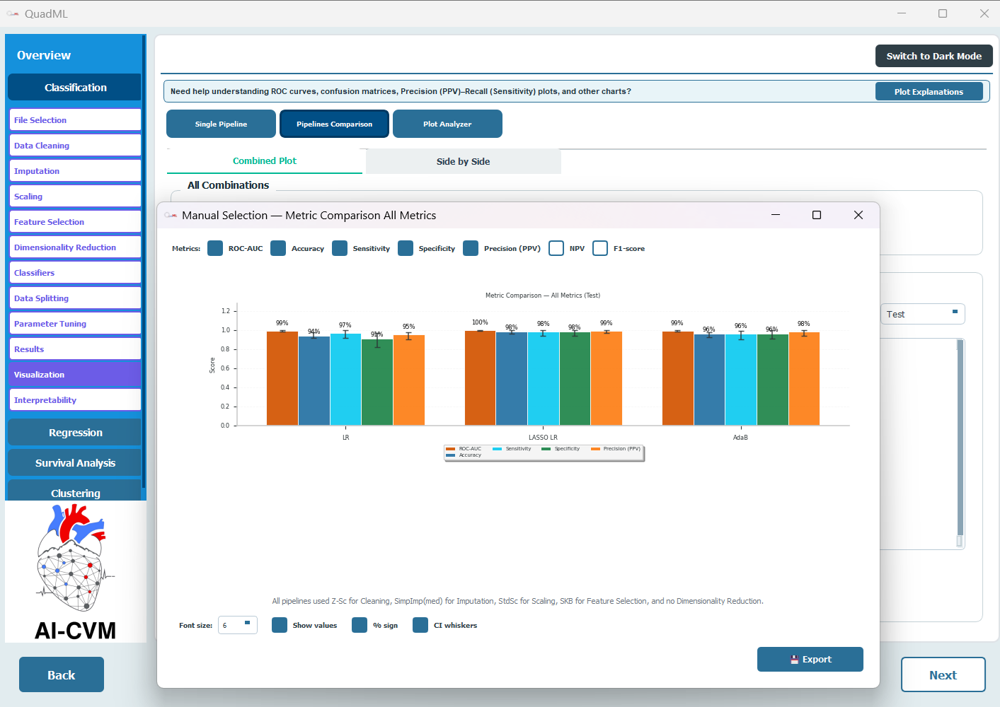

# Classification — Visualization

**Where**: Classification → **Visualization**

Charts for comparing pipelines and inspecting one selected pipeline. Load `Final_Results.csv` in **Results** first.

--8<-- "_snippets/visualization-usage.md"

Choose **Single Pipeline** or **Pipelines Comparison**, pick a pipeline, and set **Results to display** (prefer **Test** or **External**):

## Comparing pipelines

| Plot | What it shows |
|------|----------------|
| Single-metric plots | One metric across pipelines |
| Metrics comparison | Several metrics together |
| Heatmap | A metric for each combination of model and preprocessing |
| Performance distribution | How scores are spread across the search |
| Class distribution | How many rows are in each class |
| Calibration curve | Whether predicted probabilities match observed frequencies |
| Decision curve | Net benefit of using the model at different thresholds |

**Pipelines Comparison** offers Combined Plot / Side by Side, All Combinations actions, and Selected Pipelines:

Single-metric comparison (for example Accuracy across pipelines):

Metrics comparison across selected pipelines:

Heatmap of one metric (model × dimensionality reduction):

All-metrics heatmap:

Combined ROC curves across pipelines:

**Side by Side** confusion matrices:

## One pipeline

| Plot | What it shows |
|------|----------------|
| Confusion matrix | Correct and wrong predictions per class |
| ROC curve | Ranking quality at every threshold (binary) |
| Precision–recall curve | Performance when the positive class is rare |
| Probability distribution | How predicted probabilities are spread |
| Cumulative gains and lift | How much better than random the top-ranked rows are |
| Decision curve | Net benefit across thresholds |

ROC curve for a selected pipeline:

Calibration curves for a selected pipeline:

## Common mistakes

- Opening Visualization before any successful combination finished
- Mixing plots from an older dated folder after starting a new run
- Reading Train-only plots as trustworthy absolute performance
