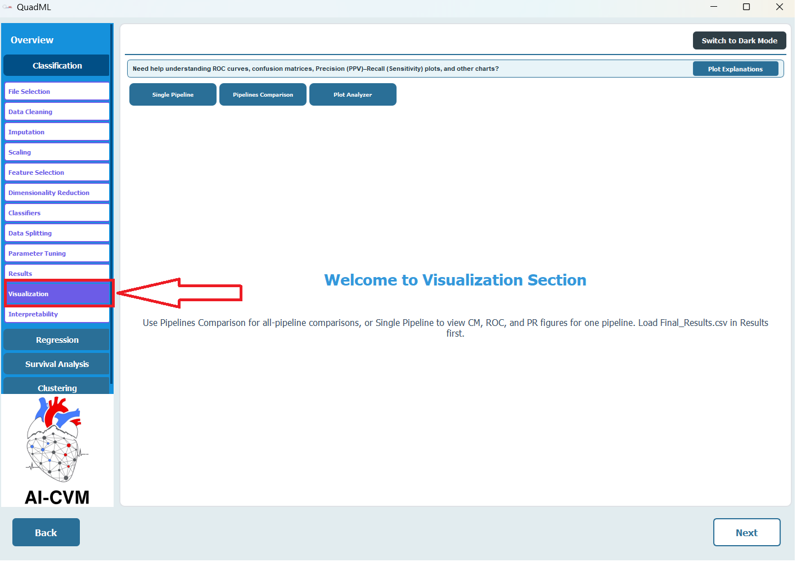
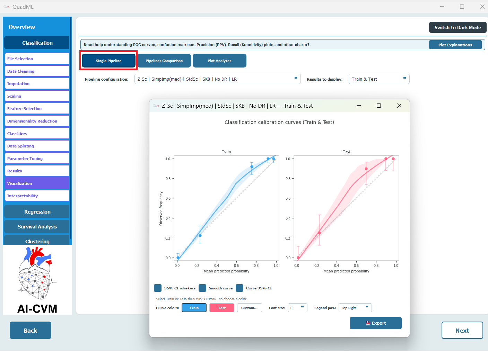
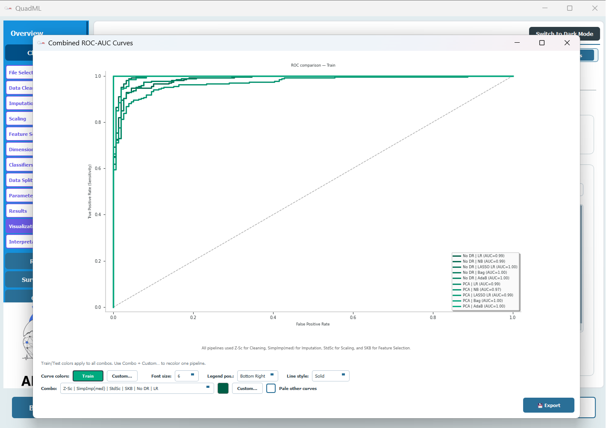
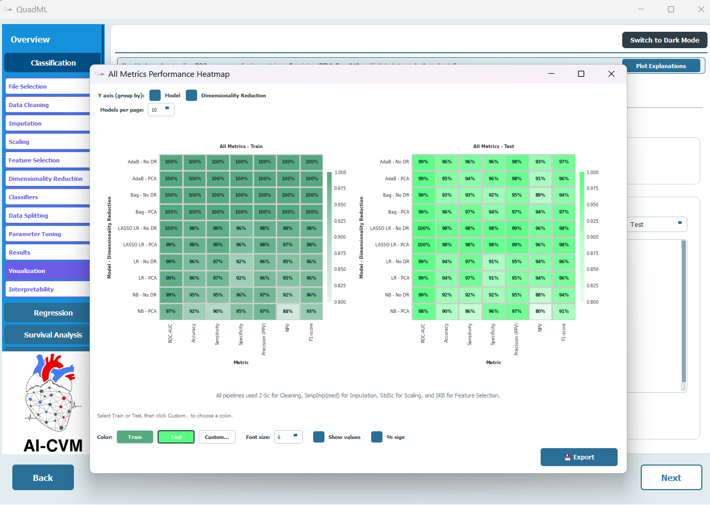
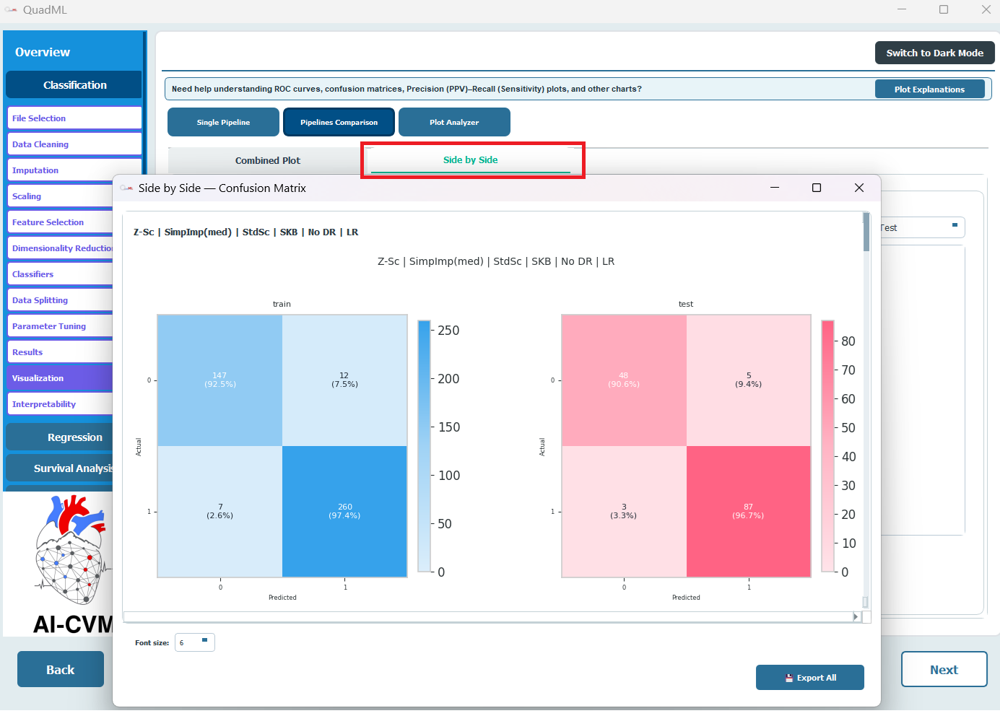

# Classification — Visualization

**Where**: Classification → **Visualization**

Load Final_Results.csv in **Results** first. Charts read metrics and saved plot data from the search output folder.

## What to click

Choose which results to display (Train, Test, External, or combined splits). Prefer Test or External when judging generalization.

Open charts from the available groups (all pipelines, compare selected, or one pipeline).

Click Plot Explanations on the top bar for the full in-app plot text.

Use Analyze (Plot Analyzer) on a figure for a structured reading of the current plot.

Where shown, use Plot style (Bar / Lollipop / Dot) and CI whiskers for metric charts.

## Chart groups (what you will find)

### Performance metric charts (many pipelines)

These charts summarize **all** (or many) searched pipelines at once, so you can rank combinations before shortlisting.

| Chart | What it shows |
| --- | --- |
| Single-metric plots | One scalar metric across pipelines — Accuracy, ROC-AUC (plus OvO / Micro on multi-class), Specificity, NPV, Recall (Sensitivity), Precision (PPV), F1, MCC |
| Metrics comparison | Several of those metrics together as bars or lines |
| Heatmaps | Metric values by classifier × feature-pipeline grid |
| Performance distribution | How metric scores are spread across the search |
| Class distribution | Counts of true labels in the selected split (optional pie when there are few classes) |
| Calibration curve | How well predicted probabilities match observed frequencies across pipelines |
| Decision curve | Net benefit of treat / don’t treat strategies — **binary only** |

### Compare selected pipelines

These use the same chart families as the all-pipelines performance views (metric bars, heatmaps, calibration, decision curve, and so on), but only for the pipelines you have added to the **comparison list** — typically a short shortlist from Results. Charts that show every combination stay under the many-pipelines group; use Compare Selected when you want side-by-side or overlay views of a few finalists without the full search clutter.

### One-pipeline diagnostic plots

These charts focus on a **single** selected pipeline (not the full search or the comparison list).

| Plot | What it shows | Availability |
| --- | --- | --- |
| Confusion matrix | Predicted vs true labels after applying the class rule | Binary: File Selection **Decision Threshold** (Train-locked). Multi-class: highest-probability class (argmax) |
| ROC curve | Ranking quality from predicted probabilities | Binary: one ROC. Multi-class: one-vs-rest ROC panels |
| Precision–Recall / F1 | Performance when the positive class is rarer, or per-class F1 | Binary: Precision (PPV)–Recall (Sensitivity) curve. Multi-class: per-class F1 chart |
| Class probability distribution | How predicted probabilities are spread | Binary only |
| Cumulative gains & lift | How much better ranking is than random for the top fractions of the list | Binary only |
| Decision curve | Net benefit of treat / don’t treat strategies across thresholds | Binary only |

### Dedicated curve sections

ROC-AUC curves (individual and comparison overlays; multi-class OvR panels)

## Bootstrap CI whiskers

Metric bar / lollipop / dot charts can show 95% bootstrap CIs when Parameter Tuning had Bootstrap CIs enabled. Heatmaps, ROC/PR, calibration, and confusion matrices stay point-only.

## Quick guide — which plot to open

| Goal | Start with |
| --- | --- |
| Rank many pipelines | Metric bars / heatmaps |
| Shortlist finalists | Compare Selected |
| Understand errors | Confusion matrix |
| Threshold-free ranking | ROC / ROC-AUC |
| Imbalanced positive class | PR curve |
| Probability quality | Calibration, class probability distribution |
| Clinical treat / don’t treat (binary) | Decision curve |

For full plot wording, use Plot Explanations in the app. Metric definitions stay under Results → Metric Explanations.

From Side by Side section in the Visualization part, you can compare the plots of different combos in Train/Test/External or combined splits.

## Common mistakes

Comparing plots from two different dated run folders

Reading a Train curve as performance on new data

Expecting Decision Curve / PDP-style tools here for multi-class when they are binary-only
