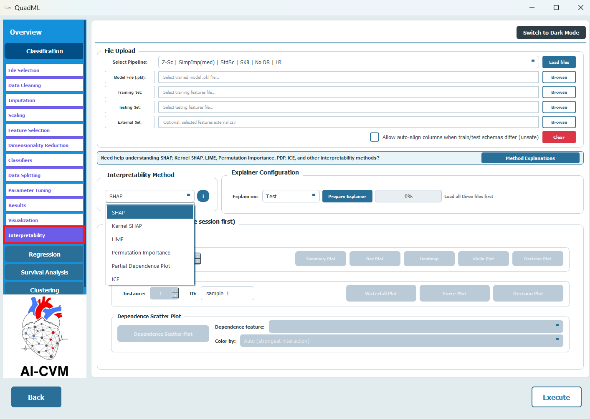
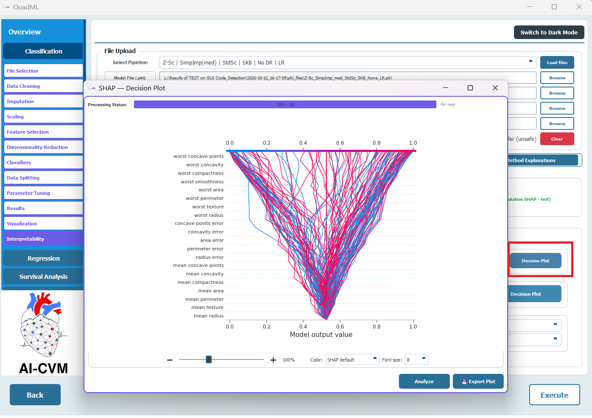
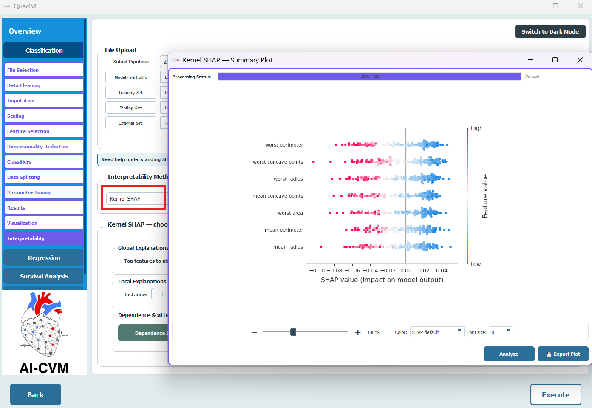
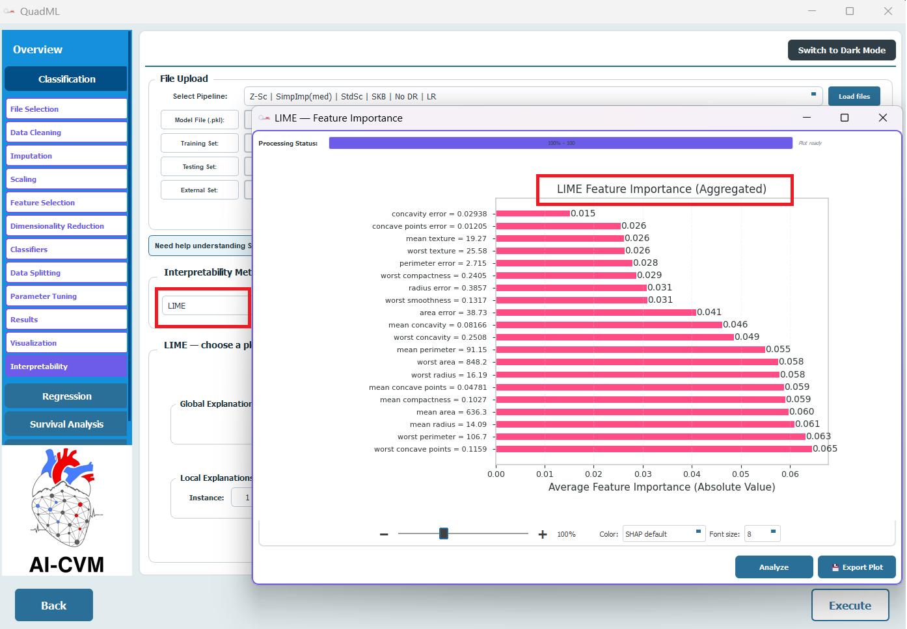
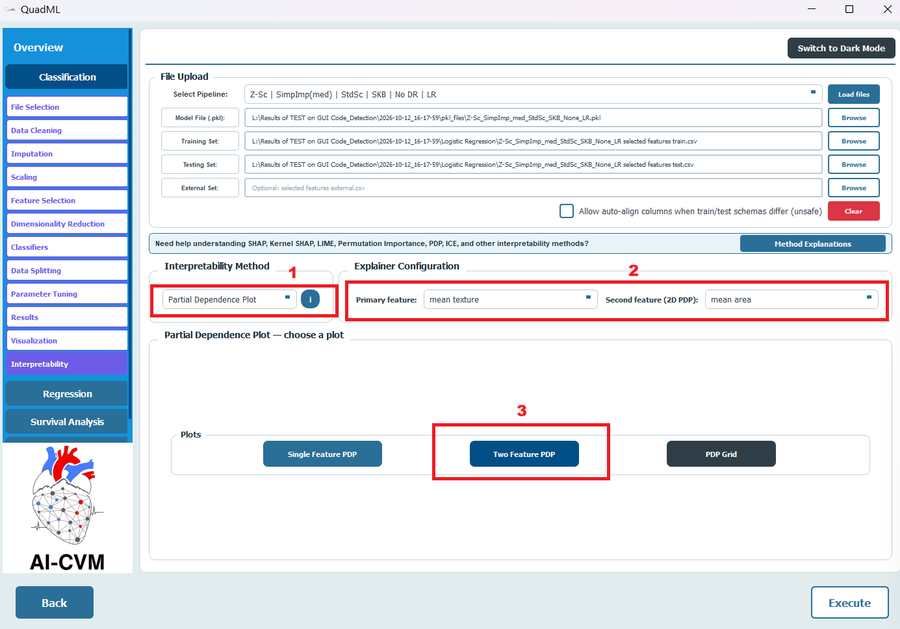
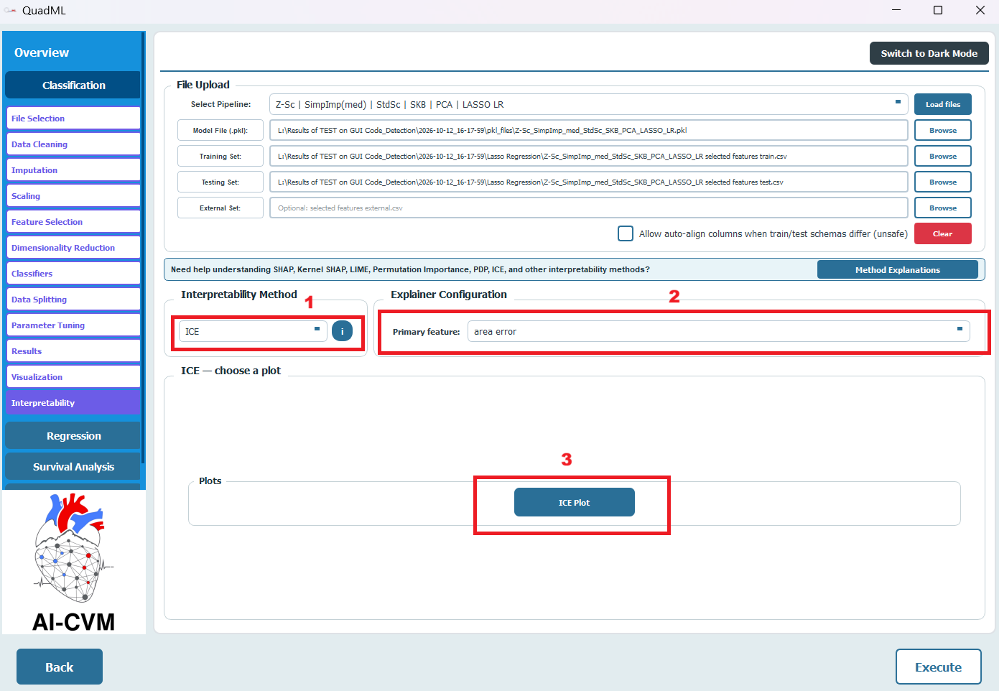
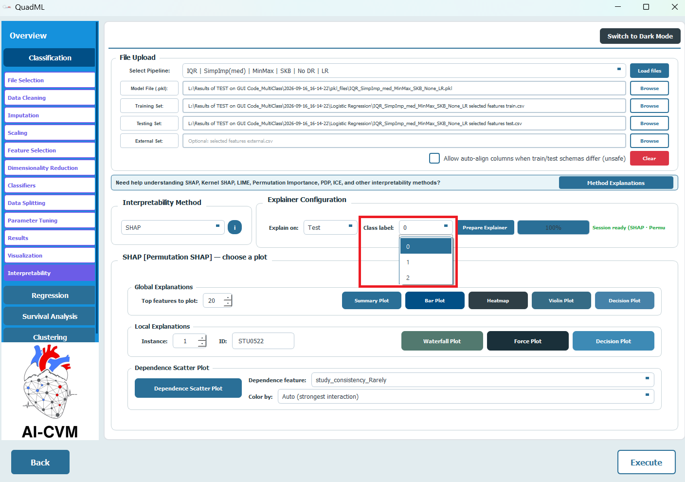

# Classification — Interpretability

**Where**: Classification → **Interpretability**

**Interpretability** explains **why** a fitted Classification pipeline makes its predictions: you load one completed model (`.pkl` plus its feature tables), prepare an explainer (SHAP, LIME, PDP/ICE, and related methods), and open local or global plots. Use it after Results to understand a chosen pipeline — it does **not** replace Test or External metrics for ranking performance.

Point Results (and then Interpretability) at the same dated run folder under your **Output Directory** — typically `Output Directory / YYYY-MM-DD_HH-MM-SS / Final_Results.csv`. That CSV lists the finished combinations; the matching `.pkl` and feature CSVs for a row live in that same run folder (or its subfolders). You can also Browse an older run’s `Final_Results.csv` if you want to explain a previous search.

## Recommended workflow

Results — load `Final_Results.csv` from the dated run folder (`Output Directory / <run timestamp>/`).

Interpretability — Select Pipeline → Load files (model `.pkl`, training features CSV, testing features CSV) from that same run.

1. Choose an explanation **method** (SHAP, LIME, PDP/ICE, …).
2. Click **Prepare Explainer** once — plot buttons stay disabled until this finishes.
3. If the page shows **Explainer Configuration** for that method, set those options before or after prepare as the UI allows.
4. Open plots from the grouped plot buttons.
5. Use the Browse fields only if you need to override the auto-filled `.pkl` or feature-CSV paths.

## Methods

### SHAP

**SHAP** breaks a predicted class probability (`predict_proba`) into per-feature contributions: positive values push toward that class, negative values push away. You can inspect one sample (local) or patterns across many samples (global).

Available plot groups include Summary, Waterfall, Force, Bar, Heatmap, Dependence Scatter, Violin, and Decision.

### Kernel SHAP

**Kernel SHAP** estimates SHAP values for any model (not only trees) by sampling feature coalitions. It uses the same style of contribution plots as SHAP, though the UI may show a smaller plot set, and it is usually slower than tree-based SHAP.

### LIME

**LIME** (Local Interpretable Model-agnostic Explanations) explains **one sample at a time**: it builds a simple local model around that instance to show which features pushed the prediction toward or away from a class. Use it when you need a readable case-level story (for example a single patient or row). The UI also offers aggregated importance and table views when you explain several instances. On multi-class tasks, pick the **Class label** you want explained (same idea as SHAP).

### Permutation Importance

**Permutation Importance** ranks features **globally** by how much the model’s score falls when that feature’s values are randomly shuffled (breaking the link between the feature and the outcome while leaving other columns unchanged). A large drop means the feature mattered for performance on the chosen split. It does **not** need a Class label — pick **Train**, **Test**, or **External**, prepare the explainer, and read the ranking plot. Use it for an overall “which columns drive the metric?” view, not for explaining one sample like LIME.

### Partial Dependence Plot (PDP) — binary only

**PDP** shows how the model’s **average** predicted probability changes when you vary one feature (or a pair of features) across their range, while averaging over the other columns. Use it to see the overall relationship between a feature and the prediction. Available for **binary** Classification only — the control is hidden for multi-class.

### ICE — binary only

**ICE** (Individual Conditional Expectation) draws one curve **per sample** as a single feature varies, so you can see how predictions change for individual rows rather than only the PDP average. Heterogeneous curves mean the feature effect differs across samples. Available for **binary** Classification only — hidden for multi-class.

## Multi-class: Class label

A multi-class model predicts a probability for **each** class. SHAP, Kernel SHAP, and LIME explain **one class at a time**, so you must choose which class’s probability to attribute.

| Task | Class label control |
| --- | --- |
| **Binary** | No Class label picker — explanations use the positive-class probability |
| **Multi-class** | Class label appears on the SHAP / Kernel SHAP / LIME panels; plot titles include `(class=…)` |

If you change Class label after **Prepare Explainer**, QuadML recomputes the attributions for the newly selected class.

## What is written to disk

Prepared explainers and related caches are stored under the current dated **run folder** (and its Interpretability subfolders) for that session, so you can reopen plots without rebuilding everything from scratch when paths stay valid.

Performance charts such as **ROC curves** and **confusion matrices** are on **Visualization**, not Interpretability — use this page for SHAP / LIME / PDP-style explanations of a loaded `.pkl`.

For the full in-app wording of each method, use the explanations bar or the **i** buttons on the Interpretability page.

## Common mistakes

Loading features from a different combination than the .pkl

Treating interpretability on Train as external validation

Looking for PDP/ICE on multi-class tasks (they are hidden)
