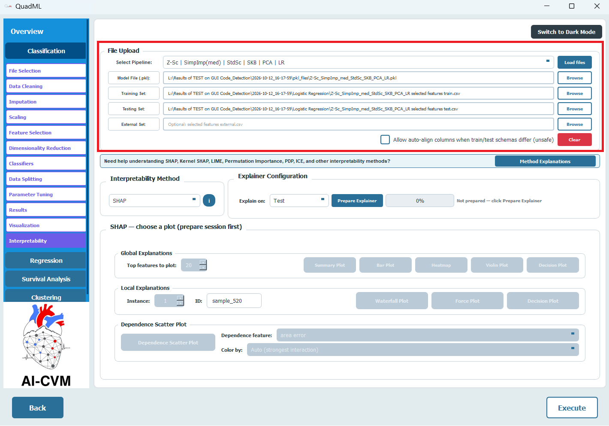
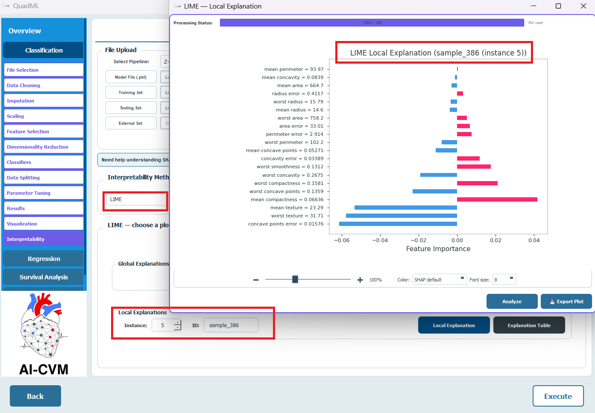
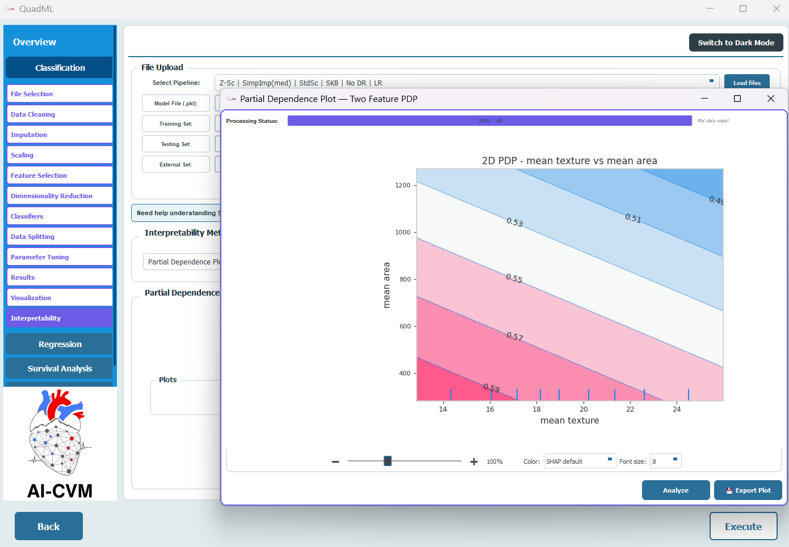
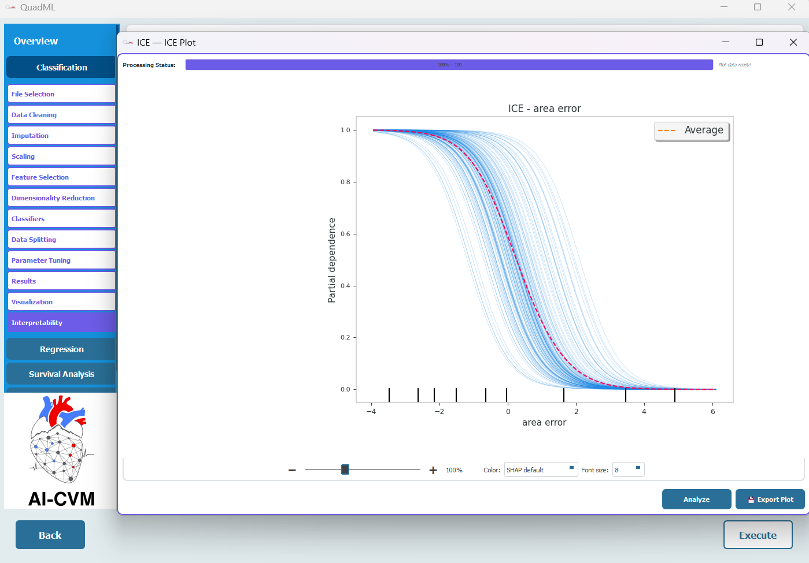

# Classification — Interpretability

Shows which features drive predicted class probabilities for a loaded fitted classification pipeline (global and local explanations). Use it after you choose a candidate from **Results**. It does **not** replace Test or External metrics for ranking models. Load the matching `.pkl` and feature CSVs, choose a method compatible with the model, set **Explain on**, then **Prepare Explainer**. Prefer **SHAP** when available; **Kernel SHAP** is a model-agnostic alternative that is usually slower. Positive attributions mean a **higher predicted probability** for the explained class (multi-class: set **Class label** before preparing). **PDP** and **ICE** are binary-only in Classification. Prefer **Test** or **External** for **Explain on** when judging which features matter on held-out data.

--8<-- "_snippets/interpretability-usage.md"

Load the matching `.pkl` and feature CSVs for one pipeline, choose a method and **Explain on** split, then compute / prepare the explainer:

SHAP session ready, **Explain on**, Prepare Explainer, global and local plot buttons:

## Methods

| Approach | What it shows | Scope |
|----------|---------------|--------|
| **SHAP** | How much each feature pushes the predicted probability up or down | All rows and single rows |
| **Kernel SHAP** | Same idea as SHAP, model-agnostic; usually slower | All rows and single rows |
| **LIME** | Which features drove one prediction, via a simple local model | Single rows (aggregated views available) |
| **Permutation Importance** | How much performance drops when a feature is shuffled | All rows |
| **PDP** | How the average prediction changes as one or two features vary | All rows (binary only) |
| **ICE** | One curve per row as a feature varies | Single rows (binary only) |

Multi-class runs can expose a **Class label** control before preparing the explainer. PDP / ICE stay binary-only.

SHAP summary (global feature impact):

SHAP heatmap across instances:

SHAP decision plot for a selected instance:

SHAP decision plot (paths across instances):

Kernel SHAP summary:

LIME aggregated feature importance:

LIME local explanation for one instance:

Permutation Importance on Test:

Partial Dependence Plot controls (primary / second feature):

Two-feature PDP example:

ICE method and primary feature:

ICE plot with average curve:

Multi-class **Class label** control:

## Common mistakes

- Loading CSVs from a different combination than the `.pkl`
- Treating Train explanations as validation
- Using Interpretability instead of Test metrics to pick a model
- Running Interpretability without a successful fitted `.pkl`
- Expecting PDP / ICE on multi-class runs
