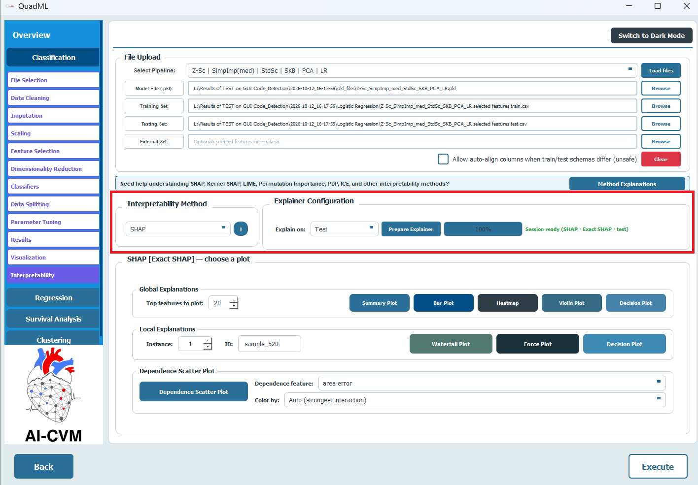
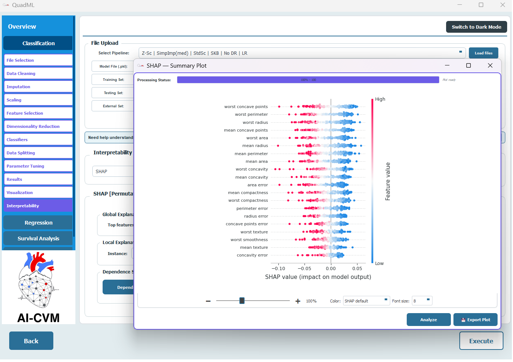
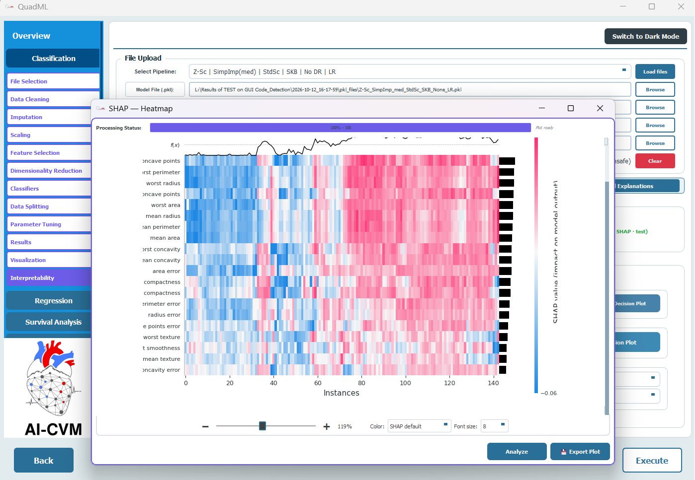
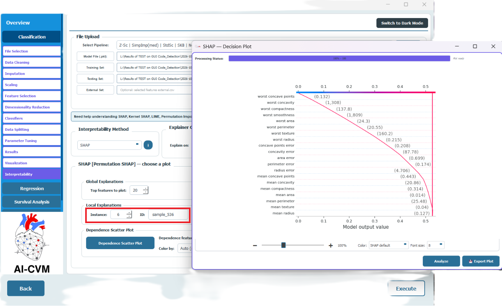
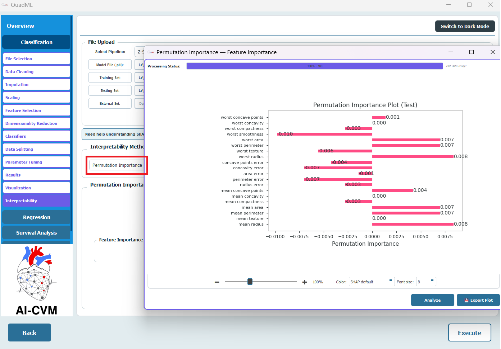

# Classification — Interpretability

**Where**: Classification → **Interpretability**

Explains a loaded fitted pipeline. It does **not** replace Test or External metrics for ranking.

--8<-- "_snippets/interpretability-usage.md"

Load the matching `.pkl` and feature CSVs for one pipeline, then **Prepare Explainer**:

Choose a method, set **Explain on** (for example Test), run **Prepare Explainer**, then open plot buttons when the session is ready:

## Methods

| Approach | What it shows | Scope |
|----------|---------------|--------|
| **SHAP** | How much each feature pushes the predicted probability up or down | All rows and single rows |
| **Kernel SHAP** | ow much each feature pushes the predicted probability up or down | All rows and single rows |
| **LIME** | Which features drove one prediction, via a simple local model | Single rows (aggregated views available) |
| **Permutation Importance** | How much performance drops when a feature is shuffled | All rows |
| **Partial Dependence Plot (PDP)** | How the average prediction changes as one or two features vary | All rows (binary for PDP/ICE in Classification) |
| **ICE** | One curve per row as a feature varies | Single rows (binary for PDP/ICE in Classification) |

**Task note:** PDP/ICE are limited to **binary** classification in this mode. Multi-class may show a Class label control where needed.

SHAP summary (global feature impact):

SHAP heatmap across instances:

SHAP decision plot for a selected instance:

Kernel SHAP summary:

LIME aggregated feature importance:

LIME local explanation for one instance:

Permutation Importance on Test:

Partial Dependence Plot controls (primary / second feature, Two Feature PDP):

Two-feature PDP example:

ICE method and primary feature:

ICE plot with average curve:

Multi-class runs can expose a **Class label** control before preparing the explainer:

## Common mistakes

- Loading CSVs from a different combination than the `.pkl`  
- Treating Train explanations as validation  
- Using Interpretability instead of Test metrics to pick a model  
- Running Interpretability without a successful fitted `.pkl`
