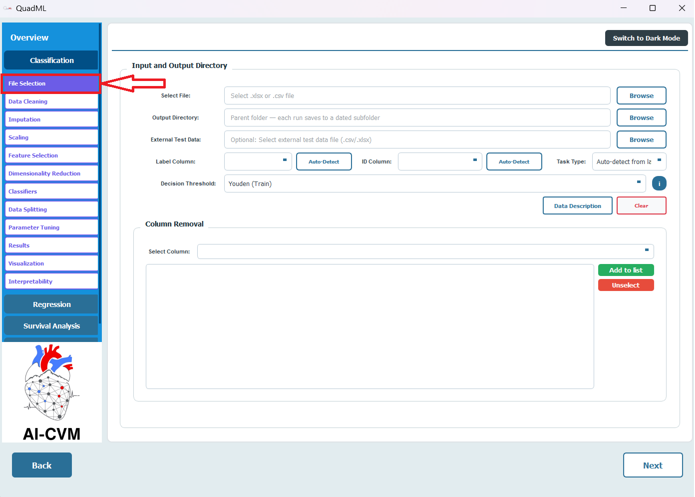

# Classification — Tutorial

End-to-end click path for a first successful Classification run. Keep the search small. For “why” and method tables, use the Pipeline and Results pages.

---

## 1. Start

1. Open QuadML → **Classification** → **File Selection**.
2. **Select File → Browse** — choose a `.csv` / `.xlsx` with a header and a label column.
3. **Output Directory → Browse** — writable **parent** folder.
4. Set **Label Column** (or **Auto-Detect**).
5. Leave **Task Type** on Auto. For binary, leave **Decision Threshold** on **Youden (Train)** unless you have a reason to change it.
6. Optional: **ID Column**, **Column Removal**, **External Test Data**.

---

## 2. Preprocess (keep it small)

| Step | Choice |
|------|--------|
| Data Cleaning | **None** |
| Imputation | **Simple Imputation** |
| Scaling | **Standard Scaler** |
| Feature Selection | **Select K Best** |
| Dimensionality Reduction | **None** |

Leave extra methods unchecked.

---

## 3. Models and split

1. **Classifiers:** Select **Logistic Regression** and **Random Forest** only.
2. **Data Splitting:** **80 / 20**, leave **Train on all data** unchecked.

---

## 4. Run

1. Open **Parameter Tuning**.
2. Set **Random Search**, **Balanced** (or **Fast**) budget, CPU/RAM **50 / 50**.
3. Leave Imbalance Handling on **Auto** unless you know you need SMOTE.
4. Review the configuration tree.
5. Click **Start Procedure** and wait until progress finishes (**Stop Procedure** only to cancel).

---

## 5. Read output

1. **Results (Metrics):** open **Metric Explanations**; prefer **Test** metrics; select a pipeline.
2. **Visualization:** pick that combination; open ROC or a metric chart; use **Plot Explanations** / Analyze.
3. **Interpretability:** **Load** that pipeline’s `.pkl` + feature CSVs; **Prepare Explainer** for SHAP or Permutation Importance; open one plot.

**Success**: `Final_Results.csv` under `Your Folder\YYYY-MM-DD_HH-MM-SS\`.

---

## Next

- [Overview](00-introduction.md) · [Metrics](10-results.md) · [Visualization](11-visualization.md) · [Interpretability](12-interpretability.md)
