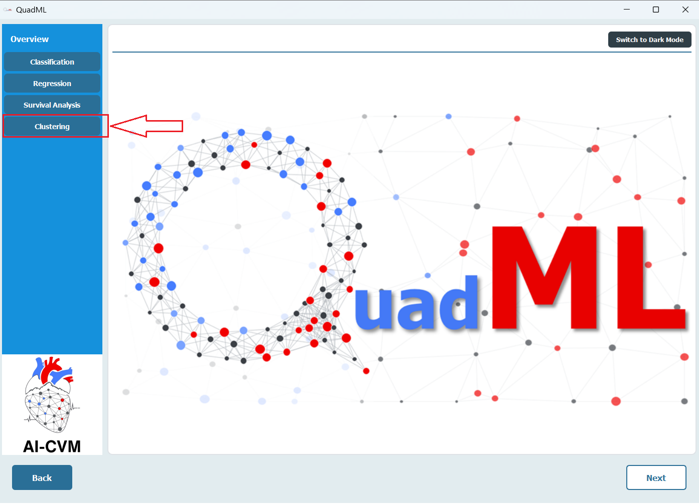

# Clustering — Overview

**Clustering** groups similar rows **without** a required target label. Typical examples are patient subtypes, sample cohorts, or any unsupervised segmentation.

In QuadML you build and compare full pipelines—cleaning, imputation, scaling, unsupervised feature selection, dimensionality reduction, and clustering models—then review internal validation metrics (Silhouette, CH, DB, DISCO, BIC, …), assignment CSVs, and plots. Everything runs locally; no data is uploaded.

### Clinical examples

- Molecular or clinical patient subtypes  
- Device / sample cohorts without a gold-standard label  
- Exploratory grouping before a supervised task  

Use Clustering for unlabeled grouping. For discrete labels use Classification; for a continuous outcome use Regression; for time-to-event use Survival Analysis.

Settings live under **Pipeline**. First run: [Tutorial](walkthrough.md).

### What is different

- No required target; optional **Benchmark Label** for ARI / NMI / FMI only (not used for ranking)
- No External file, no Data Splitting, no Interpretability
- **Search Settings** replaces Parameter Tuning
- FS is unsupervised; no LDA; sample-level cleaning methods are hidden

### Suggested first configuration

| Step | Choice |
|------|--------|
| Cleaning | **None** |
| Imputation | **Simple Imputation** |
| Scaling | **Standard Scaler** |
| Feature Selection | **None** |
| Dimensionality Reduction | **None** |
| Models | **K-Means**, Number of clusters **Auto** |
| Search | **Fast** → **Start Procedure** |
