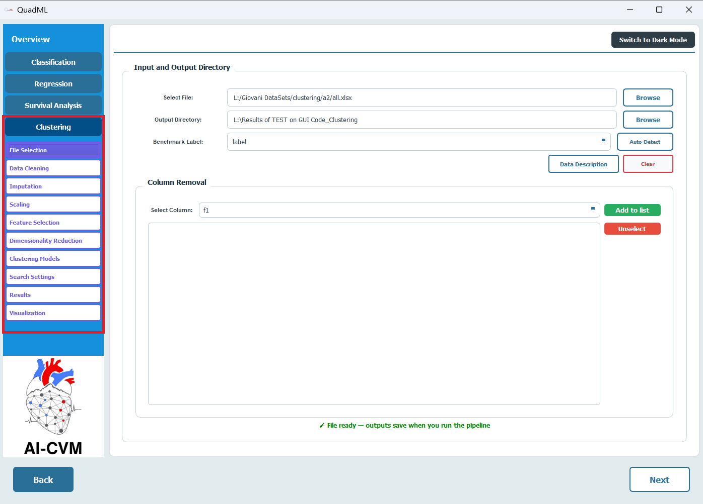

# Clustering — Introduction

**Clustering** groups similar rows in a tabular dataset **without** a required target label. Typical examples are patient subtypes, sample cohorts, or any unsupervised segmentation where you want compact, separated groups.

In QuadML, Clustering builds and compares full pipelines: you choose cleaning, imputation, scaling, unsupervised feature selection, dimensionality reduction, and clustering models; the search tries every combination you enable, then reports internal validation metrics (Silhouette, CH, DB, DISCO, BIC, …), assignment CSVs, and visualization plots. Everything runs locally — no data is uploaded.

Use this mode when you want unlabeled grouping. For discrete categories use Classification; for a continuous numeric outcome use Regression; for time-to-event data use Survival Analysis.

---

## Workflow map

After you click **Clustering** on the left, the nested steps are:

| Order | Step | Role |
|------:|------|------|
| 1 | File Selection | Load data, optional **Benchmark Label**, output folder |
| 2 | Data Cleaning | Feature-level cleaning; Exact Duplicate Rows; Missing / Outlier Threshold |
| 3 | Imputation | Fill missing values (searched combinations) |
| 4 | Scaling | Scale features (important for distance-based methods) |
| 5 | Feature Selection | Unsupervised FS methods |
| 6 | Dimensionality Reduction | PCA / ICA / Kernel PCA (or None; no LDA) |
| 7 | Clustering Models | Cluster-count models + Density-Based panel |
| 8 | Search Settings | Search budget + **Start Procedure** |
| 9 | Results | Silhouette, CH, DB, DISCO, DBCV, BIC, … (no cross-model auto-winner) |
| 10 | Visualization | Scatters, elbow, density plots, profiles |

---

## What is different from Classification / Regression / Survival

- No required target; optional **Benchmark Label** for ARI / NMI / FMI only (not used for ranking)
- No External Test Data row and no ID Column picker (Clustering never reads a second file)
- Sample-level cleaning (Isolation Forest, LOF, DBSCAN, One-Class SVM) is hidden
- Correlation Analysis on Data Cleaning is hidden; Exact Duplicate Rows and Missing / Outlier Threshold stay
- Scaling excludes Quantile Transformer and Normalizer; **None** (no scaling) is available
- FS is unsupervised (Variance Threshold, Correlation Thresholding, Feature Agglomeration, Laplacian Score)
- Laplacian Score forces DR = **None**
- Models page is two panels: **Number of clusters** (Auto / Fixed) for count-based models; Density-Based models ignore it
- Density params (DBSCAN eps, min_samples, …) are data-derived during search, not pinned on the Models page
- Hyperparameter choice is per-algorithm: average rank of Silhouette/CH/DB (centroid models), BIC (GMM), DISCO (DBSCAN / OPTICS / HDBSCAN; DBCV still reported)
- **Search Settings** instead of Data Splitting + Parameter Tuning (no CV fold controls)
- No Interpretability page — use Visualization profiling plots

---

## Suggested first configuration

- Numeric-heavy dataset, Output Directory set, Benchmark Label **(None)**
- Cleaning: **None** (Exact Duplicate Rows on by default; Missing / Outlier Threshold off)
- Imputation: a method like **Simple Imputation**
- Scaling: a scaling method like **Standard Scaler**
- Feature Selection: **None** if the number of features are few (or Variance Threshold if features are many)
- Dimensionality Reduction: **None**
- Models: **K-Means** (or keep defaults K-Means + Agglomerative + DBSCAN on a small dataset); Number of clusters = **Auto**
- Search Settings: **Fast** → **Start Procedure**

Then follow the [walkthrough](walkthrough.md).
