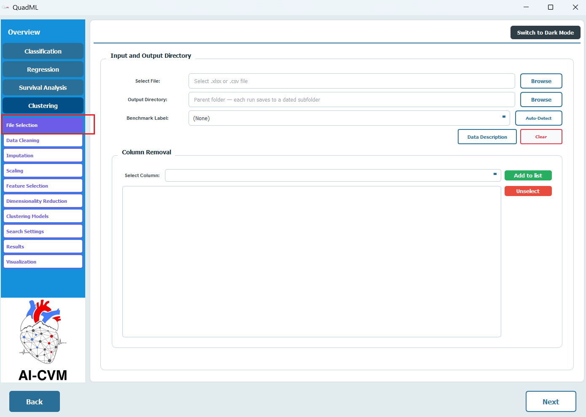
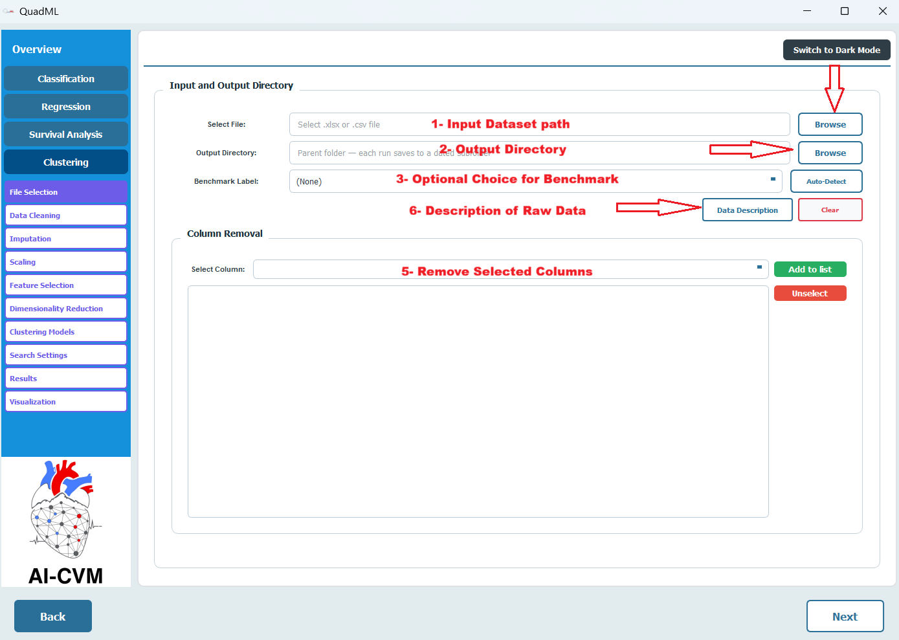

# Clustering — File selection

This step is for loading your unlabeled dataset and choosing the **Output Directory** where QuadML saves run results, plus optional Column Removal and **Benchmark Label**. There is no External Test Data and no ID Column picker. **Benchmark Label** can score ARI / NMI / FMI after clustering; it is **not** used for training or for ranking pipelines, leave **(None)** unless you want those reference metrics. Prefer mostly numeric features.

## Controls

| Control | What it does | When to use it |
|---------|--------------|----------------|
| **Select File** | Loads the main dataset | Always |
| **Output Directory** | Parent folder for dated run outputs | Always |
| **Benchmark Label** | Known class column for ARI / NMI / FMI only | Optional external validation of clusters |
| **Column Removal** | Drops listed columns at Start | IDs, text, unused columns |
| **Data Description** / **Clear** | Summary / reset | As needed |

## Common mistakes

- Starting without an Output Directory  
- Treating Benchmark Label as a training target  
- Leaving ID / text columns in as features  
