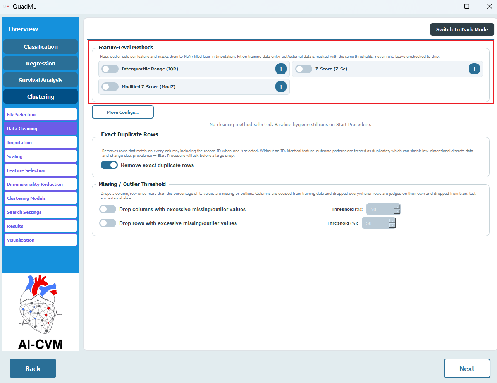
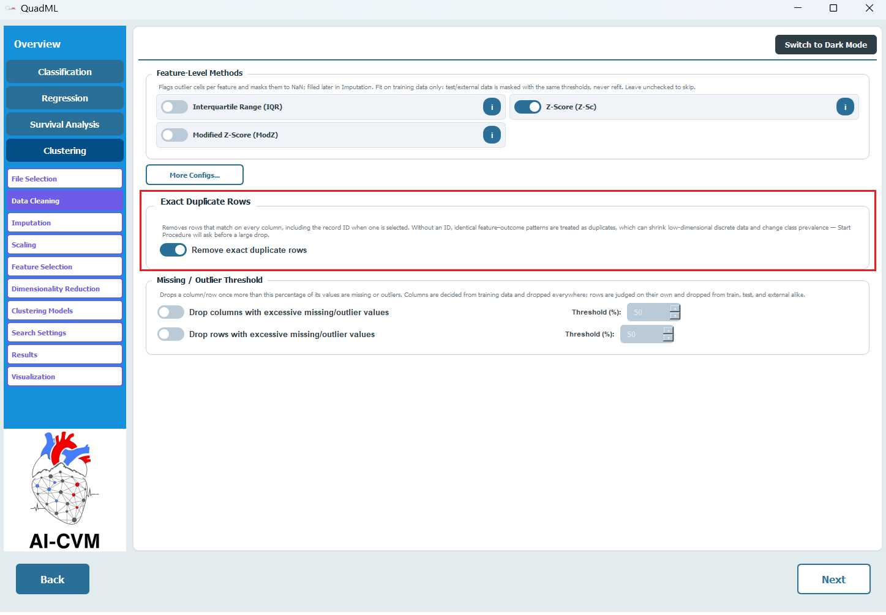

# Clustering — Data Cleaning

**Where**: Clustering → **Data Cleaning**

**Data Cleaning** prepares the dataset before clustering: optional feature-level outlier handling, exact-duplicate removal, and missing/outlier thresholds. Choices here multiply with later Imputation / Scaling / models in the search. Cleaning does **not** run when you change a method card — it runs when you click **Start Procedure**.

## Clustering-only rules

- Sample-level outlier methods (Isolation Forest, Local Outlier Factor, DBSCAN, One-Class SVM) are removed in clustering. Only **None** and feature-level methods are available.
- The **Correlation Analysis** panel on this page is also removed in Clustering (correlation filtering for features lives under Feature Selection → **Correlation Thresholding** instead).
- **Exact Duplicate Rows** and **Missing / Outlier Threshold** remain visible and apply in Clustering.

## When to use it

**Attention**: If you do not choose any cleaning method, that means **None**.

- Use **None** on clean data (baseline hygiene still runs).
- Use a **feature-level** method to flag extreme **cells** (filled later in Imputation).

---

## Methods

### None

Leaving every method card unselected is **None**: QuadML skips outlier detectors. The status line reads **No cleaning method selected**. Baseline hygiene still runs on **Start Procedure**: it removes rows whose features are all missing (and applies Exact Duplicate Rows / Missing / Outlier Threshold when those controls are enabled).

### Feature-level methods

| Method | Behaviour |
|--------|-----------|
| Interquartile Range | Per-feature IQR fences (default multiplier \(k = 1.5\)) |
| Z-Score | Per-feature z-score fences |
| Modified Z-Score | Robust (median-based) fences |

Outlier **cells** become missing and are handled on **Imputation**.

---

## What to click

1. Choose a method from the method cards (or leave all off for **None**).
2. Click **i** on a card for parameters, defaults, advantages, and disadvantages.
3. Open **More Configs** for feature-level methods when needed. Dropping columns or rows with excessive missing or outlier values is configured under **Missing / Outlier Threshold** below — it applies regardless of which cleaning method you pick.

### Exact Duplicate Rows

**Remove exact duplicate rows** is on by default. After **Start Procedure**, QuadML removes rows that match on every column and keeps the first occurrence of each unique row.

Clustering has no ID Column picker, so duplicates are judged on the full remaining dataset (after Column Removal). On low-dimensional discrete data, identical feature patterns can collapse many rows; if removal would drop a large share of rows, **Start Procedure** may ask for confirmation. Turn the toggle off to keep duplicate rows in place.

### Missing / Outlier Threshold

Optional toggles (**both off** by default):

- Drop columns with excessive missing/outlier values
- Drop rows with excessive missing/outlier values

Each has a **Threshold (%)** (default often **50**). A column/row is dropped when more than that percentage of its values are missing — or, after a feature-level method, outlier cells cleared to NaN. With cleaning method **None**, only true missing values count. Applies to the whole Clustering dataset (no Train/Test split). Never drops every column or every row.

---

## What is written to disk

After **Start Procedure**, the run folder includes cleaned data (for example `cleaned_data.csv`). Cluster assignment exports keep sample IDs aligned to rows that survived cleaning.

---

## Common mistakes

- Looking for Isolation Forest / LOF in Clustering (they are intentionally hidden)
- Looking for Correlation Analysis on this page (hidden in Clustering — use FS → Correlation Thresholding)
- Expecting the on-screen data preview to change before **Start Procedure**
- Leaving Exact Duplicate Rows on for discrete datasets where many rows share the same feature pattern
