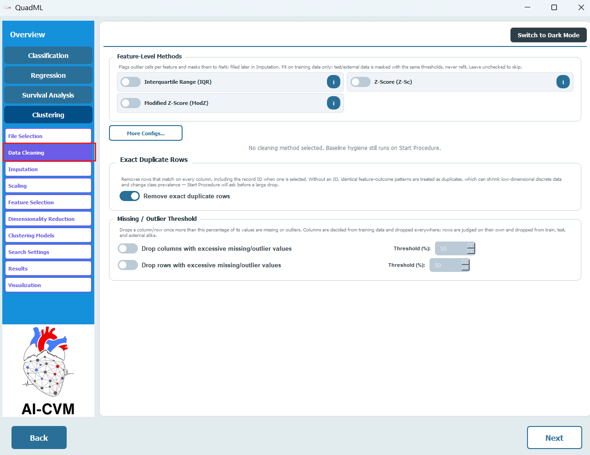

# Clustering — Data cleaning

**Where**: Clustering → **Data Cleaning**

Optional outlier / duplicate handling before clustering.

--8<-- "_snippets/data-cleaning.md"

**Task notes:** Sample-level outlier methods (Isolation Forest, LOF, DBSCAN, One-Class SVM) and **Correlation Analysis** are **hidden**. **Exact Duplicate Rows** and **Missing / Outlier Threshold** remain.

## Common mistakes

- Expecting the preview to change before **Start Procedure**
- Feature-level cleaning without Imputation for new NaNs
- Low correlation thresholds that drop many useful features
