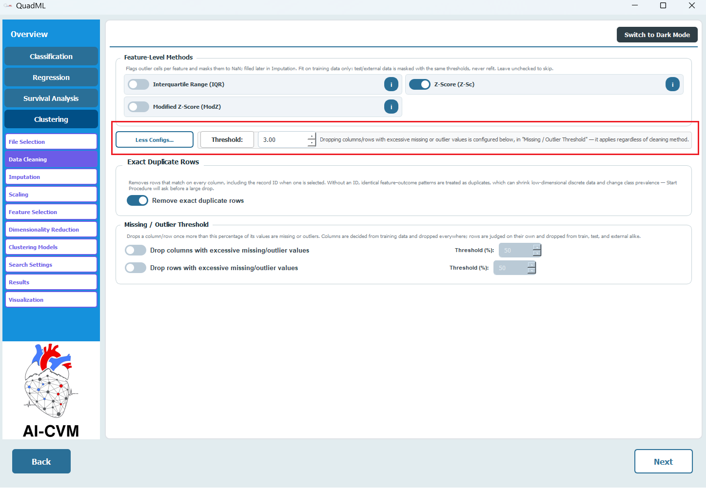
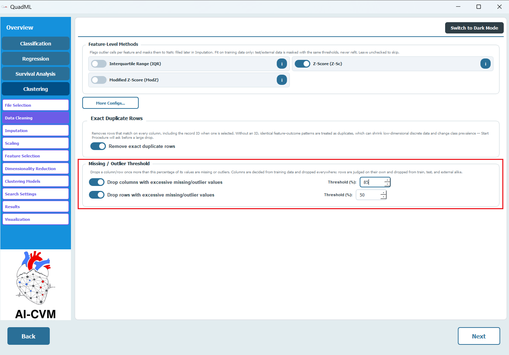

# Clustering — Data cleaning

Choose how QuadML detects and handles outliers before clustering. Feature-level methods (IQR, Z-Score, Modified Z-Score) mask extreme cells as missing so Imputation can fill them later. You can also enable exact-duplicate removal and missing/outlier column or row thresholds. Selecting no method card means **None** (baseline hygiene only). Cleaning is applied at **Start Procedure**, not when you move to the next step.

## Methods

| Method | What it does | When to use it |
|--------|--------------|----------------|
| **None** | No outlier detector; baseline hygiene only | Clean data; first baseline |
| **Interquartile Range** | Flags extreme cells with IQR fences | Classic univariate outliers |
| **Z-Score** | Flags cells far from the mean | Roughly Gaussian features |
| **Modified Z-Score** | Robust median-based fences | Skewed features / outliers |

Feature-level methods turn outlier **cells** into missing values (filled later by Imputation). Optional on this page: **Exact Duplicate Rows** and **Missing / Outlier Threshold**.

**More Configs…** opens thresholds for the selected feature-level method (for example Z-Score):

**Exact Duplicate Rows** removes rows that match on every column:

**Missing / Outlier Threshold** drops columns or rows whose share of missing or outlier values exceeds the percentage you set:

## Common mistakes

- Expecting the preview to change before **Start Procedure**
- Feature-level cleaning without Imputation for new NaNs
- Looking for Isolation Forest / LOF / Correlation Analysis on this page (hidden in Clustering)
