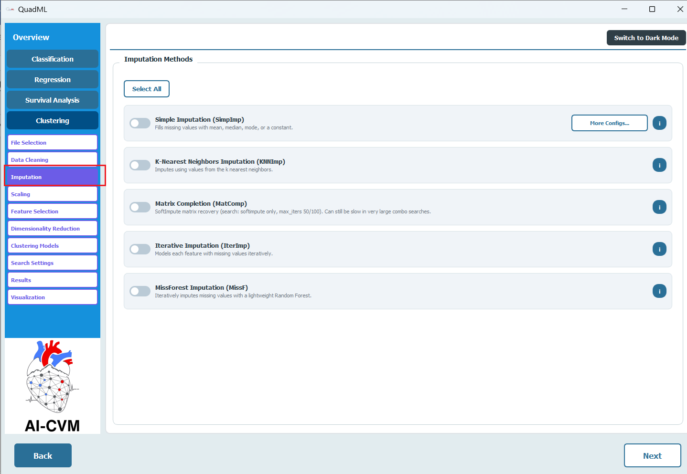
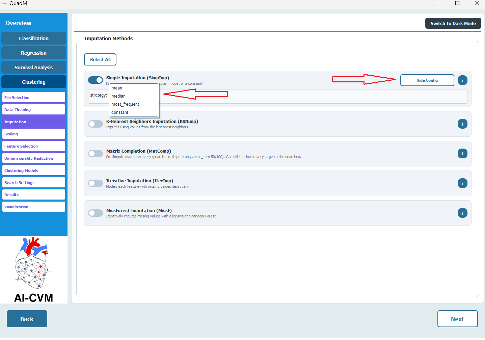

# Clustering — Imputation

Imputation fills in missing values, including those created by Data cleaning, so that every model receives a complete dataset. It is fit on the prepared clustering data (there is no Train/Test split). Choose one or more imputers (Simple, KNN, Matrix Completion, Iterative, MissForest); only **Simple Imputation** exposes **More Configs** for the fill strategy (default **median**). Enable only what you need because each extra imputer multiplies the search.

--8<-- "_snippets/imputation.md"

**More Configs…** on Simple Imputation opens the strategy options (mean, median, most_frequent, constant):

## Common mistakes

- Assuming **mean** is the Simple Imputation default while QuadML default is **median**
- Feature-level cleaning without any imputer for the missing values it creates
