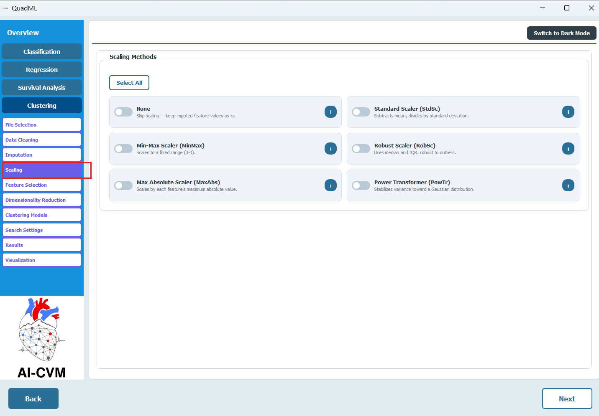
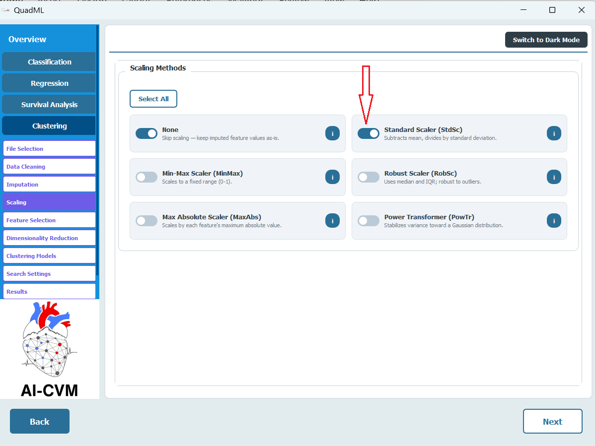
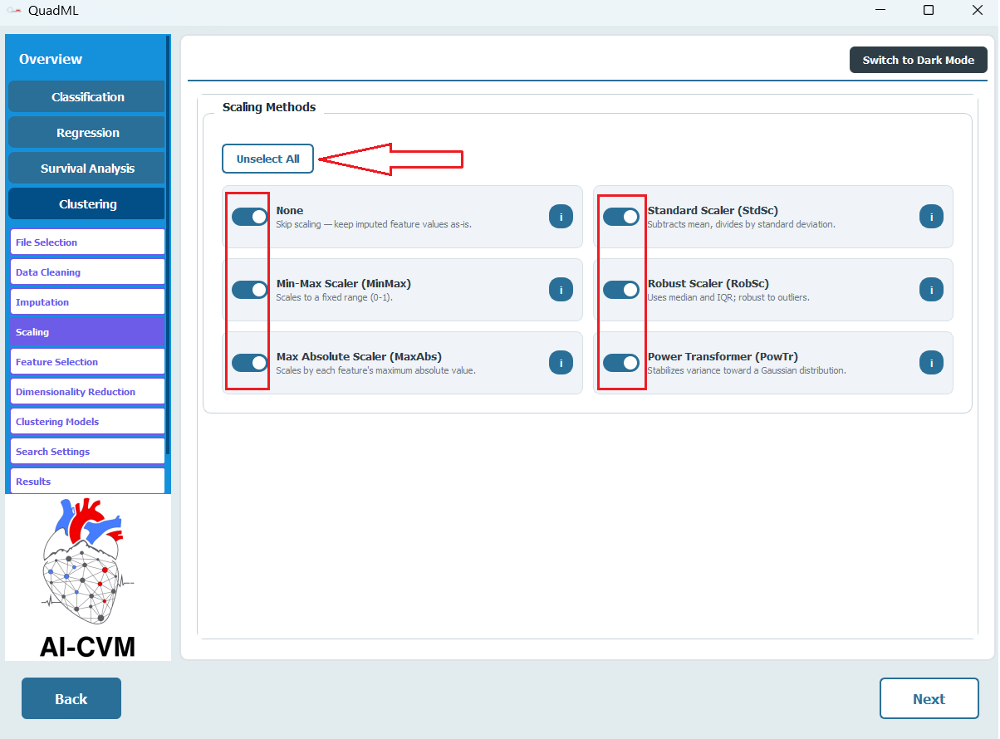

# Clustering — Scaling

**Where**: Clustering → **Scaling**

**Scaling** rescales imputed feature columns before Feature Selection, Dimensionality Reduction, and the clustering model. Each checked method (including **None**) becomes part of the combinatorial search. Distance-based clustering (**K-Means**, **DBSCAN**, …) usually needs scaling.

---

## Methods

| Method | Short idea |
|--------|------------|
| **None** | Skip scaling; keep imputed values as-is |
| **Standard Scaler** | Mean 0, variance 1 |
| **Min-Max Scaler** | Scale to a fixed range |
| **Robust Scaler** | Center/scale with robust statistics (median / IQR) |
| **Max Absolute Scaler** | Scale by max absolute value |
| **Power Transformer** | Stabilize variance / reduce skew (search may tune yeo-johnson / box-cox) |

**Not shown in Clustering:** Quantile Transformer, Normalizer.

Selecting **None** keeps the imputed feature values unchanged for that pipeline branch.

For a first run, enable **Standard Scaler** (and optionally **None** as a no-scale baseline). Avoid checking every scaler on a large search.

---

## What to click

1. Toggle the scaling method cards to include in the search (at least **None** or one scaler).
2. Click **i** on a card for how it works, defaults, pros/cons, and a library link.
3. Use **Select All** / **Unselect All** if you need to manage many cards at once.

There is no user **More Configs** panel for scaling on this page. Where a method has tunable options (Power Transformer), Search Settings explores them during the search.

---

## What is written to disk

The fitted scaler is stored inside the saved pipeline. Results labels use short codes such as `StdSc` or `No scaling`.

---

## Common mistakes

- Running K-Means / DBSCAN without scaling on mixed-scale features
- Looking for Quantile Transformer / Normalizer in Clustering (intentionally omitted)
- Selecting every scaler on the first run
