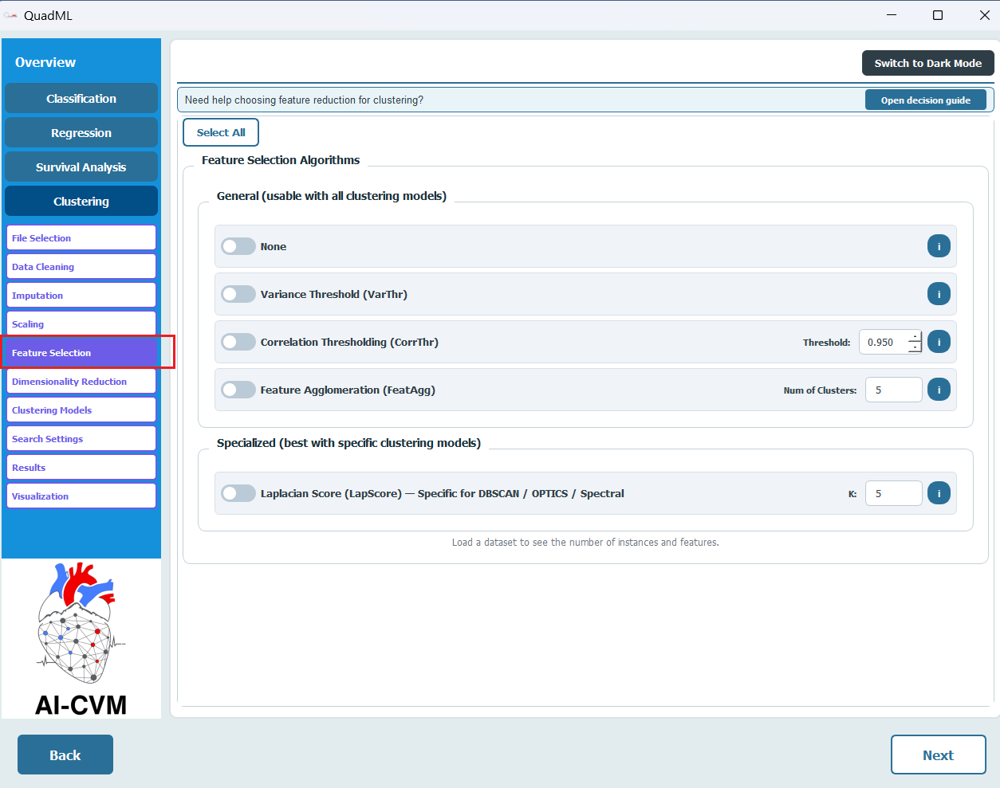

# Clustering — Feature selection

Feature selection keeps the most useful original features and drops the rest. Unlike Dimensionality reduction, it doesn't create new features, so the selected ones stay interpretable. Each selected method is combined with each Dimensionality reduction method in the search, so the number of runs grows quickly. Clustering shows unsupervised selectors only (no label-based methods). Feature selection is fit on the prepared clustering data (there is no Train/Test split). For most methods, the main parameter can be set in the method's settings, for example a correlation threshold, number of feature clusters, or Laplacian *k*.

## Methods

| Method | What it does | When to use it |
|--------|--------------|----------------|
| **None** | Keeps every feature as-is | Small feature counts; full-feature baseline |
| **Variance Threshold** | Drops features that barely change across samples | Near-constant columns |
| **Correlation Thresholding** | Drops one feature from each highly correlated pair above a threshold | Redundant feature pairs |
| **Feature Agglomeration** | Groups similar features into a smaller set | Wide data; cluster features, not rows |
| **Laplacian Score** | Ranks features by neighbourhood structure (best with DBSCAN / OPTICS / Spectral) | Density / spectral pipelines; forces DR to **None** |

General methods work with all clustering models; **Laplacian Score** is specialized for DBSCAN / OPTICS / Spectral:

If **Laplacian Score** is selected, Dimensionality Reduction must be **None**.

## Tips

- Keep **None** enabled if you want a full-feature baseline to compare against
- Set thresholds and *k*-style options in each method's settings before you start

## Common mistakes

- Turning off **None** when you still want a full-feature baseline
- Pairing **Laplacian Score** with PCA or another DR method
- Looking for supervised selectors (Select K Best, RFE, Boruta, …) on this page
- Confusing this step with PCA (that is Dimensionality Reduction)
