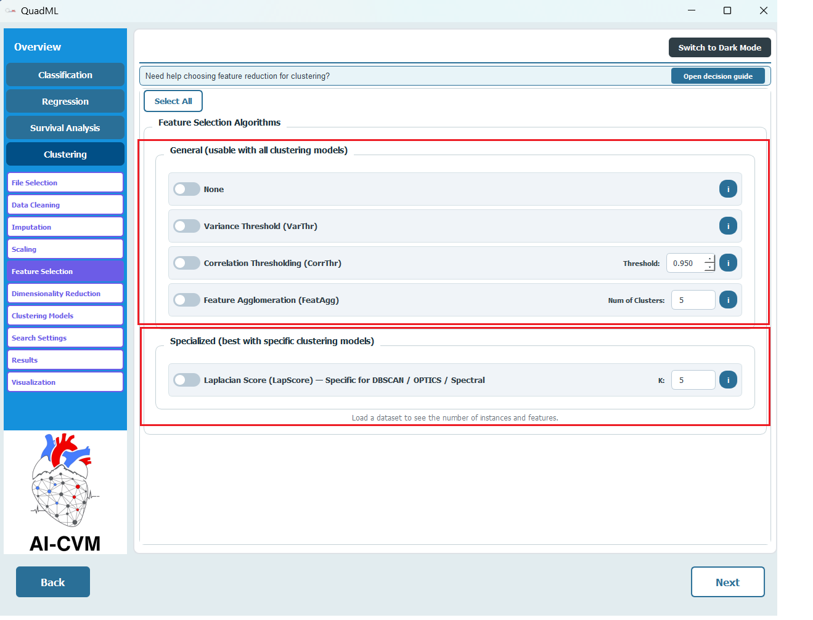

# Clustering — Feature Selection

**Where**: Clustering → **Feature Selection**

**Feature Selection** ranks or drops **original** feature columns using **unsupervised** methods (no target). It is crossed with every checked Dimensionality Reduction method on the next page (FS × DR). DR methods such as PCA are **not** chosen here — they belong on **Dimensionality Reduction**.

**None** means keep all eligible features after imputation and scaling (skip selection).

---

## Methods available in Clustering

### General

| Method | Short idea |
|--------|------------|
| **None** | Keep every eligible feature |
| **Variance Threshold** | Drop low-variance features |
| **Correlation Thresholding** | Drop highly correlated features (Clustering-oriented) |
| **Feature Agglomeration** | Merge similar features |

### Specialized

| Method | Short idea |
|--------|------------|
| **Laplacian Score** | Neighbourhood-preserving score; UI notes it is specific for DBSCAN / OPTICS / Spectral |

Supervised selectors (Select K Best, RFE, Boruta, Lasso, …) are **not** on the Clustering FS page.

### Important rule: Laplacian Score + DR

If **Laplacian Score** is selected, Dimensionality Reduction must be **None** (DR afterward would break the neighbourhood structure). Invalid FS × DR pairs are rejected by the search.

---

## What to click

1. Toggle the methods to include. Keep **None** as a baseline unless the feature count makes a full-feature search too expensive.
2. Click **i** on a method for a plain-language description and link.
3. Use **More Configs** where available.
4. **Select All** on this page toggles Feature Selection methods only — it does not toggle Dimensionality Reduction cards on the next page.

Every selected FS method is crossed with every selected DR method (except invalid Laplacian + non-None DR pairs).

---

## What is written to disk

Selected-feature / transformed matrices live in the dated run folder for Visualization and Results.

---

## Common mistakes

- Looking for Select K Best / Boruta in Clustering (supervised — not available here)
- Pairing **Laplacian Score** with PCA / ICA / Kernel PCA
- Confusing Correlation Thresholding (this page) with the hidden Correlation Analysis on Data Cleaning
