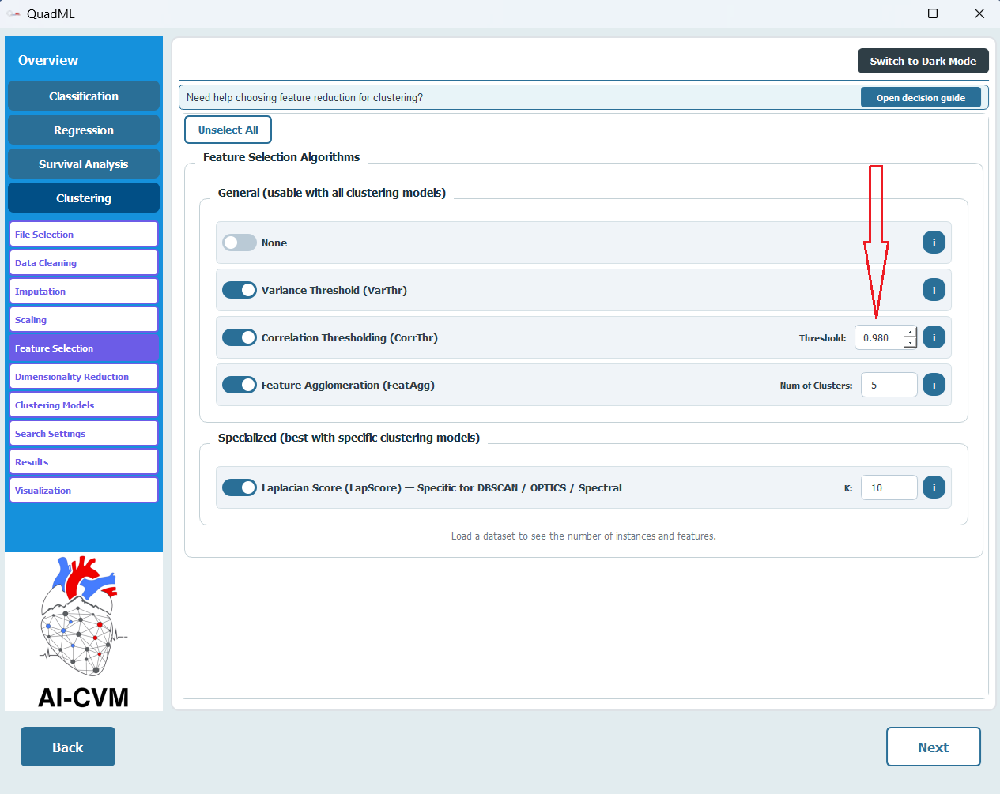

# Clustering — Feature selection

Chooses which **original** feature columns to keep by unsupervised filtering or agglomeration or keeps all of them (**None**). Unlike Dimensionality Reduction, it does not create new components; each selected method is crossed with DR in the search (FS × DR). Clustering shows unsupervised selectors only. Prefer **None** when the feature count is small; enable only what you need because each extra method multiplies the search.

## Methods

| Method | Group | What it does | When to use it |
|--------|-------|--------------|----------------|
| **None** | General | Keeps every eligible feature | Small or medium feature counts; full-feature baseline |
| **Variance Threshold** | General | Drops near-constant features | Low-information columns |
| **Correlation Thresholding** | General | Drops highly correlated features above a threshold | Redundant feature pairs |
| **Feature Agglomeration** | General | Groups similar features into a smaller set | Wide data; cluster features, not rows |
| **Laplacian Score** | Specialized | Ranks features by neighbourhood structure (DBSCAN / OPTICS / Spectral) | Density / spectral pipelines; forces DR to **None** |

General methods work with all clustering models; **Laplacian Score** is specialized for DBSCAN / OPTICS / Spectral:

Per-method settings (for example Correlation **Threshold**, Feature Agglomeration **Num of Clusters**, Laplacian **k**) and **Unselect All**:

If **Laplacian Score** is selected, Dimensionality Reduction must be **None**.

## Common mistakes

- Turning off **None** when you still want a full-feature baseline
- Pairing **Laplacian Score** with PCA or another DR method
- Looking for supervised selectors (Select K Best, RFE, Boruta, …) on this page
- Confusing this step with PCA (that is Dimensionality Reduction)
