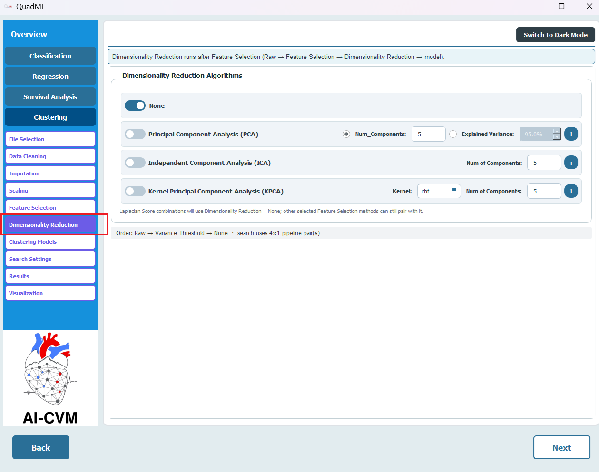

# Clustering — Dimensionality reduction

Compresses the features kept by Feature Selection into fewer components or leaves those columns unchanged (**None**). Each FS method is crossed with each DR method in the search (FS × DR). **LDA is not available** here (Classification only). Enable only what you need because each extra method multiplies the search. If Feature Selection is **Laplacian Score**, DR is forced to **None** for that combination.

## Methods

| Method | What it does | When to use it |
|--------|--------------|----------------|
| **None** | No projection | Default first choice; required with Laplacian Score |
| **PCA** | Linear principal components | Correlate/compress numeric features |
| **ICA** | Independent components | Separating mixed signals |
| **Kernel PCA** | Nonlinear components | Nonlinear structure |

Choose methods and set options. For example PCA component count or explained variance, ICA components, and the Kernel PCA kernel:

## Common mistakes

- Looking for **LDA** on this page (Classification only)
- Many DR methods without a **None** baseline
- Pairing **Laplacian Score** with PCA, ICA, or Kernel PCA
