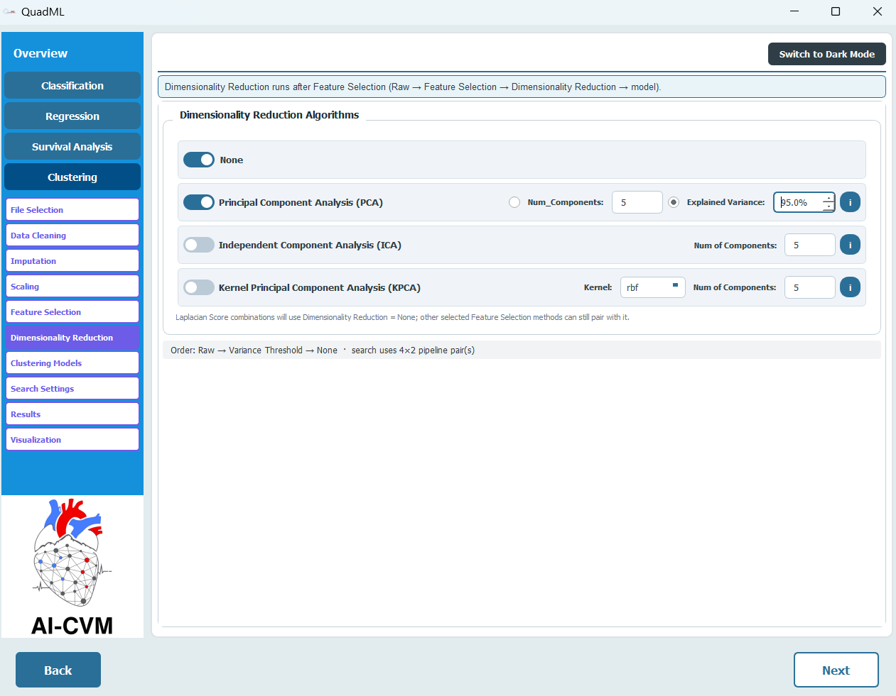

# Clustering — Dimensionality Reduction

**Where**: Clustering → **Dimensionality Reduction**

**Dimensionality Reduction (DR)** compresses the features that remain **after** Feature Selection into a smaller space (or leaves them unchanged). Order in the pipeline is: `Imputation → Scaling → Feature Selection → Dimensionality Reduction → Clustering model`. Every checked FS method is crossed with every checked DR method (FS × DR), except invalid Laplacian Score + non-None DR pairs.

**None** means no extra projection for that pipeline branch. **LDA is not available** in Clustering (needs labels; Classification-only).

---

## Methods

| Method | Short form | Notes |
|--------|------------|--------|
| **None** | None | Skip DR; cluster in selected original features |
| **Principal Component Analysis** | PCA | Unsupervised linear components (`PC1`, `PC2`, …) |
| **Independent Component Analysis** | ICA | Unsupervised independent components |
| **Kernel Principal Component Analysis** | KPCA | Nonlinear kernel PCA |

If Feature Selection is **Laplacian Score**, leave DR on **None**.

For a first run, keep **None** (and add PCA only if you already know you want components).

---

## What to click

1. Toggle the DR methods to include. Prefer **None** unless you intend to search compressed spaces.
2. Click **i** for method notes, defaults, and library links.
3. Use the on-card controls where shown (number of components, explained variance for PCA, kernel for KPCA).

---

## What is written to disk

Component transformers are stored with each combination’s pipeline. Results labels use `PCA`, `ICA`, `KPCA`, or `No DR`.

**Visualization → Reduced Components** shows this same DR space; **Feature Space** shows the selected/scaled features (or pre-DR features when DR was used). Density-role plots (Core / Border / Noise) also use this clustering space with the same axis picker — not a separate viz-only PCA.

---

## Common mistakes

- Looking for **LDA** in Clustering (Classification-only)
- Forcing PCA after **Laplacian Score**
- Confusing Feature Selection (rank/drop original columns) with DR (project into components)
