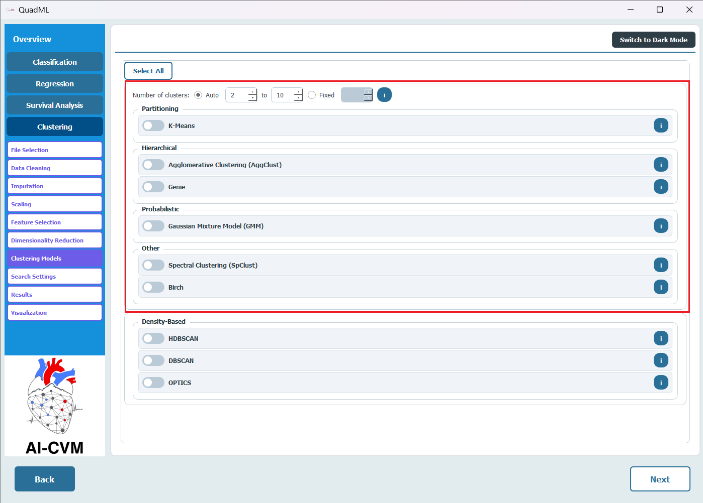
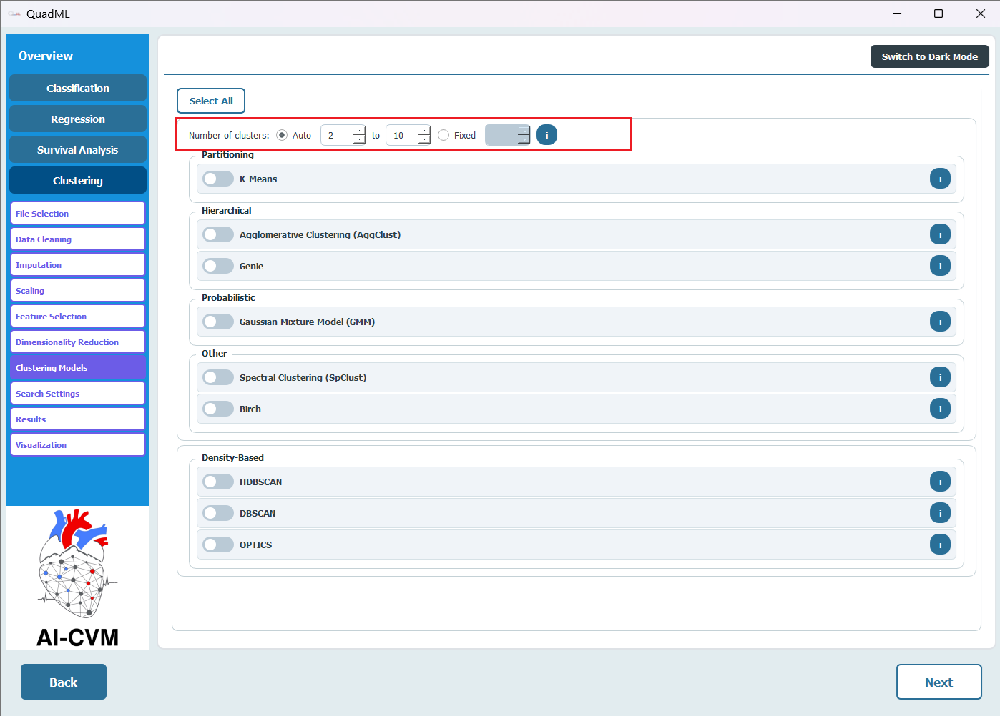

# Clustering — Models

Chooses clustering algorithms that assign rows to cohorts. Each selected model is trained and evaluated in the search and is crossed with every Imputation × Scaling × Feature Selection × Dimensionality Reduction combination you enabled, so the total number of pipelines is a product of those choices. Enable only what you need because each extra model multiplies the search. Hyperparameters are explored on **Search Settings** and during search.

## Models

| Model | Panel | How it works | Short code |
|-------|-------|--------------|------------|
| K-Means | Partitioning | Partitions rows into *k* centroid clusters | K-Means |
| Agglomerative Clustering | Hierarchical | Merges nearest clusters bottom-up | AggClust |
| Genie | Hierarchical | Hierarchical clustering with a Gini-based linkage | Genie |
| Gaussian Mixture Model | Probabilistic | Soft clusters from Gaussian components | GMM |
| Spectral Clustering | Other | Clusters in a graph embedding | SpClust |
| Birch | Other | Incremental tree of clustering feature subclusters | Birch |
| HDBSCAN | Density-Based | Hierarchical density-based clusters | HDBSCAN |
| DBSCAN | Density-Based | Density clusters with noise label −1 | DBSCAN |
| OPTICS | Density-Based | Ordering points to identify density structure | OPTICS |

Cluster-count models (**Partitioning**, **Hierarchical**, **Probabilistic**, **Other**) share the **Number of clusters** control:

## Number of clusters

| Mode | Behaviour |
|------|-----------|
| **Auto** (default) | Tries integers in a size-scaled min–max range; centroid models pick by Silhouette / CH / DB rank; GMM by BIC |
| **Fixed** | One *k* / component count; other hyperparameters still searched |

**Density-Based** models (**HDBSCAN / DBSCAN / OPTICS**) ignore Number of clusters. Density parameters are derived during search, not typed on the Models page.

**Point:** First run: **K-Means** only with **Auto**. **Genie** needs optional `genieclust`. **Spectral** and **Genie** can be expensive on large data.

## Common mistakes

- Expecting Density-Based models to obey Number of clusters
- Looking for per-card ε / min_samples controls (they are data-derived in search)
- Enabling Spectral + Genie on a huge dataset for a first run
