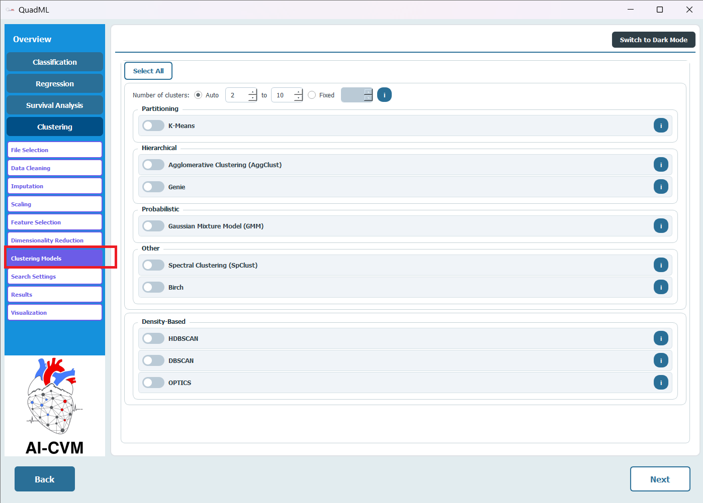

# Clustering — Models

**Where**: Clustering → **Clustering Models**

Choose clustering algorithms to search. Each checked model is crossed with every Imputation × Scaling × FS × DR combination you enabled.

Two panels: **cluster-count** models (shared Auto / Fixed *k*) and **Density-Based** (ignore *k*).

## Models

| Model | How it works | Short code |
|-------|--------------|------------|
| K-Means | Partitions rows into *k* centroid clusters | K-Means |
| Agglomerative Clustering | Merges nearest clusters bottom-up | AggClust |
| Genie | Hierarchical clustering with a Gini-based linkage | Genie |
| Gaussian Mixture Model | Soft clusters from Gaussian components | GMM |
| Spectral Clustering | Clusters in a graph embedding | SpClust |
| Birch | Incremental tree of clustering feature subclusters | Birch |
| HDBSCAN | Hierarchical density-based clusters | HDBSCAN |
| DBSCAN | Density clusters with noise label −1 | DBSCAN |
| OPTICS | Ordering points to identify density structure | OPTICS |

## Number of clusters

| Mode | Behaviour |
|------|-----------|
| **Auto** (default) | Tries integers in a size-scaled min–max range; centroid models pick by Silhouette / CH / DB rank; GMM by BIC |
| **Fixed** | One *k* / component count; other hyperparameters still searched |

Density-Based models (**HDBSCAN / DBSCAN / OPTICS**) ignore Number of clusters. Density parameters are derived during search, not typed on the Models page.

**Tip:** First run: **K-Means** only with **Auto**. **Genie** needs optional `genieclust`. **Spectral** can be expensive on large data.

## Common mistakes

- Expecting Density-Based models to obey Number of clusters  
- Looking for per-card ε / min_samples controls (they are data-derived in search)  
- Enabling Spectral + Genie on a huge dataset for a first run  
