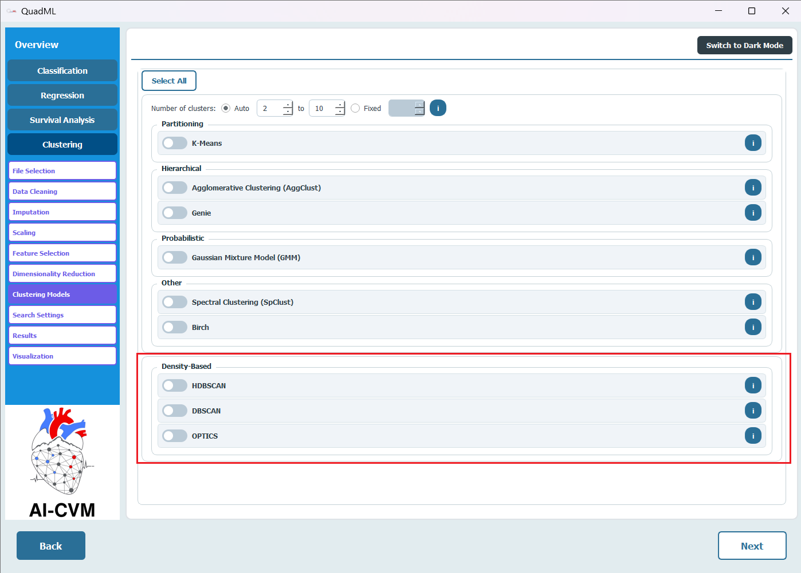
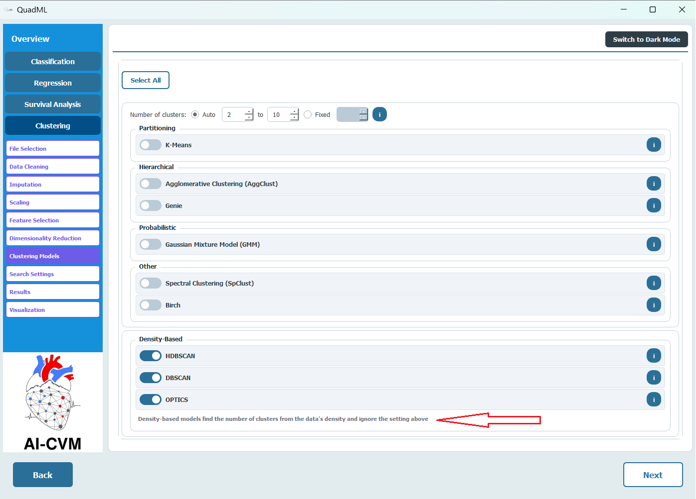
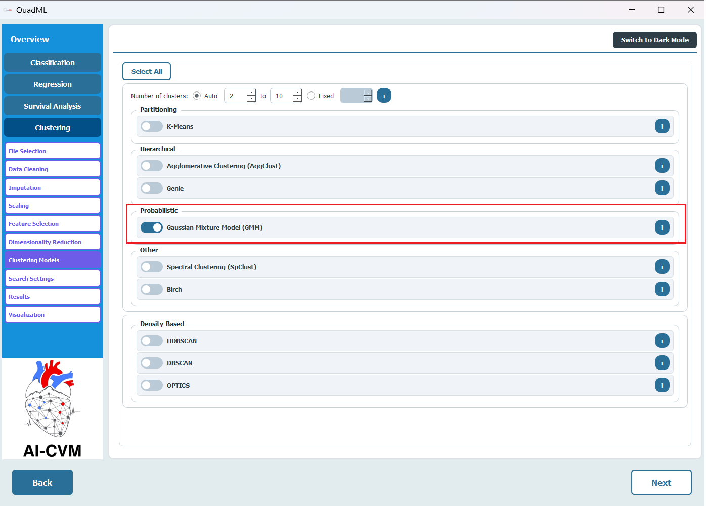
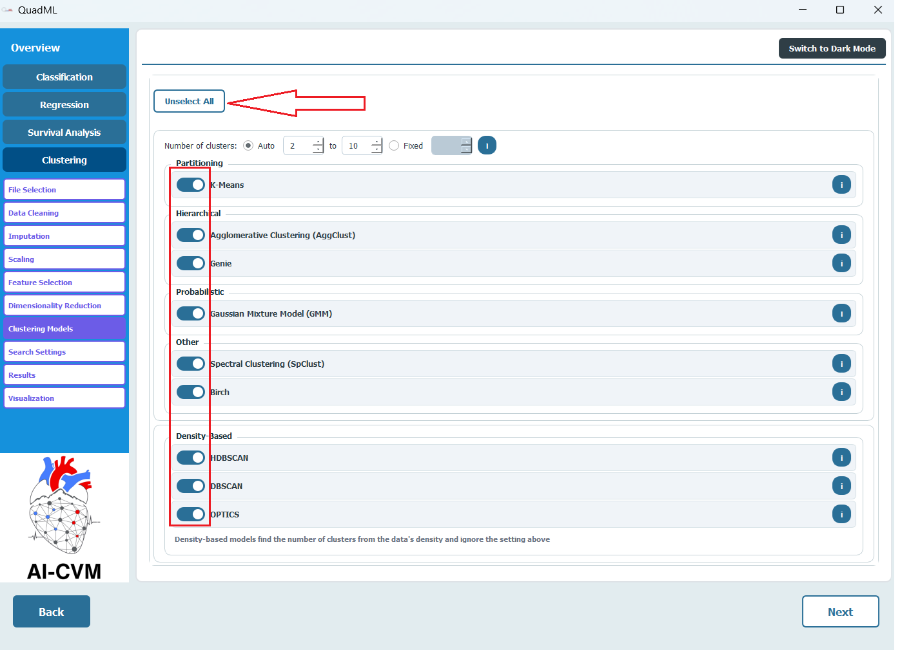

# Clustering — Clustering Models

**Where**: Clustering → **Clustering Models**

**Clustering Models** are the algorithms that assign rows to groups. Check one or more models; each checked model is crossed with every Imputation × Scaling × Feature Selection × Dimensionality Reduction combination you enabled earlier. Hyperparameters are explored later on **Search Settings**, not typed by hand as the main workflow on this page.

The page is a **two-panel** layout:

- **Cluster-count panel** — shared **Number of clusters** (Auto / Fixed) plus Partitioning / Hierarchical / Probabilistic / Other
- **Density-Based panel** — HDBSCAN / DBSCAN / OPTICS only (no *k* control)

For a first run: **K-Means** only with **Auto** cluster count — or keep the three defaults (K-Means, Agglomerative, DBSCAN) if the dataset is small.

---

## Models (GUI names)

| GUI name | Short code | Panel / section |
|----------|------------|-----------------|
| K-Means | K-Means | Cluster-count → Partitioning |
| Agglomerative Clustering | AggClust | Cluster-count → Hierarchical |
| Genie | Genie | Cluster-count → Hierarchical |
| Gaussian Mixture Model | GMM | Cluster-count → Probabilistic |
| Spectral Clustering | SpClust | Cluster-count → Other |
| Birch | Birch | Cluster-count → Other |
| HDBSCAN | HDBSCAN | Density-Based |
| DBSCAN | DBSCAN | Density-Based |
| OPTICS | OPTICS | Density-Based |

---

## Number of clusters (cluster-count panel)

At the top of the upper panel (below Select All):

**Number of clusters:** Auto [min] to [max] · Fixed [value]

Applies once to every model in the cluster-count panel (K-Means, Agglomerative, Genie, GMM components, Spectral, Birch).

| Mode | Behaviour |
|------|-----------|
| **Auto** (default) | Search tries every integer from min to max (default range scales with dataset size: roughly \(2 \ldots \lceil\sqrt{n/2}\rceil\), at least up to 10). Among those candidates, centroid / hierarchical models pick by average rank of Silhouette, Calinski–Harabasz, and Davies–Bouldin (Silhouette breaks ties). GMM picks by BIC. |
| **Fixed** | Pin one count / component value; other hyperparameters still searched |

Does **not** apply to the Density-Based panel. When any of HDBSCAN / DBSCAN / OPTICS is checked, a notice appears under that panel:

> Density-based models find the number of clusters from the data’s density and ignore the setting above

---

## Density-Based panel (no eps / min_samples controls)

DBSCAN, OPTICS, and HDBSCAN have no Auto / Fixed ε or min_samples controls on the Models cards. Density parameters are derived during search from the prepared feature matrix:

| Model | How parameters are set |
|-------|------------------------|
| DBSCAN | eps from scales × the k-distance knee (0.5–1.0×); min_samples from feature count (dimension-scaled, capped by row count) |
| OPTICS | min_samples dimension-scaled; xi / min_cluster_size sampled; reachability built once per discrete point |
| HDBSCAN | min_cluster_size (and related) searched; no eps to tune |

Candidates must pass validity filters (at least 2 clusters, min cluster size ≥ 3, noise ≤ 50%). Among valid draws, search prefers ≤ 30% noise and ≤ 90% of rows in the largest cluster, then ranks by **DISCO** (Beer et al., ICLR 2026). Noise points get label −1.

Click **i** on each card for catalog metrics, live search grids, and density/count help.

---

## GMM note

**Gaussian Mixture Model** selects hyperparameters by **BIC**. Imputation / scaling hyperparameter search is skipped for GMM so BIC compares on fixed impute/scale defaults (your chosen methods still apply; their extra HP grids do not).

---

## What to click

1. Toggle models to include (or **Select All** on enabled cards carefully).
2. Set **Number of clusters** Auto range or Fixed once for all count-based models.
3. If any Density-Based model is on, read the notice under that panel — it ignores Number of clusters.
4. Continue to **Search Settings** to run.

**Genie** requires the optional `genieclust` package; the card is disabled if missing.

---

## What is written to disk

Assignments, profiles, transformed features, and fitted models live in the dated run folder.

---

## Common mistakes

- Looking for per-model Auto / Fixed cluster-count or DBSCAN ε / min_samples on each card (page-level bar / data-derived search)
- Expecting Density-Based models to obey **Number of clusters**
- Enabling Spectral Clustering and Genie on a huge dataset for a first run (can be expensive)
- Expecting a fixed *K* on DBSCAN / OPTICS / HDBSCAN
