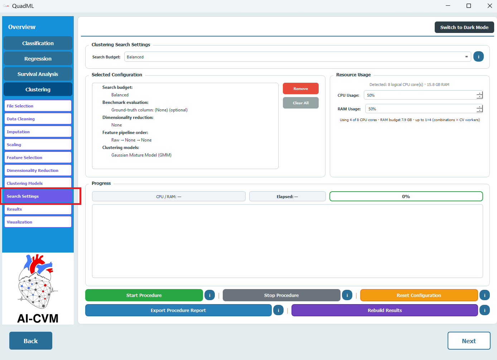
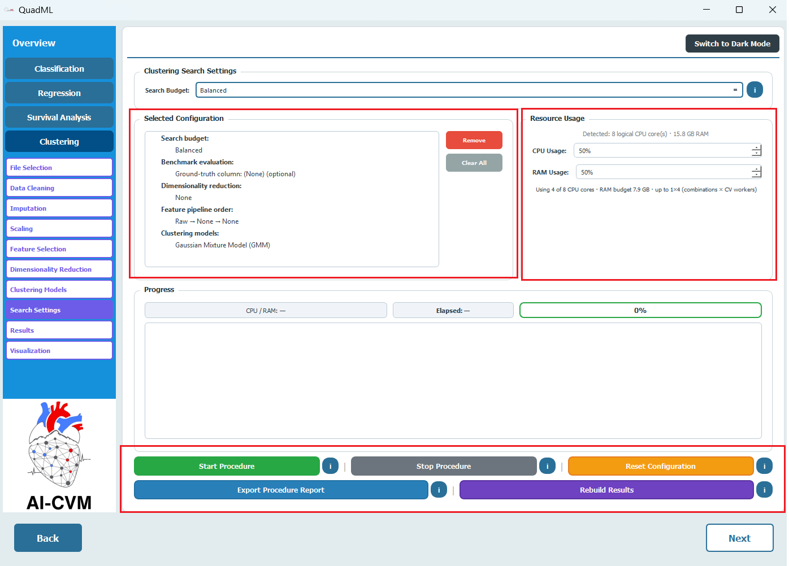

# Clustering — Search settings

Sets how QuadML searches the pipeline and model combinations you enabled earlier, then starts the run with **Start Procedure**. Choose a **Search Budget** (Fast / Balanced / Thorough) and CPU/RAM limits; review the selected configuration tree before you start. **Search Settings** replaces Parameter Tuning in other modes. There is **no** Train/Test split, Bootstrap CI panel, imbalance panel, or CV fold control on this page. Clustering evaluates unsupervised internal metrics on the prepared data. Use **Stop** to cancel and keep partial outputs in the output run folder.

--8<-- "_snippets/search-run.md"

Search Budget options (**Fast** / **Balanced** / **Thorough**):

Selected configuration tree, **Resource Usage**, and **Start** / **Stop** / **Reset** / **Export** / **Rebuild Results**:

--8<-- "_snippets/start-stop-resources.md"

## How winners are chosen

| Model family | Hyperparameter selection |
|--------------|--------------------------|
| Centroid / hierarchical / Spectral / Birch | Average rank of Silhouette Up, CH Up, Davies–Bouldin Down |
| Gaussian Mixture Model | BIC (lower better) |
| DBSCAN / OPTICS / HDBSCAN | Validity filters → **DISCO** (higher better); DBCV reported only |

There is **no** automatic best model across paradigms. Compare sizes, noise, DISCO / BIC, and domain knowledge.

**Point:** Check the configuration tree before Start.

## Common mistakes

- Starting with every method checked — combination count is a product
- Ignoring Resource Usage on large searches
- Changing File Selection roles after configuring without re-checking the tree
- Closing the app instead of **Stop**
- Setting CPU/RAM to 100% on a machine you still need for other work
- Starting again without noticing a new dated folder was created
