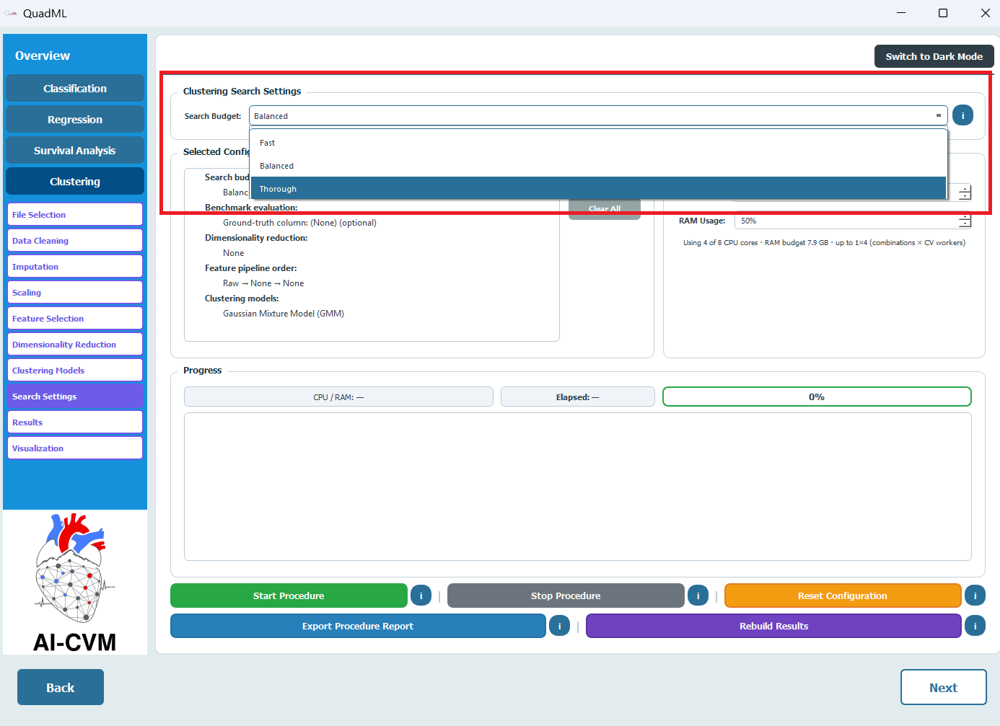

# Clustering — Search Settings

**Where**: Clustering → **Search Settings**

**Search Settings** is Clustering’s run page. Classification / Regression / Survival use **Parameter Tuning** instead. Cross-validation fold controls are removed here (unsupervised search). There is **no** Bootstrap CI panel and **no** class-imbalance panel.

---

## What to click

1. **Search Budget:** Fast / Balanced / Thorough — scales each model’s discrete grid richness and continuous-draw budget. It does **not** remove methods you already checked.
2. **Resource Usage:** CPU % and RAM % (default 50 / 50).
3. Review the **selected configuration** tree (cleaning, impute, scale, FS, DR, models, Number of clusters, optional benchmark column).
4. **Start Procedure** — fits on the prepared dataset (no Train/Test split); writes **`Final_Results.csv`**.
5. **Stop Procedure** — cancels; partial combo results may remain.
6. If the procedure stops or crashes mid-run, click **Rebuild Results** to rebuild `Final_Results.csv` from finished combo JSON when available.
7. Other actions as labeled: **Reset Configuration**, **Export Procedure Report**, **Rebuild Results**.

For a first run, **Fast** is enough.

---

## How winners are chosen (inside each pipeline)

| Model family | Hyperparameter selection |
|--------------|--------------------------|
| Centroid / hierarchical / Spectral / Birch | Average rank of Silhouette ↑, Calinski–Harabasz ↑, Davies–Bouldin ↓ (Silhouette breaks ties) |
| Gaussian Mixture Model | BIC (lower better) |
| DBSCAN / OPTICS / HDBSCAN | Validity filters → prefer ≤30% noise and ≤90% largest-cluster fraction → **DISCO** (higher better) |

**DBCV** is still computed for the final selected candidate of every algorithm when possible — for **reporting only**. It does **not** choose density hyperparameters.

There is **no** automatic “best configuration” across different algorithms: internal indices are not a neutral winner across density vs centroid vs mixture paradigms. Compare rows in Results and choose with cluster sizes, noise, DISCO / BIC, and domain knowledge.

Data-derived values used during search (also summarised in `clustering_config.json` → `search_notes`): DBSCAN eps from 0.5–1.0× the k-distance knee; DBSCAN/OPTICS min_samples from dimensionality; Birch threshold from a nearest-neighbor scale; *k* / components from the page-level **Number of clusters** control.

---

## What is written to disk

In the dated run folder under your **Output Directory**:

- `Final_Results.csv` — one row per pipeline combination
- `clustering_config.json` (run config + search notes; actual values live in Best Parameters)
- Cluster assignments (with sample IDs when available), transformed features, cluster profiles
- Combo results / procedure report as applicable

---

## Common mistakes

- Looking for Data Splitting or CV folds in Clustering
- Starting with every model + every FS/DR on a large dataset — combination count is a product
- Expecting Train/Test metric columns like Classification
- Expecting one auto-picked best model across K-Means vs DBSCAN vs GMM
- Expecting DBCV to choose the density-model winner (use **DISCO**)
