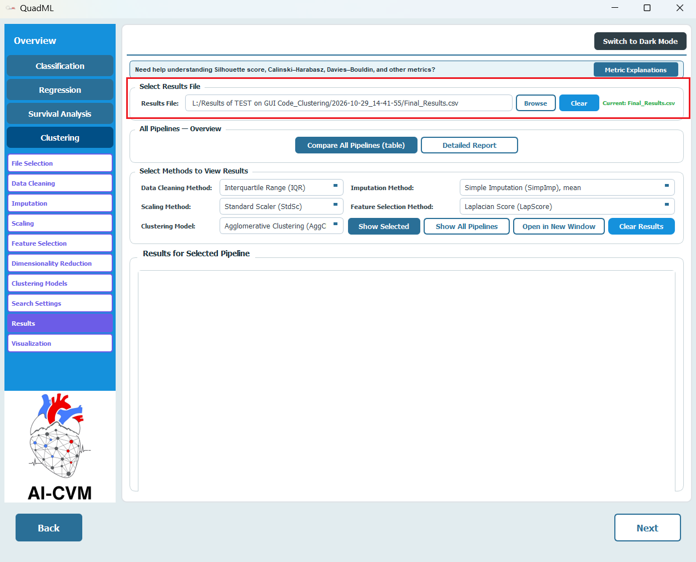
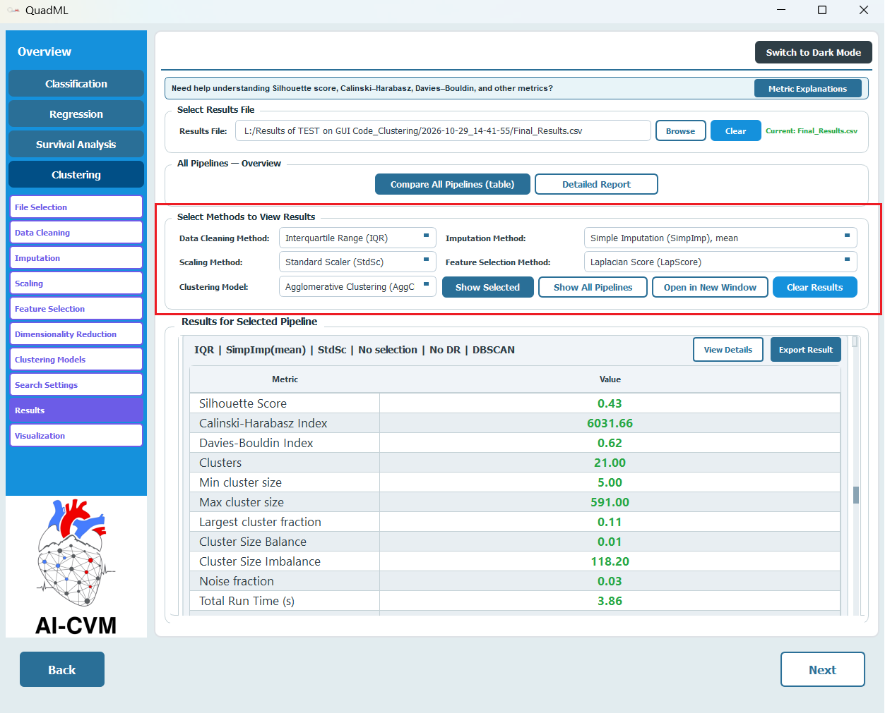
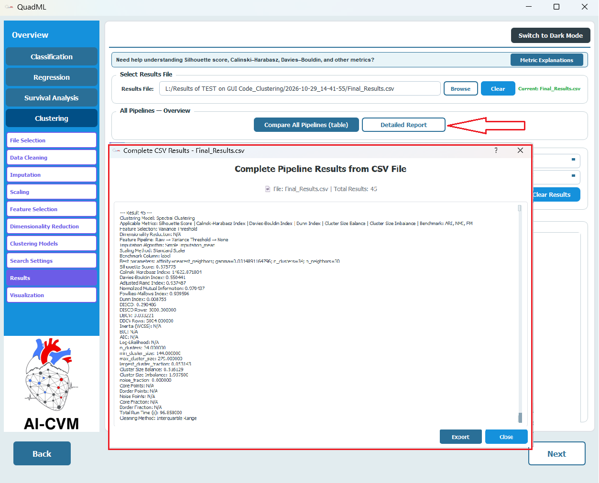

# Clustering — Results

**Where**: Clustering → **Results**

After **Start Procedure** finishes, **Results** loads `Final_Results.csv` from the dated run folder and shows each searched pipeline combination with unsupervised validation metrics, so you can compare, filter, and open detailed reports. You can also **Browse** an older run folder that already contains `Final_Results.csv` (or combo JSON) to reload and inspect previous results without starting a new search.

---

## What to click

1. Confirm the results file. QuadML looks for **`Final_Results.csv`** in the run folder. You can **Browse** another folder that contains that CSV or combo JSON.
2. Read the pipeline cards — unsupervised metrics on the prepared feature matrix (**no** Train/Test labels).
3. Click **Metric Explanations** on the top bar for the full, in-app metric text.
4. Use overview actions as labeled, for example:
   - **Compare All Pipelines (table)**
   - **Detailed Report**
   - **Show Selected** / **Show All Pipelines** / **Open in New Window** / **Clear Results**
5. Filter by cleaning, imputation, scaling, feature selection, DR, and model as shown on the page.

---

## How to read metrics (summary)

Clustering is unsupervised: metrics describe compactness and separation on the data used for the search. Prefer several metrics together. Rows are **not** auto-ranked into a single cross-model winner — pick among well-behaved solutions yourself.

### Internal metrics

| Metric | Direction | Notes |
|--------|-----------|-------|
| Silhouette Score | Higher better (−1 to +1) | Used in centroid-model selection ranks; always reported when defined |
| Calinski–Harabasz | Higher better | Part of centroid selection ranks |
| Davies–Bouldin | Lower better | Part of centroid selection ranks |
| Dunn Index | Higher better | Reported for the selected partition-style model (not used to pick HPs during search) |
| DISCO | Higher better (−1 to +1) | Selects DBSCAN / OPTICS / HDBSCAN hyperparameters (Beer et al., ICLR 2026; noise-aware). DISCO Rows notes subsample size (capped at 3000) |
| DBCV | Higher better | Reported for the final selected model of every algorithm when computable (DBCV Rows); **not** used to pick density HPs |
| Inertia / WCSS | Lower better for fixed *K* | K-Means |
| BIC / AIC (GMM) | Lower better | BIC selects GMM HPs |
| Log-Likelihood (GMM) | Higher better | |

### Structure summaries

- Number of clusters (`n_clusters`)
- Min / max cluster size, size balance / imbalance
- Largest cluster fraction — share of rows in the biggest cluster (density search prefers ≤ 0.9)
- Noise fraction; Core / Border / Noise counts for DBSCAN (OPTICS / HDBSCAN report noise; core/border may be N/A without a single-radius core definition)

### Benchmark metrics (optional)

If a **Benchmark Label** was set on File Selection: Adjusted Rand Index, Normalized Mutual Information, Fowlkes–Mallows Index. These are evaluation only and do **not** affect pipeline ranking. The benchmark column name is recorded on the result row and excluded from plot feature axes.

Single-cluster or all-noise solutions may show N/A for Silhouette / CH / DB / Dunn. Density candidates that form clusters of identical duplicate rows leave DBCV undefined.

For full definitions, open **Metric Explanations** in the app.

---

## What is written to disk

You are reading files already written by the search (`Final_Results.csv`, combo JSON, assignments, profiles). Export extra CSV or report files from the Results buttons if you need a copy elsewhere. Best Parameters keep preprocessing step prefixes so Visualization refits do not confuse imputer/scaler values with model hyperparameters.

---

## Common mistakes

- Ranking density pipelines on DBCV instead of **DISCO** (plus sizes / noise)
- Ranking only on Silhouette without checking cluster sizes / noise / BIC where relevant
- Treating ARI/NMI as the search ranking objective
- Picking a “winner” across K-Means vs DBSCAN vs GMM from one index alone
- Opening a Results file from Classification or Survival by mistake
