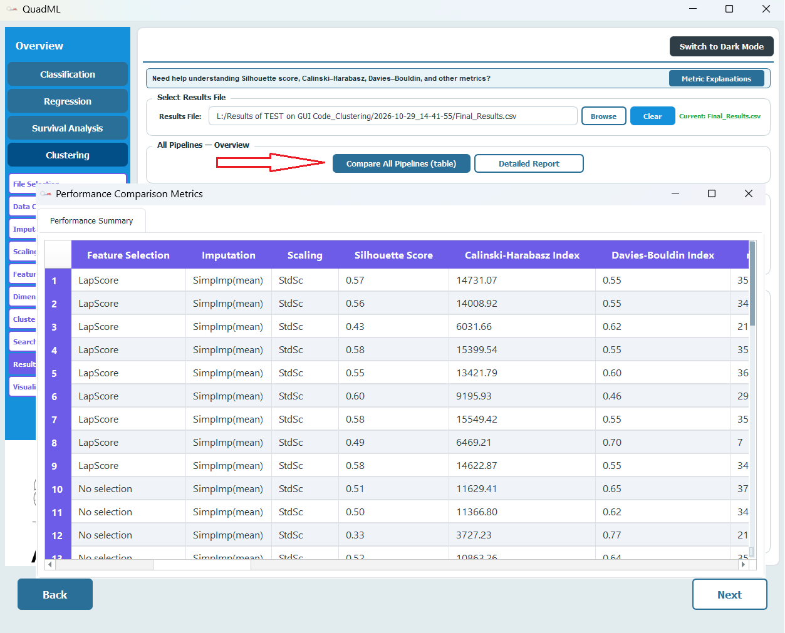
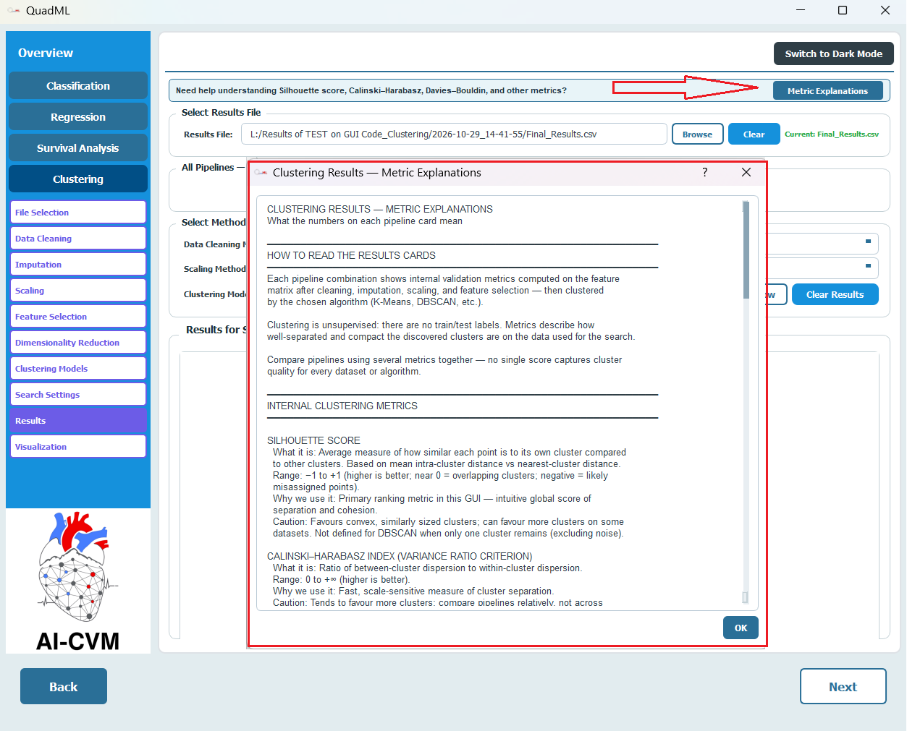

# Clustering — Metrics

Shows unsupervised validation scores for every searched pipeline after **Start Procedure** (or **Rebuild Results**). Load Final_Results.csv from the output run folder, then filter by cleaning, imputation, scaling, feature selection, dimensionality reduction, and clustering model. There is **no** Train/Test split. Metrics describe separation, compactness, density validity, or (for GMM) likelihood criteria on the prepared feature matrix. Optional **Benchmark Label** columns (ARI / NMI / FMI) appear only when you set that column on File Selection; they do not rank the search. Prefer several internal indices together; do not force one winner across K-Means vs DBSCAN vs GMM. Open **Metric Explanations** in the app for full definitions.

--8<-- "_snippets/results-usage.md"

Browse or confirm `Final_Results.csv` for the output run folder, then filter pipelines and open details:

**Show Selected** opens unsupervised metrics for one pipeline (cluster counts, sizes, noise, and scores):

**Compare All Pipelines (table)** ranks configurations by internal scores:

**Detailed Report** opens the full CSV-style metric view:

**Metric Explanations** covers how to read Silhouette, CH, DB, and related scores:

## Internal validation

| Metric | What it means | Better |
|--------|---------------|--------|
| Silhouette | Separation vs cohesion (−1 to 1) | Higher |
| Calinski–Harabasz (CH) | Between- vs within-cluster dispersion | Higher |
| Davies–Bouldin (DB) | Average cluster similarity | Lower |
| DISCO | Density-aware score for DBSCAN / OPTICS / HDBSCAN | Higher |
| DBCV | Density-based validity (reported; not the primary pick) | Higher |
| BIC | GMM model selection criterion | Lower |

## Optional external labels

| Metric | What it means | Better |
|--------|---------------|--------|
| ARI / NMI / FMI | Agreement with **Benchmark Label** | Higher |

Density models: use **DISCO** plus sizes / noise—not DBCV alone. Size balance, noise fraction, and cluster counts matter when comparing paradigms.

## Common mistakes

- Comparing runs from different Output Directory dated folders without noting File Selection changes
- Opening a `Final_Results.csv` from a different mode
- Ranking density models by Silhouette / CH alone and ignoring DISCO, sizes, and noise
- Treating **Benchmark Label** ARI / NMI / FMI as the search ranking criterion
- Forcing one winner across K-Means, DBSCAN, and GMM with a single metric
