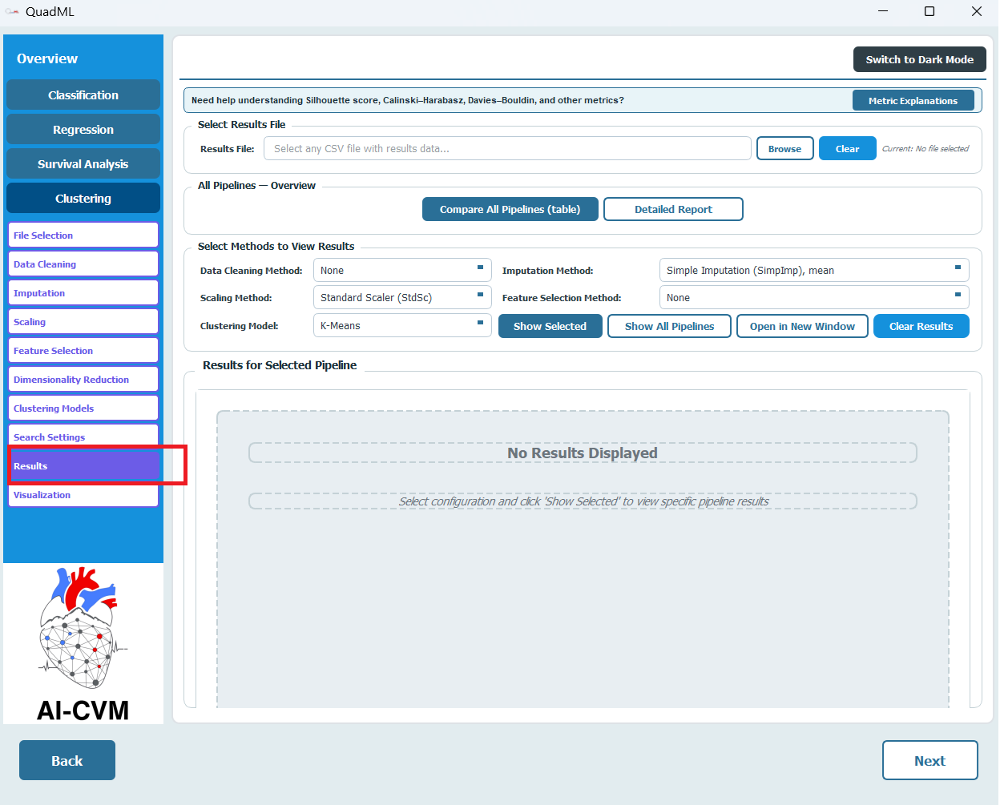

# Clustering — Metrics

**Where**: Clustering → **Results**

Compare searched pipelines with unsupervised validation metrics. There is no Train/Test split.

--8<-- "_snippets/results-usage.md"

## Internal validation

| Metric | What it means | Better |
|--------|---------------|--------|
| Silhouette | Separation vs cohesion (−1 to 1) | Higher |
| Calinski–Harabasz (CH) | Between- vs within-cluster dispersion | Higher |
| Davies–Bouldin (DB) | Average cluster similarity | Lower |
| DISCO | Density-aware score for DBSCAN / OPTICS / HDBSCAN | Higher |
| DBCV | Density-based validity (reported; not the primary pick) | Higher |
| BIC | GMM model selection criterion | Lower |

## Optional external labels

| Metric | What it means | Better |
|--------|---------------|--------|
| ARI / NMI / FMI | Agreement with **Benchmark Label** | Higher |

Prefer several internal indices together. Density models: use **DISCO** plus sizes / noise — not DBCV alone. Do not force one winner across K-Means vs DBSCAN vs GMM. Open **Metric Explanations** in the app for full definitions.

## Common mistakes

- Comparing runs from different Output Directory dated folders without noting File Selection changes
- Expecting Bootstrap CI columns when Bootstrap was off for that run
- Opening a `Final_Results.csv` from a different mode
- Picking by Train metrics while held-out scores are poor
