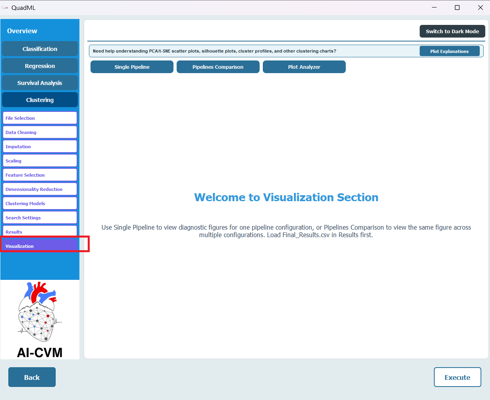

# Clustering — Visualization

**Where**: Clustering → **Visualization**

Charts for cluster geometry, parameter choice, and segment profiling. Load `Final_Results.csv` in **Results** first. There is **no** Interpretability page — use profiling plots here.

--8<-- "_snippets/visualization-usage.md"

## Cluster visualization

| Plot | What it shows |
|------|----------------|
| Feature Space | Scatter in clustering feature space |
| Reduced Components | Colours in PCA / ICA / Kernel PCA space |
| t-SNE / UMAP | Exploratory embeddings (UMAP needs `umap-learn`) |

## Parameter selection

| Plot | What it shows |
|------|----------------|
| Elbow / CH / DB vs *k* | Help choose *k* for count-based models |
| GMM BIC / AIC | GMM component choice |
| Dendrogram | Agglomerative hierarchy |
| k-Distance / Density Parameter | DBSCAN / OPTICS / HDBSCAN parameter views |
| OPTICS Reachability / HDBSCAN Condensed Tree | Density structure |

## Quality and profiling

| Plot | What it shows |
|------|----------------|
| Silhouette histogram / knife | Per-point and per-cluster silhouette |
| Core / Border / Noise | Density roles (density models) |
| Cluster sizes / profile heatmap | Size bars; z-scored feature profiles |
| Parallel coordinates / box / violin | Feature patterns by cluster |
| Volcano | Cohen’s *d* vs FDR (not log2 fold change) |

Live *k* / eps overrides are **Single Pipeline** only. Use **Plot Explanations** / **Analyze** for in-app help.

## Common mistakes

- Opening Visualization before any successful combination finished
- Mixing plots from an older dated folder after starting a new run
- Reading Train-only plots as trustworthy absolute performance
