# Clustering — Visualization

**Where**: Clustering → **Visualization**

**Visualization** turns the finished search into plots. Load **`Final_Results.csv`** in **Results** first. Search does not write every diagnostic PNG up front; charts are built live from assignments, transformed-features, and profiles CSVs. There is **no** Interpretability page in Clustering — use profiling plots here to understand segments.

---

## What to click

1. Work in **Single Pipeline** or **Pipelines Comparison** (side-by-side).
2. Open plots from the four groups below.
3. Click **Plot Explanations** on the top bar for the full in-app plot text.
4. Use **Analyze** (Plot Analyzer) on a figure for a structured reading of the current plot.
5. Where offered, use live *k* / eps / density override sliders — **Single Pipeline** only (Compare does not share one pipeline’s override across panels).

---

## Plot groups

### 1. Cluster Visualization (2D scatter)

| Chart | What it shows |
|-------|----------------|
| Feature Space | Scatter in the clustering feature space (selected/scaled features, or pre-DR features when DR was used) |
| Reduced Components | Cluster colours in the PCA / ICA / Kernel PCA space the model used (axis picker) |
| t-SNE Scatter Plot | Exploratory embedding (stochastic); override coloring follows displayed labels |
| UMAP Scatter Plot | Exploratory embedding (requires `umap-learn`) |

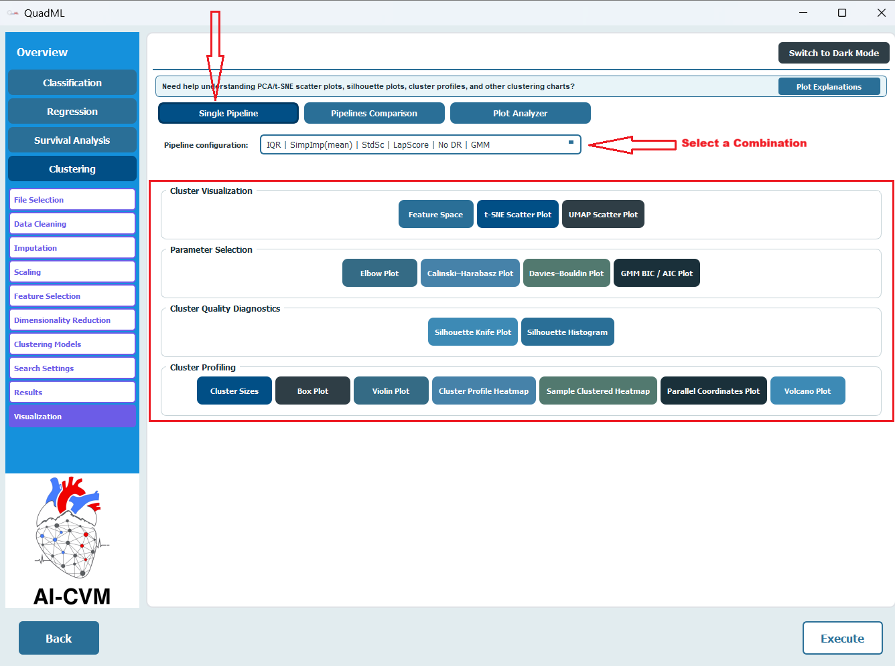

### 2. Parameter Selection

| Chart | What it shows |
|-------|----------------|
| Elbow Plot | Inertia vs *k* (K-Means scan); selected *k* marked when known |
| Calinski–Harabasz / Davies–Bouldin Plot | Metrics vs *k* |
| GMM BIC / AIC Plot | GMM only (fits with the same `n_init` as search so the Selected marker matches reported BIC) |
| Dendrogram | Agglomerative only |
| k-Distance Graph | DBSCAN / OPTICS only (hidden for HDBSCAN; no eps to choose) |
| Density Parameter Plot | Silhouette and noise vs eps (DBSCAN) / xi (OPTICS) / min_cluster_size (HDBSCAN); marks the selected value even if it sits outside the sweep |
| OPTICS Reachability | OPTICS only |
| HDBSCAN Condensed Tree | HDBSCAN only; hierarchy from the fitted single-linkage tree with selected clusters circled |

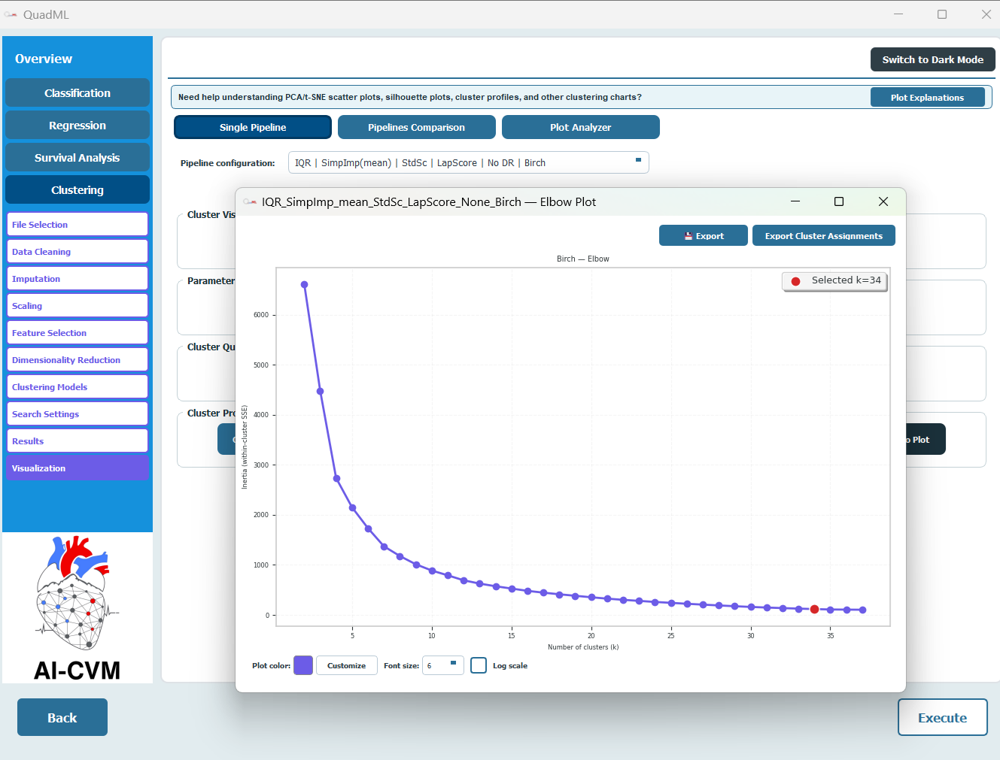

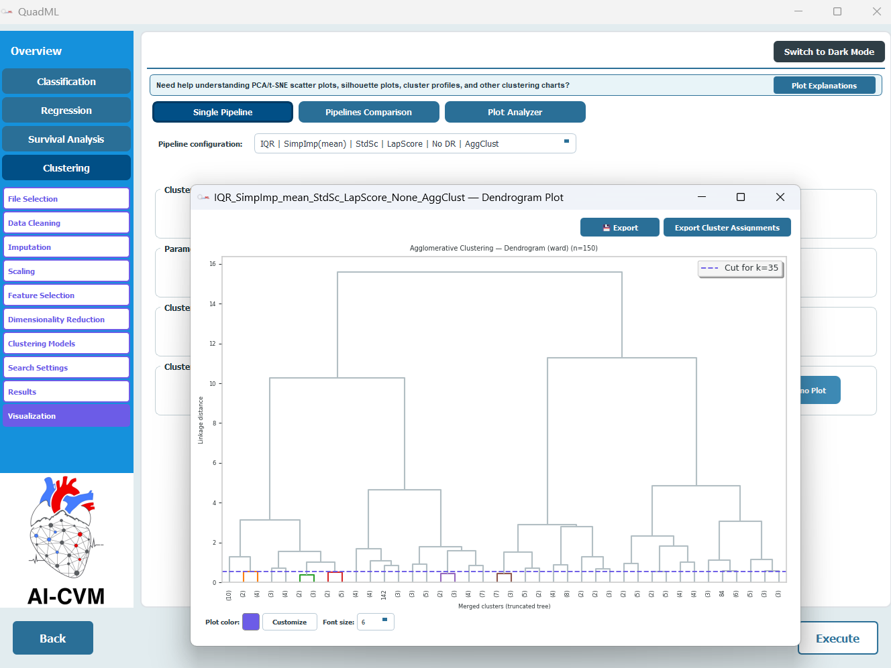

### 3. Cluster Quality Diagnostics

| Chart | What it shows |
|-------|----------------|
| Silhouette histogram | Distribution of silhouette scores |
| Silhouette knife plot | Per-cluster silhouette shapes |
| Core / Border / Noise | Density roles in the clustering feature space (same X/Y pickers as Feature Space / Reduced Components). DBSCAN / HDBSCAN show Core / Border / Noise; OPTICS emphasizes Clustered vs Noise when core roles are undefined |

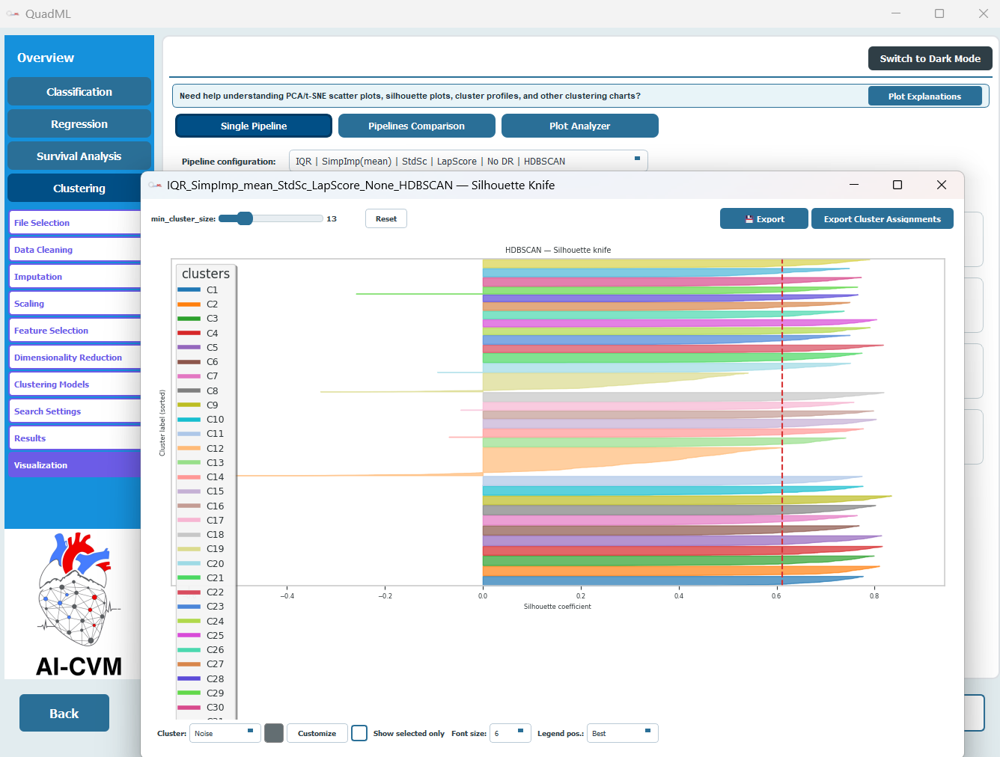

### 4. Cluster Profiling

| Chart | What it shows |
|-------|----------------|
| Cluster sizes | Bars (pie when few clusters) |
| Cluster profile heatmap | Colours are per-feature z-scores vs the global mean (diverging map, ±3 SD); cell text can still show raw means; profiles include a `\|z_vs_global` column |
| Sample clustered heatmap | Samples × features (feature cap keeps best-separating features by η², up to 1000). Toolbar: Palette (default Blue / Red / vlag + SHAP presets); cluster colours; Color feature tree toggle (off by default). Agglomerative may add a sample dendrogram |
| Parallel coordinates | Capped to best-separating features by η² |
| Box / Violin by feature | Caps prefer η² separation; NaNs dropped per cluster |
| Volcano plot | Effect size is Cohen’s *d* (standardized mean difference) vs FDR (Mann–Whitney + BH); modes One vs Rest / A vs B / A vs Selected; default cutoff about \|*d*\| ≥ 0.5. All numeric features are tested; only point labels are capped |

Some plot types (box, violin, sample clustered heatmap, volcano) are excluded from side-by-side Compare — use **Single Pipeline**.

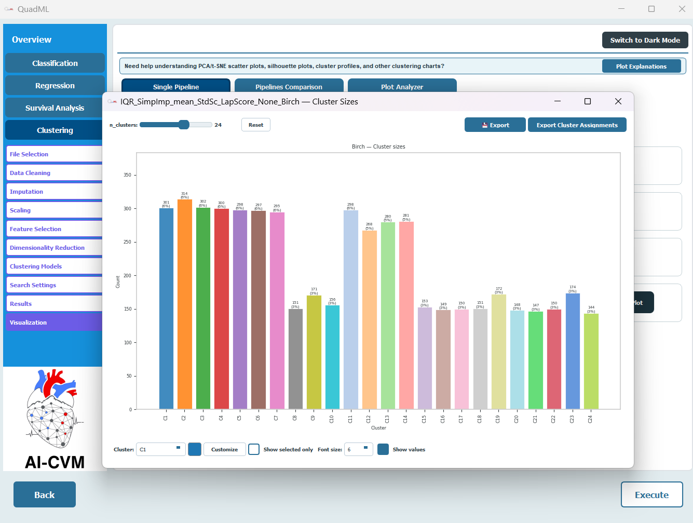

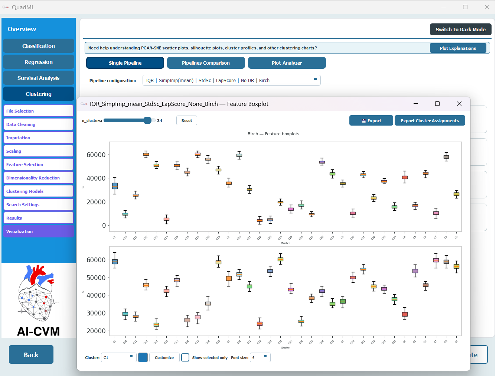

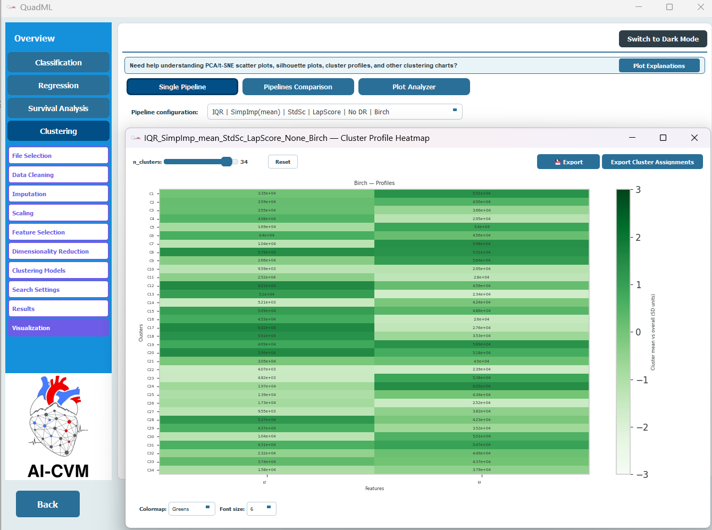

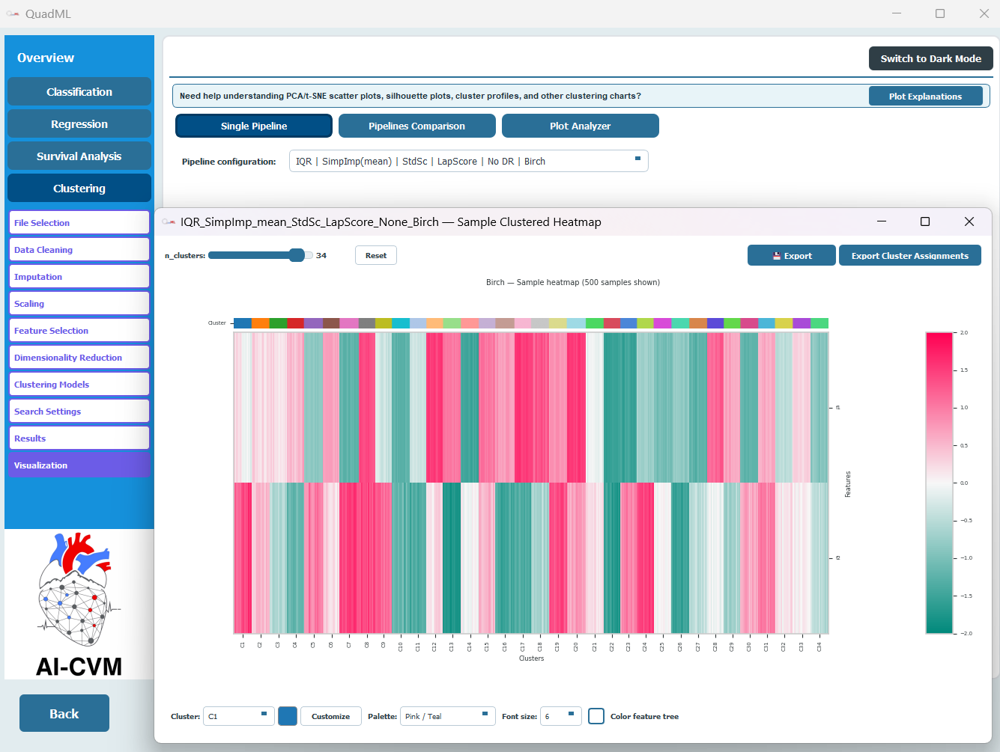

---

## Quick guide — which plot to open

| Goal | Start with |
|------|------------|
| See separation in model / feature space | Feature Space / Reduced Components |
| Choose *k* | Elbow / CH / DB / Silhouette |
| Tune DBSCAN / OPTICS eps | k-Distance Graph, Density Parameter Plot |
| Inspect HDBSCAN hierarchy | HDBSCAN Condensed Tree |
| Density structure | Core / Border / Noise (clustering space) |
| Interpret segments | Profile heatmap (z-scored colours), box/violin, volcano (Cohen’s *d*) |
| Compare shortlisted pipelines | Pipelines Comparison |

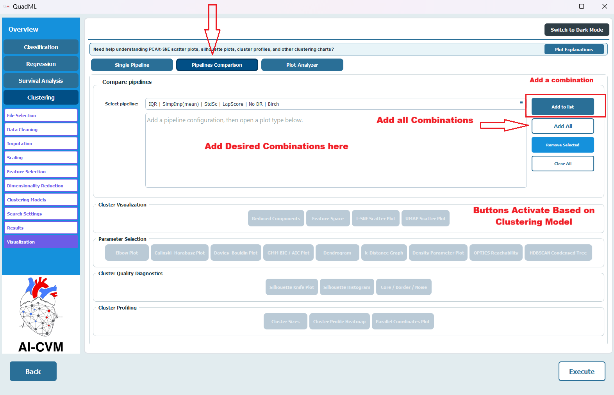

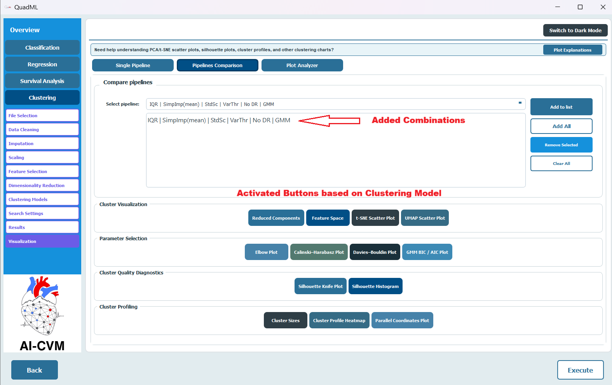

## Plot Analyzer

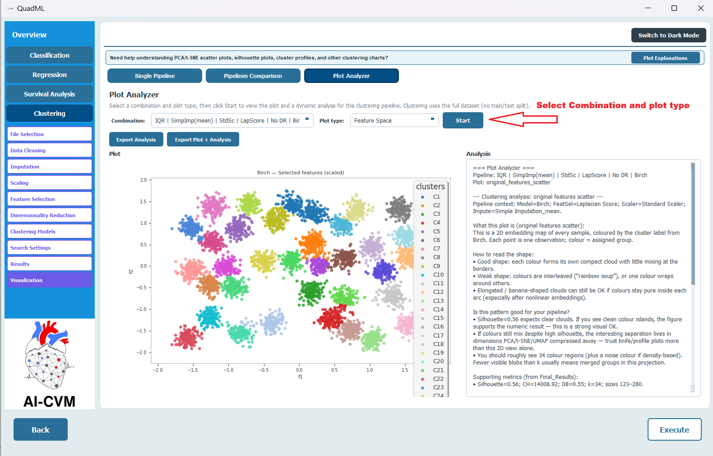

---

## Common mistakes

- Treating t-SNE distances as exact geometry
- Expecting Train/Test split selectors like Classification
- Opening density-only plots for K-Means (buttons may be hidden)
- Looking for k-Distance Graph on HDBSCAN (use Condensed Tree / Density Parameter Plot instead)
- Reading volcano x-axis as log2 fold change (it is Cohen’s *d*)
- Expecting Compare panels to share one *k*/eps override (overrides are Single Pipeline only)
- Looking for an Interpretability page (Clustering has none — use profiling plots here)
