# Clustering — Visualization

Shows cluster geometry, parameter-choice curves, quality diagnostics, and segment profiling for pipelines you already scored on **Results**. Load `Final_Results.csv` in **Results** first, then open **Visualization** and choose **Single Pipeline** (one configuration), **Pipelines Comparison** (the same plot across combinations), or **Plot Analyzer**. There is **no** Interpretability page in Clustering. Use profiling plots here. Live *k* / eps / density overrides apply on **Single Pipeline** only. Plot buttons depend on the selected clustering model. Use **Plot Explanations** and **Analyze** for in-app help.

--8<-- "_snippets/visualization-usage.md"

Choose **Single Pipeline**, **Pipelines Comparison**, or **Plot Analyzer**:

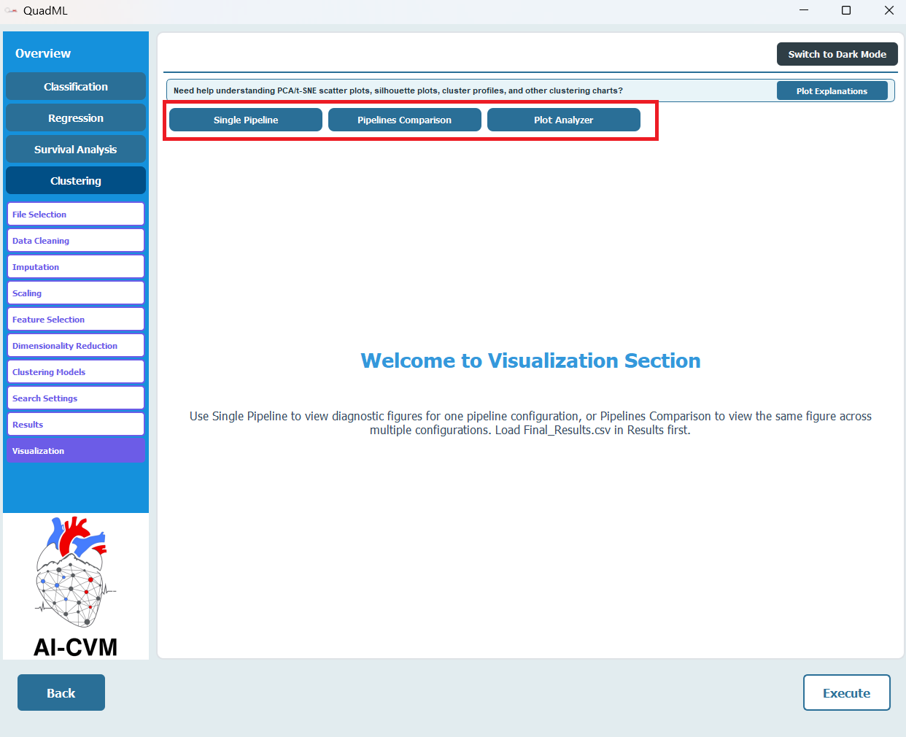

**Plot Explanations** covers how to read scatter plots, silhouette views, and profiles:

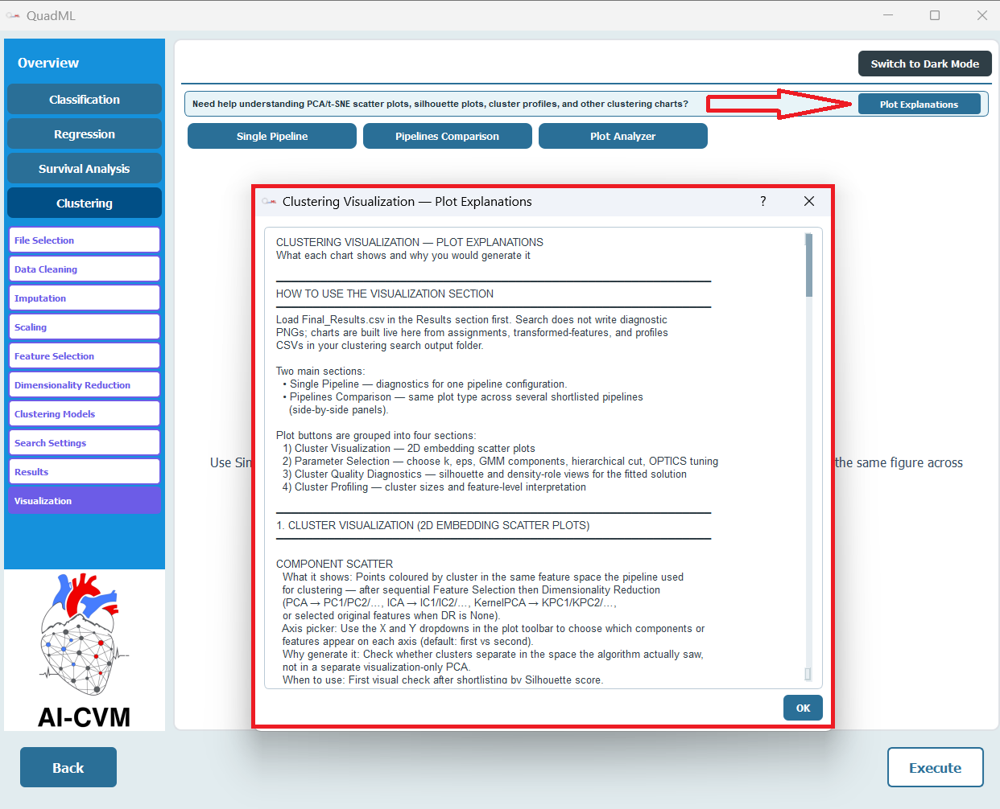

**Single Pipeline** — pick a combination, then open a plot group:

## Cluster visualization

| Plot | What it shows |
|------|----------------|
| Feature Space | Scatter in clustering feature space |
| Reduced Components | Colours in PCA / ICA / Kernel PCA space |
| t-SNE / UMAP | Exploratory embeddings (UMAP needs `umap-learn`) |

Feature Space scatter (points coloured by cluster):

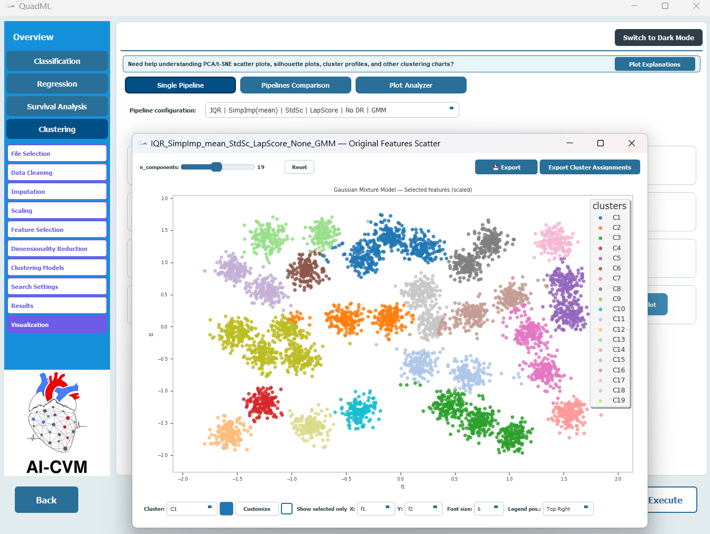

t-SNE scatter (exploratory; clustering was not run in this projection):

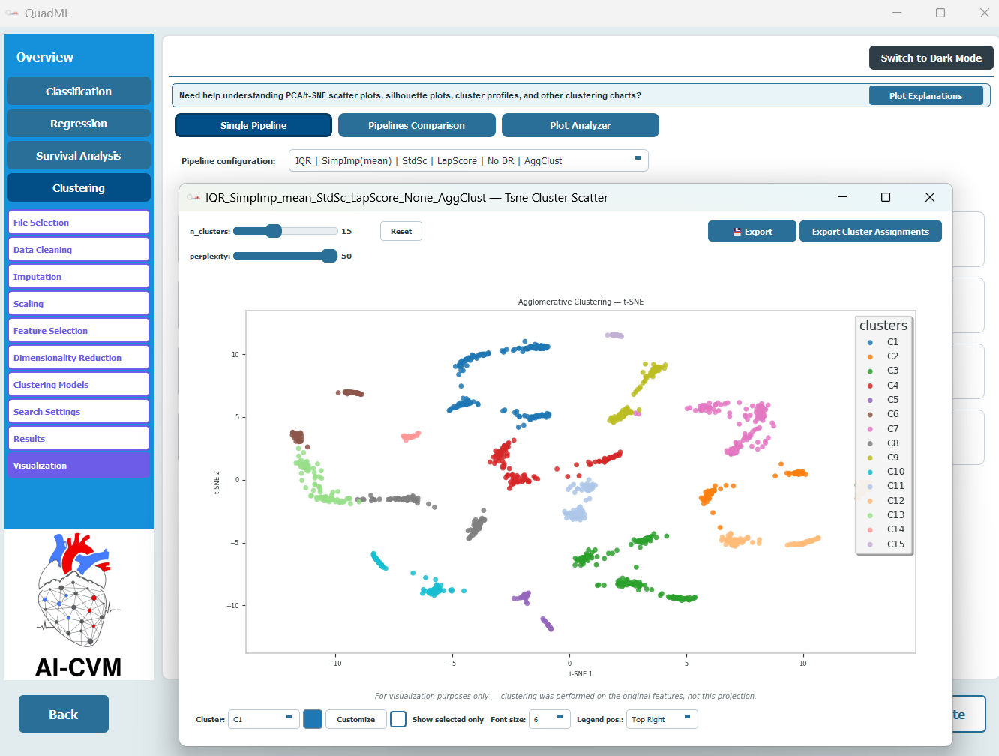

UMAP scatter with density-model noise and live parameter sliders:

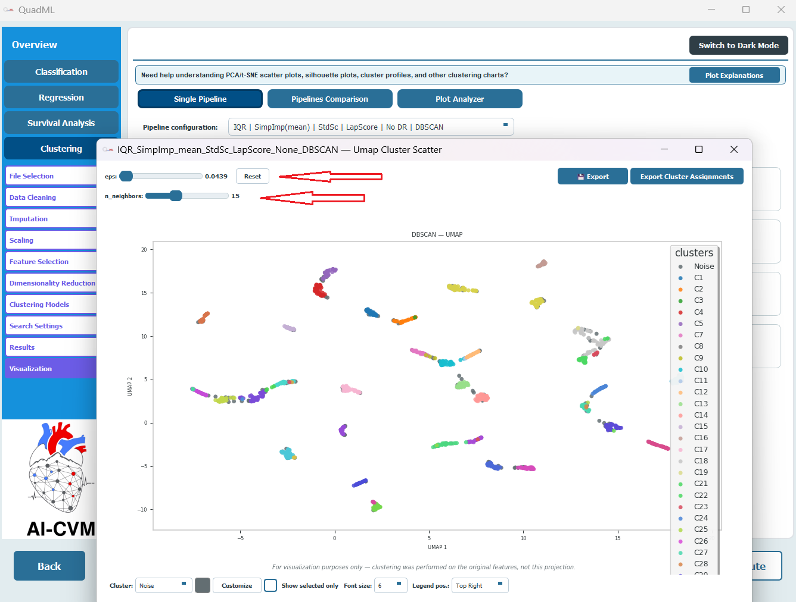

## Parameter selection

| Plot | What it shows |
|------|----------------|
| Elbow / CH / DB vs *k* | Help choose *k* for count-based models |
| GMM BIC / AIC | GMM component choice |
| Dendrogram | Agglomerative hierarchy |
| k-Distance / Density Parameter | DBSCAN / OPTICS / HDBSCAN parameter views |
| OPTICS Reachability / HDBSCAN Condensed Tree | Density structure |

Elbow (inertia vs *k*):

Calinski–Harabasz vs *k*:

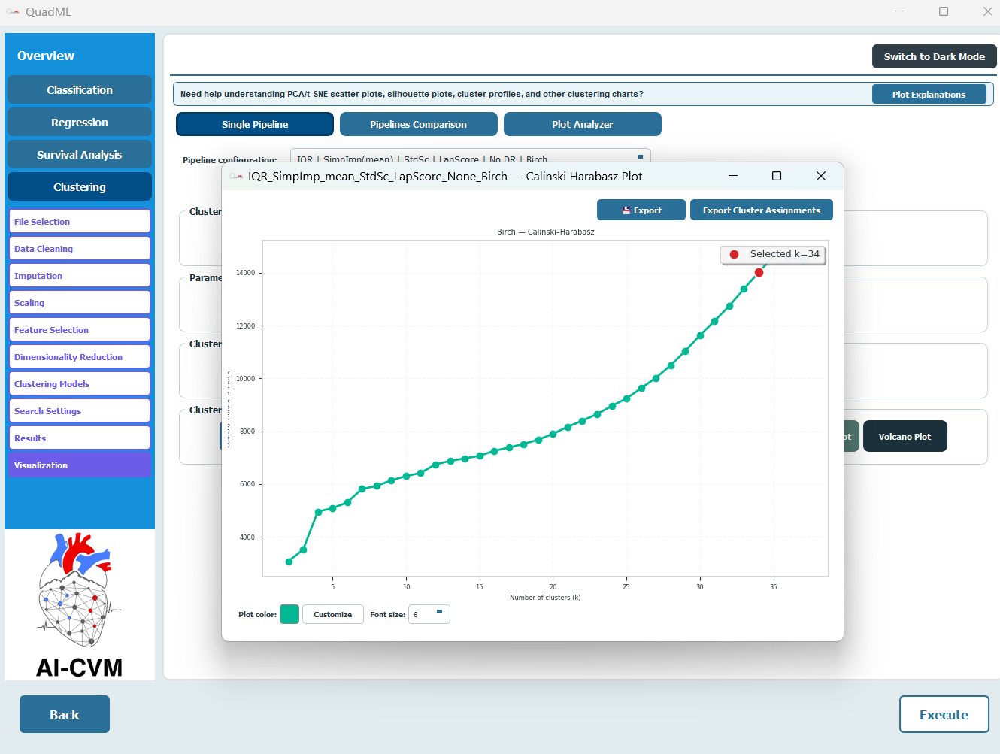

Davies–Bouldin vs *k*:

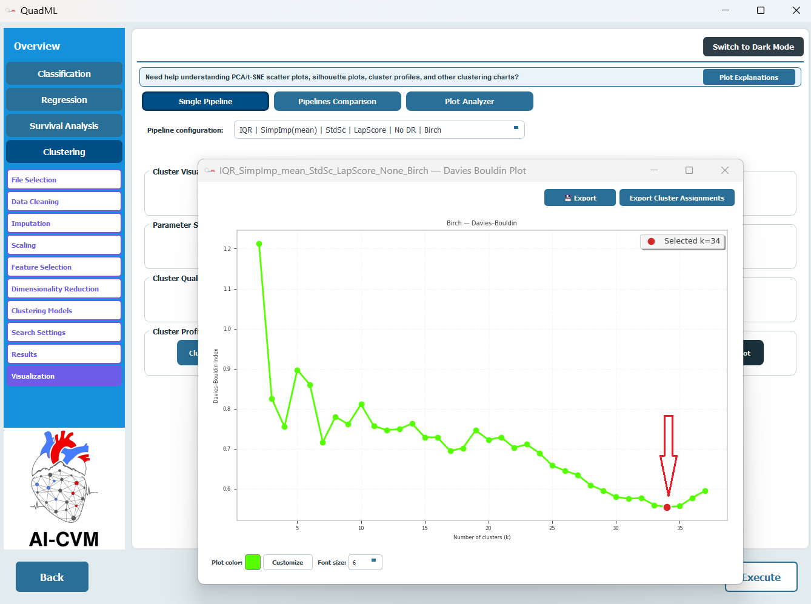

Dendrogram (Agglomerative):

Density parameter dependence (for example HDBSCAN `min_cluster_size`):

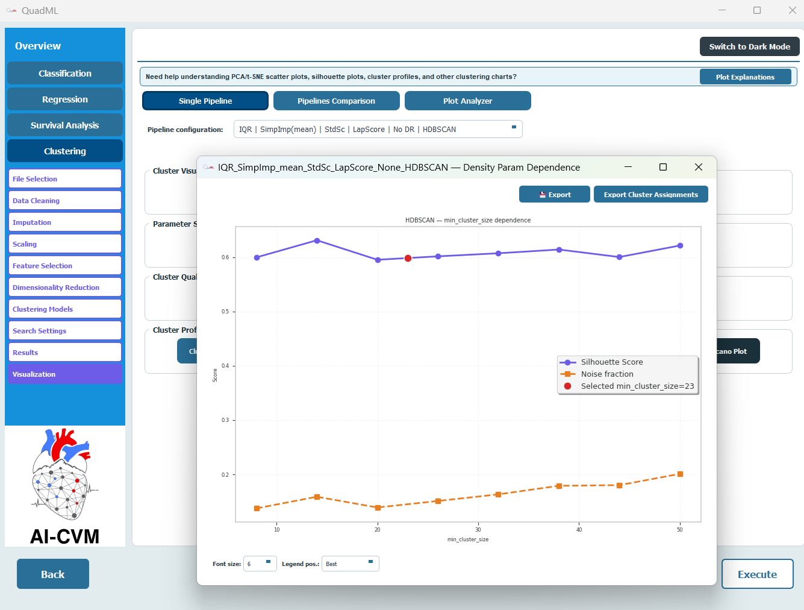

HDBSCAN Condensed Tree:

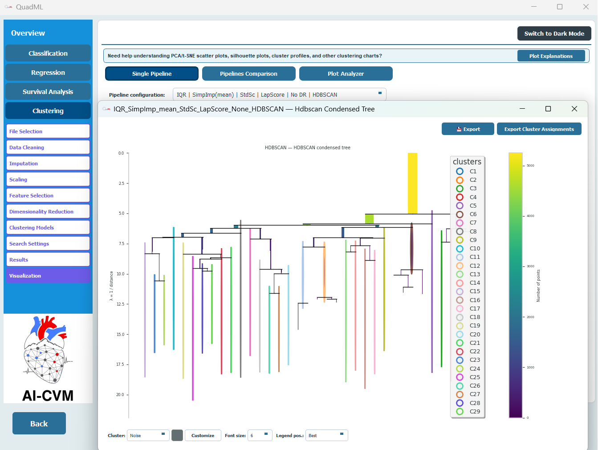

## Quality and profiling

| Plot | What it shows |
|------|----------------|
| Silhouette histogram / knife | Per-point and per-cluster silhouette |
| Core / Border / Noise | Density roles (density models) |
| Cluster sizes / profile heatmap | Size bars; z-scored feature profiles |
| Sample clustered heatmap | Sample × feature view ordered by cluster |
| Parallel coordinates / box / violin | Feature patterns by cluster |
| Volcano | Cohen’s *d* vs FDR (not log2 fold change) |

Silhouette knife:

Silhouette histogram:

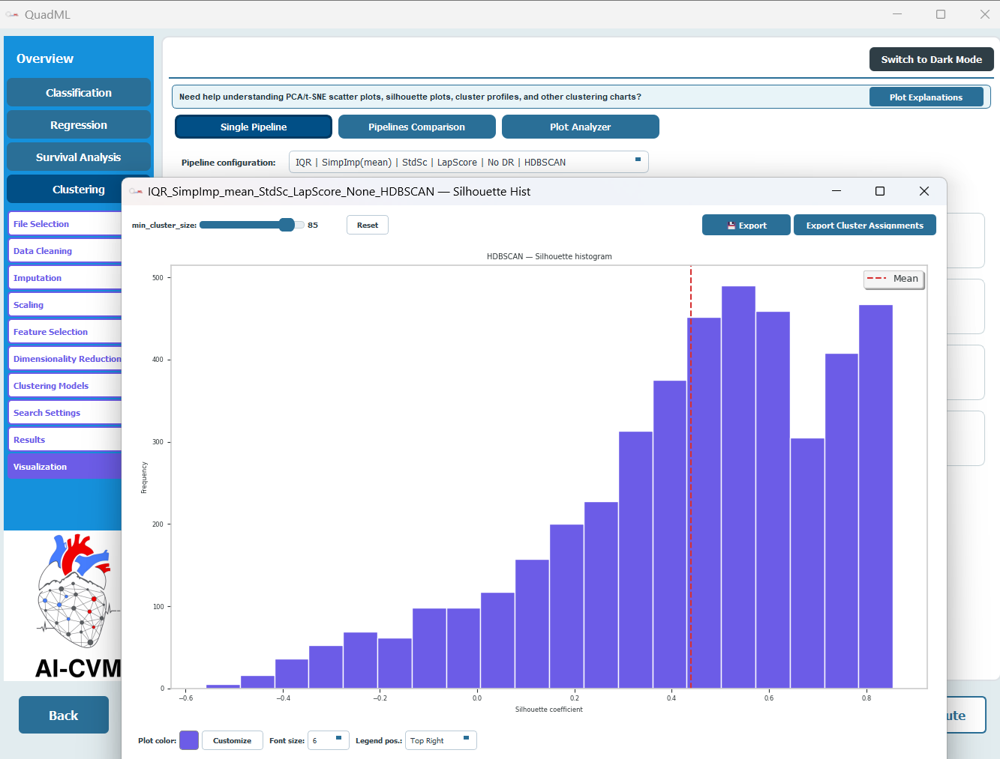

Core / Border / Noise:

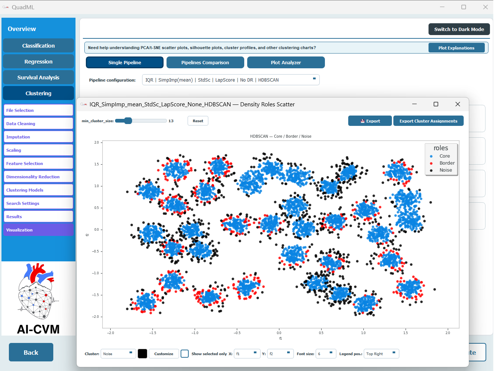

Cluster sizes:

Feature box plots:

Feature violin plots:

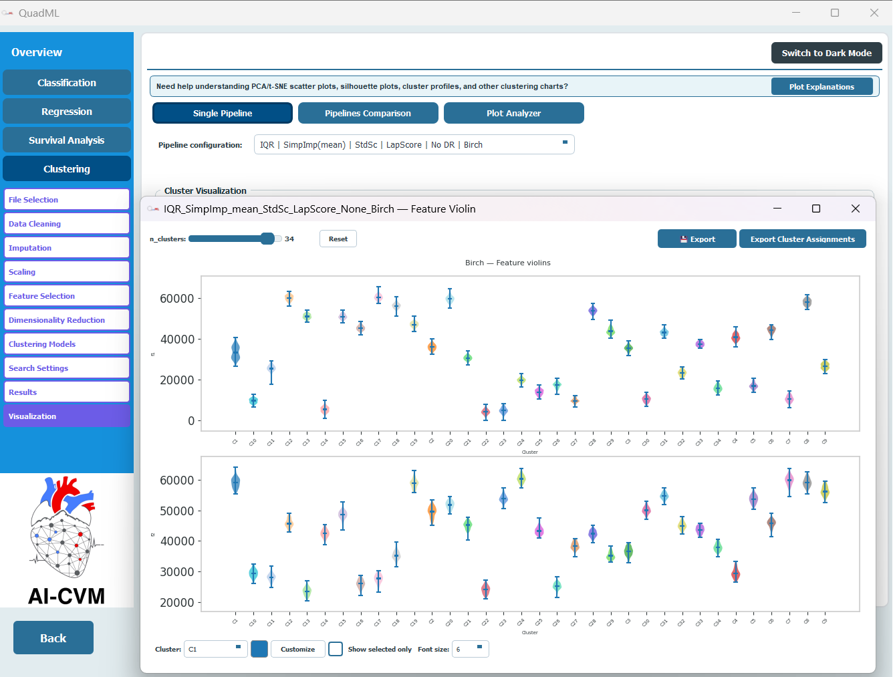

Cluster profile heatmap:

Sample clustered heatmap:

## Comparing pipelines

**Pipelines Comparison** — add combinations, then open a plot (buttons depend on the model):

Activated plot buttons after combinations are added:

## Plot Analyzer

**Plot Analyzer** adds a plain-language reading next to the chart:

Use **Plot Explanations** / **Analyze** for in-app help. Export plot and **Export Cluster Assignments** from plot windows when needed.

## Common mistakes

- Opening Visualization before any successful combination finished
- Mixing plots from an older dated folder after starting a new run
- Treating t-SNE / UMAP layout as the space the algorithm clustered in
- Expecting every plot button for every model (availability is model-dependent)
