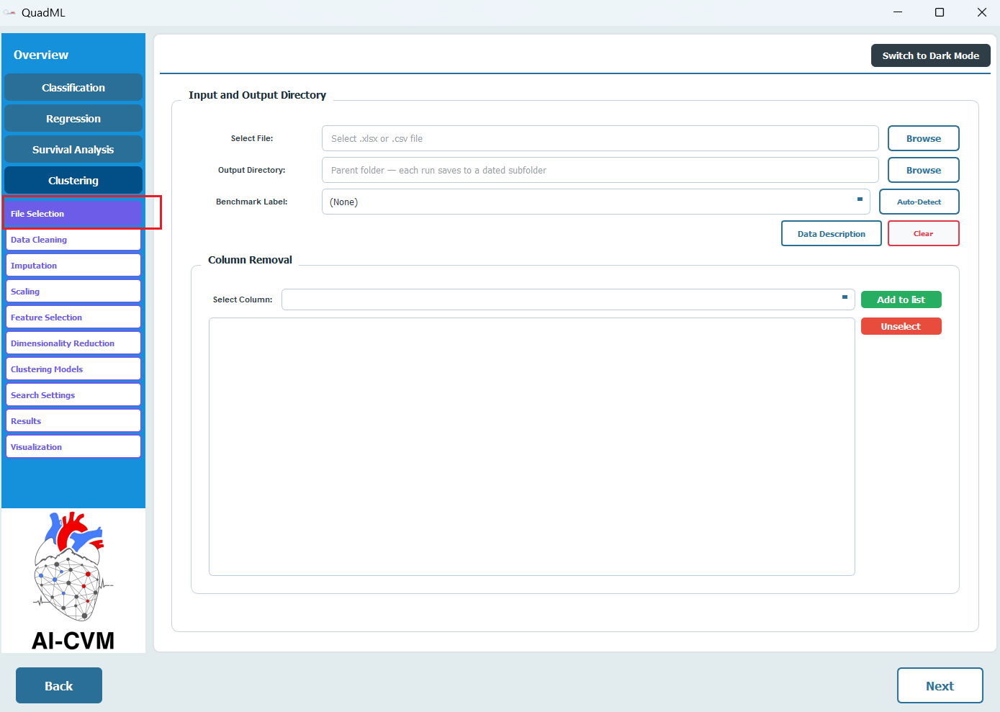

# Clustering — Tutorial

A short end-to-end click path for a first Clustering run: load unlabeled numeric data, keep preprocess light, enable **K-Means** only with **Auto** cluster count, run a small search on **Search Settings**, then read Metrics and Visualization. Keep the search small so the first run finishes quickly. There is **no** Interpretability step in Clustering. For method details and full option tables, use the Pipeline and Results pages.

---

## 1. Start

1. Open QuadML and select **Clustering** from the left panel, then open **File Selection**.
2. Click **Browse** under Select File and upload a mostly numeric `.csv` or `.xlsx`.
3. Click **Browse** under Output Directory and choose a writable parent folder.
4. Leave **Benchmark Label** on **(None)** unless you intentionally want ARI / NMI / FMI reference scores.
5. Optional: **Column Removal** (no External file or ID Column in Clustering).

---

## 2. Preprocess (keep it small)

| Step | Choice |
|------|--------|
| Data Cleaning | **None** |
| Imputation | **Simple Imputation** |
| Scaling | **Standard Scaler** |
| Feature Selection | **None** |
| Dimensionality Reduction | **None** |

Leave extra methods unchecked.

---

## 3. Models

1. **Clustering Models:** **K-Means** only.
2. **Number of clusters:** **Auto**.

---

## 4. Run

1. Open **Search Settings** (replaces Parameter Tuning in other modes).
2. Set **Fast**, CPU/RAM **50 / 50**.
3. Review the configuration tree.
4. Click **Start Procedure** and wait until progress finishes (**Stop Procedure** only to cancel).

---

## 5. Read output

1. **Metrics:** open **Metric Explanations**; read Silhouette with CH / DB and check cluster sizes.
2. **Visualization:** Feature Space or Cluster Profile Heatmap; use **Plot Explanations** / Analyze.

**Success**: `Final_Results.csv` under `Your Folder\YYYY-MM-DD_HH-MM-SS\`.

---

## Next

- [Overview](00-introduction.md) · [Metrics](09-results.md) · [Visualization](10-visualization.md)
